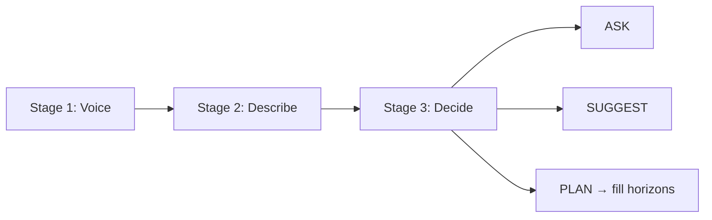

# Decide / Stages

Not an `llm_roles` module — map only. Stage 3 Decide is Planning-
internal (`project/engine/judgment/decide.py`).

| Stage | Job | Lives in |
|---|---|---|
| 1 Voice | Talk to the user | `llm_roles/voice.py` |
| 2 Describe | One neutral "about" sentence | `llm_roles/describe.py` |
| 3 Decide | Enough to plan? ASK / SUGGEST / PLAN | `engine/judgment/decide.py` |
| 3 Fill | Horizons; optional WHEN calendar steps | `judgment/run_stage3.py` (+ `time/calendar.py`) |

Active chat: Stages 1–2 in `project/panes/chat/turn.py`, then Planning
(`route_note` → `generate_plan` → Decide, then Fill if planable).
