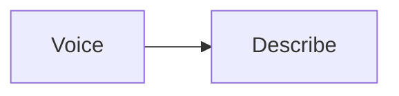

# Conversation roles

Map of the shared LLM roles in this package. Chat uses Voice and
Describe only.

| Role | Job | Lives in |
|---|---|---|
| Voice | Talk to the user | `llm_roles/voice.py` |
| Describe | One neutral "about" sentence | `llm_roles/describe.py` |

Active chat: both roles in `project/panes/chat/turn.py`. A focused
structure request can mint map children; that is canvas, not a role
here. Stage 3 (Decide / Fill) is gone.
