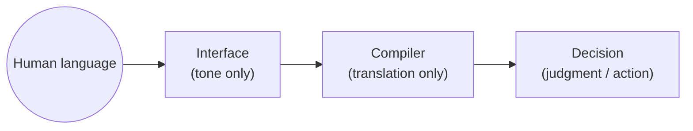
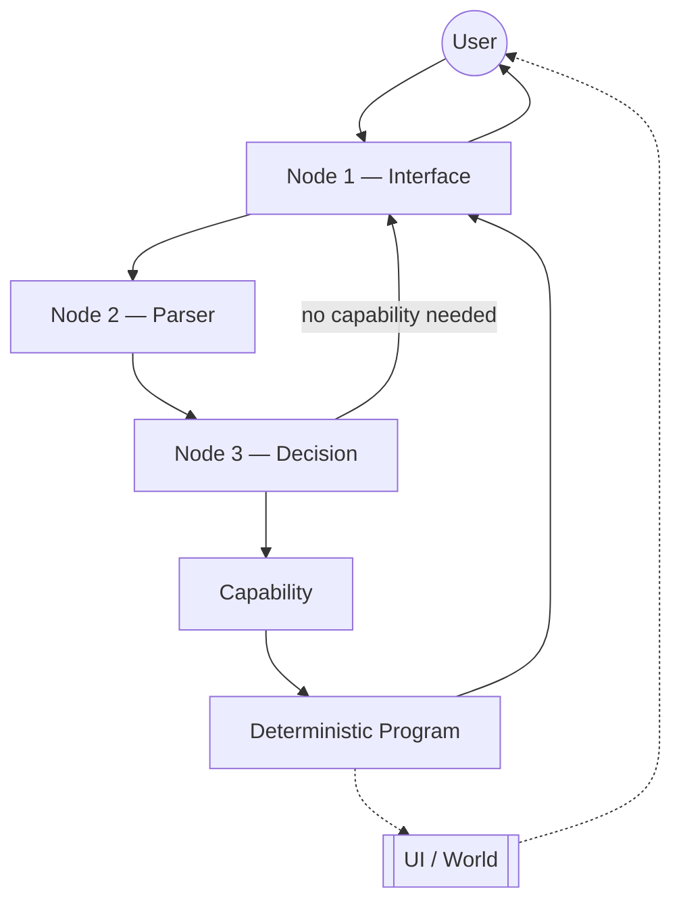

# 03 — Architecture

> How the agent is meant to be structured: what it's made of, how the pieces relate, and what principles guide how it grows. **Intent, not proof of what's built** (see `../COLLABORATION.md`'s doc-role table) — see [[04-current-state]] for what's actually implemented right now, [[05-decisions]] for the reasoning behind specific choices, and `v4-migration-decision.md` for the original decision record this document draws from and supersedes as the living reference (that file stays as the historical record of the v1→v4 decision itself — several code docstrings still cite it by name, so it isn't deleted — this document is where the target architecture is now actively maintained).

## Contents

Part 1 — Definitions *(schema: what IS each category — stable, rarely changes)*
1. Domains and Faculties
   i. Domain
   ii. Faculty
2. Nodes and Modules
   i. Node
   ii. Module
3. Capabilities
   (Part 1, visually — an ASCII diagram tying the above together)

Part 2 — Components *(data: what actually exists today, same order as Part 1 — grows as the project does)*
1. Domains and Faculties
   i. Domains
   ii. Faculties
      a. Time
      b. Math
2. Nodes and Modules
   i. Node
      a. Node 1 — Interface
      b. Node 2 — Parser
      c. Node 3 — Decision
   ii. Modules
3. Capabilities
   i. Planning

Part 3 — Behavior *(how the components above actually interact — opens by defining Infrastructure, the one category with no fixed instance list)*
1. Deterministic Program
2. Data flow
3. Context and scope
4. UI manifestation
5. The agent, precisely
6. Boundaries and non-responsibilities
7. Architectural principles
   i. Local-first
   ii. Portable
   iii. Replaceable infrastructure
   iv. Privacy by architecture
   v. Start simple
8. Open questions
9. Related documentation

---

## Part 1 — Definitions

What these words mean in this project — not which concrete things exist (that's Part 2), and not how they behave together (that's Part 3).

### 1. Domains and Faculties

#### i. Domain

An area of responsibility or subject matter the system operates on. A Domain is the *thing*, not a capability for acting on it.

Named only when something concrete actually operates on or manages it — not because it's a noun the system happens to touch. At least one of three has to be true: a Faculty operates on it (Time → temporal understanding), a Capability is responsible for it (Planning → the Planning capability), or the system persists real state for it (Goals → `data/plans.json`). A recognized but not-yet-built Domain (Knowledge, Memory, World) still qualifies, the same way an unbuilt future Capability does — but a word the system merely mentions, with no Faculty, Capability, or persisted state behind it, does not.

#### ii. Faculty

A reusable, deterministic capability for understanding or interpreting something within or across Domains — the thing that operates *on* a Domain. Not simply reused code, and not a conceptual label for a topic: a Faculty is earned, never created because a concept has a plausible name (see [[05-decisions]], "Faculty categorization"). A Domain does not automatically get its own Faculty just because the agent needs to reason about it — Time is a Domain; temporal understanding is the corresponding Faculty.

Two recognized shapes a Faculty can take, both already established in this project's own decision history:

a. **Resolves ambiguous natural-language input** — Time's original bar: interpreting "this weekend," comparing durations, recognizing a phrase.
b. **A fundamental, independently-existing reasoning domain**, whether or not any single operation within it is itself ambiguous — Math's bar: `add`/`subtract`/`multiply`/`divide` interpret nothing ambiguous, but quantitative reasoning is still a basic capability the agent needs a deterministic answer for, not a guessed one (see [[05-decisions]], the 2026-09-05 refinement).

### 2. Nodes and Modules

#### i. Node

A system responsibility with its own contract and a *defined* process. A Node composes Modules and/or Faculties where its own process actually calls for them; it does not compose itself dynamically at runtime, and it does not choose its own architecture — see Part 2 § 2.ii for what "defined" means concretely.

#### ii. Module

A reusable, *LLM-backed* cognitive function (Interpretation, Hypothesis, Critique, Reasoning, Synthesis) a Node may call on. Neutral by design: no knowledge of which Node is calling it, or of any other Module. A Module's output can vary between identical calls — it's an LLM call, not a computation — which is exactly what separates it from a Faculty, even though both are "reusable across Nodes." They are not the same kind of thing, and not interchangeable: a Node choosing between them is choosing between two different *kinds* of tool, not two options for the same job.

### 3. Capabilities

A bounded domain responsibility (Planning is the first) that uses both LLM reasoning and deterministic program logic internally, in whatever mix its own domain requires, reached through Node 3's routing decision. Not "an LLM call," and not owned by any single Node.

### Part 1, visually

The same round trip as the mermaid diagram in Part 3 § 2, drawn with characters instead — same topology, same labels, just a different rendering:

```text
                         USER
                        ↓    ↑
        ┌────────▶ NODE 1 — INTERFACE ◀────────────┐
        │                  │                        │
        │                  ↓                        │
        │            NODE 2 — PARSER                │
        │                  │                        │
        │                  ↓                        │
        │            NODE 3 — DECISION               │
        │                  │                         │
        │   "no capability needed"                   │
        └──────────────────┘                         │
                            │                         │
                            ↓                         │
                       CAPABILITY                     │
                            │                         │
                            ↓                         │
                 DETERMINISTIC PROGRAM ────────────────┘
                            ┊
                            ┊  (parallel, never through Node 1)
                            ↓
                       UI / WORLD
                            ┊
                            ↓
                           USER
```

---

## Part 2 — Components

The concrete instances of each Part 1 category — what actually exists, or is built, today. Same order as Part 1; Infrastructure has no entry here (see Part 3's opening note for why). See Part 3 § 2 for how these instances connect — not repeated here to avoid two diagrams drifting out of sync with each other. Not every turn traverses the whole thing — see Part 3 § 3. A Node may draw on Modules and/or Faculties internally; neither appears in that diagram because they're implementation detail of one Node's own process, not a separate stage of the pipeline.

### 1. Domains and Faculties

#### i. Domains

The recognized Domains: Time, Goals, Planning, Knowledge, Memory, World — each passes Part 1 § 1.i's test (a Faculty, a Capability, or persisted state). "Conversation" doesn't pass it and is deliberately not listed here: nothing yet operates on it as its own subject — it's the medium Node 1/2/3 pass text through, not something a Faculty interprets or a Capability owns. Not equally built — see [[04-current-state]] for what's actually implemented; Memory and World remain empty placeholders today.

#### ii. Faculties

##### a. Time

Domain / Faculty. Temporal understanding: temporal expression matching, duration resolution, fixed goal timeframes, relative duration comparison. Deliberately separated from LLM reasoning: **code decides, the model is told**. The Faculty owns backend's authoritative notion of current time (`now()`, `time_logic/current_time.py`) — the one place backend code reads the system clock. Seasons are recognized but resolved only given a hemisphere, never guessed. Activity-specific interpretation of duration ("is 45 minutes long or short *for running*") remains outside the Faculty for now — see [[concepts]].

##### b. Math

Faculty, no paired Domain. Quantitative reasoning the agent can operate within, the same "code decides, the model is told" reasoning as Time. `backend/foundation/math.py`: the four basic arithmetic operations only — a single flat module, not a package, grown into more structure only if real need shows up.

### 2. Nodes and Modules

#### i. Node

##### a. Node 1 — Interface

Responsibility: the natural conversation with the person, and presenting the conversation's own responses. The only role that talks to the user directly.

Needs to know: the ongoing conversation history/context; a light-weight sense of what currently exists (e.g. that the user has some active Goals or Visions, by name) so it can refer to them naturally.

Must not need to know: anything about how any capability works internally. Node 1 has no business knowing what `PLAN_KEYS`, `step_status`, `suggested_action`, or `current_step` are.

Must not be: Planning. Node 1 does not decide whether a goal is plannable, does not produce plan content, and does not run Minimum Planability's judgment.

Modules: none by default. Its process is `I → S` at most, tested — see § ii below. Tone is Node 1's own, never a Module's.

##### b. Node 2 — Parser

Responsibility: transform the human conversation into a structured, capability-agnostic understanding — "what is this person actually talking about," not "what should Planning do about it." This is Node 2's umbrella and external interface, not a wrapper around Module Library.

Produces: something a capability-selection step can act on without having already done the capability's own reasoning — roughly, the relevant content of what was said, and which existing entity (if any) it seems to concern.

Must not produce: capability-specific concepts, or a judgment about whether action is needed. In particular, Node 2's output must never itself be `suggested_action`, `current_step`, `step_status`, or `plan.now` — those are Planning's own vocabulary. An "actionable" flag here would already be a hidden capability-adjacent judgment dressed up as a neutral description. Node 2 asks "what is being communicated," never "what should the system do about it" — that boundary stays with Node 3.

Modules: none by default — its own single LLM call is the primary mechanism, matching the existing `understand()` contract. A specialized Module (Interpretation, Critique, Reasoning) may be added as an internal aid *if* a concrete problem in Node 2's own output demonstrates a need for one — an empirical question, not a default pipeline.

##### c. Node 3 — Decision

Responsibility: decide *whether* a capability needs to run at all, and if so, *which one*. Nothing more.

```text
Node 3 asks:      "What capability does this situation need?"
Capability asks:  "How does Planning (or whichever capability was
                    selected) actually handle this situation?"
```

Must not: absorb any part of a capability's own domain logic. Node 3 does not evaluate Minimum Planability, does not decide ASK vs. SUGGEST vs. PLAN, and does not touch a capability's state. Its output is a routing decision plus whatever Node 2 already produced — not a re-interpretation of it.

#### ii. Modules

A Node's process is *defined*, not chosen at runtime. Adaptivity means how much of a Node's own predefined process runs, decided by code reading a Module's structured output — never a model choosing which Modules to call:

```python
interpretation = INTERPRETATION(text, purpose)
if interpretation["ambiguous_terms"]:
    ...H → C → R → S...
else:
    about = interpretation["explicit"]
```

This mirrors a precedent already built and proven in Planning itself: `generate_plan()` calls `generate_steps()` only when `step_count()` (code, not the model) says a real step list is warranted — the same "code decides whether to go deeper" shape, independently arrived at before Module Library existed.

**What's actually built today:** `backend/module_library/` — five Modules (`interpret`, `hypothesize`, `critique`, `reason`, `synthesize`), each `(text, purpose, context=None) -> dict`, none aware of the others or of any Node. Every Module — like every Node's own LLM call — routes through `backend/model/client.py`, the shared model-call boundary. That boundary is Infrastructure (see Part 3's opening note): it moves text to the model and back, and decides nothing about what either side means. **Not yet wired into any Node in production** — an experiment building Node 2 around a mandatory Module pipeline was tried and reverted; Node 2's own single LLM call remains the primary mechanism (§ i.b above). See [[06-development]] for that experiment's own log entry.

Whether any Node should use a Module by default, and whether adaptive depth (as sketched above) actually improves a Node's output over its own single call, is not decided — see Part 3 § 8.

### 3. Capabilities

#### i. Planning

Planning is the first capability, and it is not merely "generate a plan." It is the entire existing responsibility already developed and proven:

```text
Goal
Minimum Planability
ASK / SUGGEST / PLAN
Current / Desired State
Progression
Plan
Action
Feedback
Replanning
deterministic Planning state (persistence, Time/Math use, feedback parsing)
```

None of this moves to Node 2 or Node 3 because of where it happens to sit in the data flow relative to them. Planning is reached *through* Node 3's routing decision, but everything that happens once Planning is selected — including Planning's own use of an LLM for the parts that genuinely require language reasoning (deciding whether a goal is vague, producing plan content, generating step text) — remains entirely internal to Planning. `backend/planning/plan/planner.py`'s own use of `ask_model()`/`generate_steps()` alongside deterministic logic (Time/Math Faculties, `feedback_parser.py`, persistence) does not change in kind — only in what sits in front of it.

A capability is therefore not "an LLM call." It is a bounded domain responsibility that uses both LLM reasoning and deterministic program logic internally, in whatever mix its own domain actually requires — the same "code decides, the model is told" split already established for Time and Math, generalized to a whole domain rather than one Faculty.

**Entities within Planning, distinct from each other:** a **Goal** (what the user wants — a stable identity) and a **Vision** (optional shared context spanning multiple Goals) are two different kinds of thing Planning operates on, not interchangeable and not the same kind of concept as Domain/Faculty/Node/Module above. Neither is redefined here — [[planning-model.md|planning-model]] is the authority on both, and on Plan/Action/Feedback/Replanning alongside them.

Future capabilities (Shopping, Research, Coding, ...) are a scalability property of this shape, not something built now.

---

## Part 3 — Behavior

How the components in Part 2 actually interact.

**Infrastructure**, read this whole part through: shared technical machinery the system uses but which does not itself represent something the agent understands. *"A Faculty understands something. Infrastructure moves, stores, or provides something."* Unlike Domain/Faculty, Node/Module, or Capability, it is not one nameable component with a closed set of instances — it's a **test**, applied wherever code either understands something or merely moves/stores/provides it. It shows up scattered through what follows (persistence, the model-call boundary, HTTP transport) rather than as a single box, which is why it has no matching entry of its own in Part 2.

### 1. Deterministic Program

> LLMs reason and interpret; deterministic software handles what requires determinism, state, persistence, validation, and concrete execution.

Persistence is Infrastructure (see the note above) — `backend/infrastructure/data_persistence.py`. Beyond that, concretely, today: validation of LLM output shape (`ask_model()`'s required-key check), deterministic calculations and interpretation where the input is unambiguous (Time, Math Faculties), feedback parsing where the judgment is deliberately kept out of LLM hands (`feedback_parser.py`), and UI manifestation (§ 4 below).

### 2. Data flow

**Theoretical minimum, independent of naming.** Any pipeline that both talks to a human and acts on structured information needs at least three distinct links, each doing a genuinely different job — this is why there are three Nodes, not an arbitrary split:



- **Interface** — plain text, tone only. Its only job is to communicate naturally; it doesn't need to understand what's being asked, only how to say it.
- **Compiler** — translates human language into a form the next link can actually use. Translation/structuring, not judgment.
- **Decision** — the link that actually acts on the information: decides what it means for the system, and what, if anything, should happen next.

Node 1/2/3 are this project's concrete implementation of that shape.

**The full round trip, both directions.** Solid: the conversational path, always through Node 1 on the way back out (proven in `cli.py`). Dashed: the parallel structural/visual path that never passes through Node 1.



**This project's concrete flow, both directions:**

```text
Node 1 → Node 2
  natural language + relevant conversational context

Node 2 → Node 3
  structured, capability-agnostic understanding of what the
  conversation currently concerns

Node 3 → Capability
  capability selection + the relevant understanding from Node 2
  (Node 3 does not re-derive or restate it)

Node 3 → Node 1  (direct, when no capability applies)
  small talk, a greeting, or anything else that doesn't call for a
  capability — Node 3 decides "none," and Node 1 replies with
  nothing further to ground it in. Capability and Deterministic
  Program never run for this turn. Proven, not hypothetical:
  `cli.py`'s process_turn() calls respond() straight from Node 3's
  decision whenever select_capability() returns nothing.

Capability → Deterministic Program
  structured result, state change, or a requested concrete action

Deterministic Program → Node 1
  the result surfaced as plain text — never the capability's own
  field names or data shape. Node 1 always produces the final reply
  last, grounded in what the capability actually produced; it is
  never alone with the user, even though it's the only Node that
  talks to them. Proven, not hypothetical: `cli.py`'s process_turn()
  already calls Node 1's respond() as its last step on every turn,
  passing the capability's surfaced result in.

Deterministic Program → UI / World  (parallel, not through Node 1)
  a structured visual rendering of the result, where one exists —
  the UI never decides what the structure means, only how to show it

Node 1 → USER
  the reply, in Node 1's own voice
```

A narrower question remains open here — see § 8.

### 3. Context and scope: scoped vs. free conversation

Node 3 does not need to run on every message. Its job — deciding which capability applies — has nothing left to decide once a conversation is already known to concern a specific capability and a specific entity within it (e.g. an existing Goal's own ongoing thread).

```text
Free conversation:
  USER → Node 1 → Node 2 → Node 3 → Capability

Known capability context:
  USER → Node 1 → (known Capability, Node 3 not re-run)
```

Which of today's interaction surfaces falls into which shape is not decided — see § 8. The principle is only that a capability, once already established for a given context, is not re-selected on every subsequent turn inside that same context.

### 4. UI manifestation

The interface is where the system's understanding and results become visible and interactive — it is not where reasoning happens, and it does not need to know why a result looks the way it does, only how to render it and how to relay an interaction back. Closer to Infrastructure in spirit than to a Node or Faculty — it doesn't understand, it presents.

```text
Conversation
    ↓
structured result (produced by a capability, shaped by the
    deterministic program)
    ↓
manifestation
    ↓
interactive UI
```

Illustrative only: a request to plan drinking a glass of water in three steps could resolve to a structured three-item result, which the UI manifests as `●──●──●` with per-point interaction — the LLM never produces UI markup, and the UI never decides what the three steps are. What "structured result" looks like in general, how many kinds of manifestable unit exist, and how `frontend/view_data/`-equivalent code relates to it going forward is implementation-phase work — see [[concepts]] for the v1 reference implementation this can draw from (six work-area templates: active, active_goal, completed_goal, conversation, history, set_goal, vision) without being obligated to rebuild it as-is.

### 5. The agent, precisely

"Agent" is used carefully here. It does not name a new, separate component:

```text
Agent = Node 3 + capabilities + deterministic program + state + interface
```

Node 3 is the component that selects and directs a capability; it is not, by itself, "the agent." There is no additional layer named something like "Agent Intelligence" sitting above or beside Node 3 with its own undefined responsibility — if such a thing turns out to be needed, it must be justified the same way a Faculty is (demonstrated need, not a plausible name).

### 6. Boundaries and non-responsibilities

Stated explicitly, so later drift is visible rather than silent:

- Node 1 does not decide, plan, or select capabilities.
- Node 2 does not decide capability selection, and does not produce capability-specific fields.
- Node 3 does not perform a capability's own domain reasoning, and does not touch a capability's state directly.
- Planning does not get absorbed into Node 2 or Node 3 merely because it is conceptually "in the flow" between them.
- The deterministic program does not reason about ambiguous input in natural language; where a judgment about ambiguous text is required, it stays inside a capability's own deterministic logic (`feedback_parser.py` today), never becomes a Node-2-level generic judgment.
- The UI does not decide anything about a Goal, Plan, or Vision, and does not host any reasoning.
- A Module never decides what happens next, never carries a Node's own tone or behavioral contract, and never needs to know which Node — or which other Module — is calling it.
- A Node's process is defined by its own code; a Module is never the thing that decides how deep that process goes.

### 7. Architectural principles

#### i. Local-first

The user's device remains the authoritative copy of their data.

#### ii. Portable

User data should remain in open, human-readable formats where practical.

#### iii. Replaceable infrastructure

Cloud services, synchronization servers and external APIs are dependencies, not the source of truth.

#### iv. Privacy by architecture

Sensitive personal data should remain local where possible. If synchronization is introduced, it should preserve end-to-end encryption and user ownership.

#### v. Start simple

Do not introduce databases, vector stores, services or distributed infrastructure — or a Module/Faculty framework, graph engine, or DSL — until the current implementation creates a real, felt need for them.

> The app should be able to disappear without the user's history disappearing.

See [[05-decisions]] for the reasoning behind specific architectural decisions.

### 8. Open questions

Deliberately left open — resolved by building and observing, not further design:

- Whether Node 1 re-voices a capability's own already-conversational output (an ASK question, a SUGGEST awaiting confirmation) in its own words, or relays it closer to verbatim. The general return path — through Node 1, grounded in what the capability produced — is already proven (§ 2 above); this narrower question isn't.
- How much conversational context Node 2 actually needs to produce a useful, capability-agnostic understanding — untested.
- Precisely when Node 3 should be bypassed (which existing surfaces count as "already scoped").
- Whether any Node should use a Module by default, and whether adaptive depth measurably improves a Node's output — see Part 2 § 2.ii above and [[concepts]].
- Whether `acknowledger.py`'s responsibility actually moves to Node 1.
- How UI manifestation should represent a capability's result in general — the v1 six-work-area reference (§ 4 above) is a candidate starting point, not adopted.
- Whether a deterministic "time since we last discussed this" extension to the Time Faculty is worth building — see [[concepts]].

### 9. Related documentation

- `v4-migration-decision.md` — the original v1→v4 decision record this document draws from; kept as several code docstrings cite it directly by name (renamed 2026-09-11 from `architecture-v4.md`, content unchanged, to stop it reading as competing with this document for "the v4 architecture").
- [[planning-model.md|planning-model]] — the authority on Planning's own domain concepts (Goal, Minimum Planability, ASK/SUGGEST/PLAN, Progression, Action, Feedback, Replanning, Vision); unchanged and un-redefined by this document.
- [[04-current-state]] — the authority on what is actually built right now; verify any claim in this document against it.
- [[05-decisions]] — decision log; entry #21 (the model-swap decision) and the Faculty-categorization entries are the concrete precedents this document builds on.
- [[concepts]] — open, undecided reflection this document deliberately does not resolve.
