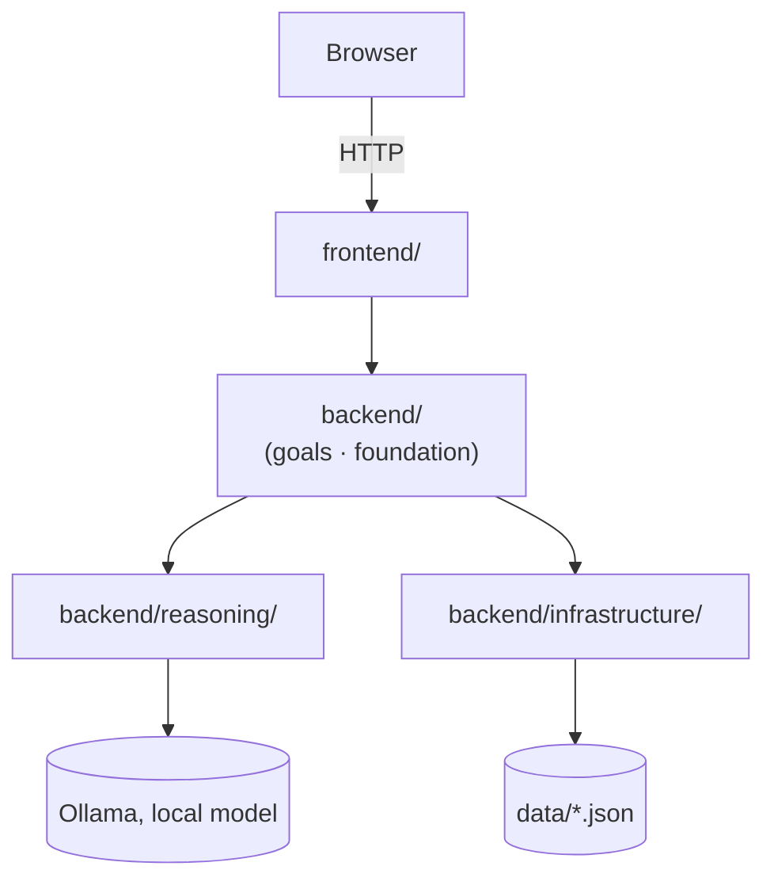

# 04 — Current State

What is true about the project right now. Read this before anything else in `docs/` — see `COLLABORATION.md` for why, and for how to treat what's written here (fact vs. hypothesis vs. decision vs. open question).

This file is a snapshot, not a log — it describes the present, not how it got there. It goes stale the moment something changes; whoever changes it updates this file before finishing (see `COLLABORATION.md`, "Before finishing").

## Quick Structure

What the project consists of — scannable in a few seconds. See § Visual Overview below for how the main parts connect, and § 1–4 for what each boundary means and who owns what.

```text
1. FRONTEND
   ├── Application      → frontend/app.py
   ├── Templates        → frontend/templates/
   │   (conversation/, set_goal/, vision/, active/, active_goal/,
   │    completed_goal/, history/, navigation/)
   ├── CSS              → frontend/css/
   └── view_data/       → goal_overview.py / text_formatting.py / plan_horizons.py

2. BACKEND
   ├── Goals
   │   ├── Goal         → goal/resolver.py
   │   ├── Plan         → plan/
   │   └── Feedback     → feedback/
   ├── Foundation       → time/, math.py (the two established Faculties)
   ├── Reasoning        → model_client.py (the Ollama boundary)
   ├── Infrastructure   → data_persistence.py
   └── memory/, world/  — empty placeholders

3. DATA
   ├── plans.json
   ├── visions.json
   └── knowledge/       → example_chunks.json (sketch, unused)

4. TOOLS
   ├── project_check.py
   ├── docs_check.py
   └── docs_lint.py
```

## Visual Overview

How the main areas connect — not every file, function, or edge. § 3 below has the full, verified dependency detail, including the direct Frontend → Infrastructure edge this simplified view leaves out.



## 1. Project Structure

### i. Frontend

- Application entry point — `frontend/app.py`: Flask setup, Jinja global/filter registration, eleven routes across six work areas (`/`, `/set-goal` GET+POST, `/vision` GET+POST, `/vision-archive` POST, `/active`, `/feedback` POST, `/step` POST, `/goal-vision` POST, `/goal-cancel` POST, `/history`, `/completed`), and the CLI entry point (`-m frontend.app`).
- Templates — `frontend/templates/`, 23 Jinja templates organized by page: `index.html`, `conversation/`, `set_goal/`, `vision/`, `active/`, `active_goal/`, `completed_goal/`, `history/`, `navigation/`.
- CSS — `frontend/css/style.css`.
- View-data modules — `frontend/view_data/goal_overview.py` (groups/composes goals for the overview page), `frontend/view_data/text_formatting.py` (pure text formatting for display), `frontend/view_data/plan_horizons.py` (Plan-horizon labels for the UI). Prepare already-decided backend information for `templates/` to render — not the views themselves.

### ii. Backend

- Goals — `backend/goals/goal/resolver.py`: goal identity/history reading (`get_latest_for_goal`, `get_latest_for_all_goals`, `get_history_for_goal`).
- Plans — `backend/goals/plan/`: `planner.py` (goal → plan, `replan()`, the decision logic behind creating a goal and reacting to feedback, Goal cancellation (`cancel_goal()`), and Vision management (`set_goal_vision()`, `archive_vision()` — archiving a Vision detaches it from every currently-active Goal that references it, leaving completed/cancelled Goals' `vision_id` untouched); a Plan record's fields are named by `PLAN_KEYS` — `year`, `month`, `week`, `today`, `hour`, `minute`, `now` — planning-level names, not literal/deictic durations), `model_client.py` (Plan-specific JSON-shape validation on top of Reasoning), `step_generator.py` (fills in a plan's step list), `action_reader.py` (reads the current Action, `plan.now`, from the latest plan).
- Feedback — `backend/goals/feedback/`: `feedback_parser.py` (deterministic outcome/duration-change parsing), `acknowledger.py` (display-only acknowledgment via Reasoning, for feedback `feedback_parser.py` can't classify).
- Infrastructure — `backend/infrastructure/data_persistence.py`: saves/loads `data/plans.json` and `data/visions.json`.
- Reasoning — `backend/reasoning/model_client.py`: the one call to the local Ollama model every other component goes through.
- World / domain areas — `backend/foundation/time/` (temporal understanding, split into `time_data/`/`time_logic/`) and `backend/foundation/math.py` (basic deterministic arithmetic) — the two established Faculties; `backend/memory/` (empty), `backend/world/` (empty).

Larger or structurally complex source files — most of `backend/foundation/time/`, `backend/foundation/math.py`, `backend/goals/plan/planner.py`, `frontend/app.py` — carry a `Contents` navigation comment near the top, listing major sections and their declarations in the file's actual order; see `global-standards/CODE_STYLE_GUIDE.md` §1 for the convention.

### iii. Data

`data/plans.json`, `data/visions.json` — local, git-ignored. `data/knowledge/example_chunks.json` also exists, a leftover sketch artifact — no backend code reads it yet (Knowledge/RAG is not built, see § 7).

### iv. Tools

`tools/project_check.py`, `tools/docs_check.py`, `tools/docs_lint.py` — standalone dev utilities, no runtime relationship to the agent.

## 2. Responsibilities

### i. Frontend responsibilities

Receive an HTTP request, read/validate form input, call one backend function per route, choose a template, redirect. No domain decisions — the view-data modules (`goal_overview.py`, `text_formatting.py`, `plan_horizons.py`) shape how data is displayed, they don't decide anything about a Goal, Plan, or Vision.

### ii. Backend responsibilities

Own every Goal/Plan/Vision/Feedback decision and its persistence. This is where the architectural concepts from `03-architecture.md` — Domains, Faculties, Infrastructure — are actually implemented today.

Two Faculties are established: **temporal understanding** (`backend/foundation/time/`) and **Math** (`backend/foundation/math.py`). Time (the Domain) and temporal understanding (the Faculty) are related but distinct: Time is what the system operates on, temporal understanding is the capability the agent uses to make sense of it; Math has no paired Domain — nothing yet treats standalone quantities as records the system operates on. A Faculty is earned either through demonstrated reuse or by representing a genuine, independently-existing reasoning domain, not proposed ahead of either (see `05-decisions.md`, "Faculty categorization" and its refinement) — speculative empty scaffolds for unproven Faculties (formerly `foundation/language/`, `foundation/meaning(maybe)/`) were removed 2026-08-27 rather than kept as placeholders.

Temporal understanding currently covers: recognizing and resolving clock times, calendar periods, weekdays, months, named fractions, and counted lengths through decade/century/millennium; seasons (spring/summer/autumn/winter, "fall" recognized as a synonym for autumn), resolved against an explicit, caller-supplied hemisphere ("northern"/"southern") and reported as recognized-but-unresolved when none is given — no code anywhere supplies one yet, since no location/hemisphere source exists; and `now()` (`time_logic/current_time.py`), backend's one authoritative current-time read, used throughout `foundation/time/`'s own logic and by `planner.py`. `data_persistence.py`'s `created_at` timestamps deliberately still read the system clock directly — Infrastructure bookkeeping, not temporal reasoning, so left outside this.

Math currently covers basic deterministic arithmetic only: `add`, `subtract`, `multiply`, `divide` (`backend/foundation/math.py`, a single flat module) — division by zero raises `ZeroDivisionError` explicitly. No percentages, algebra, statistics, or expression parsing.

**Vision** (added 2026-08-26) is a fifth concept, deliberately none of the above — not a Domain, Faculty, or pipeline stage. It's optional, cross-goal context (`data/visions.json`, an optional `vision_id` on a Goal record); see `03-architecture.md` § Vision for what it is and isn't. The conceptual model is **Vision / Goal / Plan / Action / Feedback** — "Action" replaces "Task"/"today's action" as the term used across docs and the UI. Vision has its own lifecycle, `ACTIVE`/`ARCHIVED` (added 2026-09-06) — not `COMPLETED`, since a Vision is a direction, not something finished; `archive_vision()` also detaches every currently-active Goal that references the archived Vision (`vision_id` set to `None`), leaving completed/cancelled Goals' `vision_id` as historical context. The Vision page (`/vision`) shows Active and Archived Visions as two separate sections; Active's own Vision-picker offers only active Visions.

A Plan record's fields are named by **`PLAN_KEYS`** — `year`, `month`, `week`, `today`, `hour`, `minute`, `now` — planning-level names, not literal or deictic durations (renamed from `one_year`/`one_month`/`this_week`/`this_hour`/`this_minute`/`right_now`; see `05-decisions.md` #19). Existing `data/plans.json` records are remapped to the new names on read, via `data_persistence._LEGACY_HORIZON_KEY_RENAMES` — not rewritten on disk until next saved. `_horizon_scope_instruction()` (`planner.py`) decides which `PLAN_KEYS` fields the model fills in for a given goal, and names the goal's own actual resolved timeframe when its outer, `year`-level field applies, rather than assuming a literal year; the underlying threshold table (`_HORIZON_LENGTH_THRESHOLDS`) and bucketing function (`broadest_relevant_horizon()`) live in `backend/foundation/time/time_logic/frozen_duration.py`, not in `planner.py` itself.

`data_persistence.py` is Infrastructure, not a Faculty: it stores and retrieves data without understanding what it represents.

Full architectural definitions and relationships: `03-architecture.md`.

### iii. Data responsibilities

Pure storage — plaintext JSON, no logic, no interpretation of what's stored.

### iv. Tools responsibilities

Deterministic, mechanical checks (git status, imports, pyflakes, stale path mentions, docs structure) — no runtime relationship to the agent, and no judgment about whether the project's design is correct.

## 3. Dependencies / Flow

### i. Browser → Frontend

Plain HTTP request/response — form submissions and page renders, no other protocol.

### ii. Frontend → Backend

`frontend/app.py` imports directly from four backend areas:

```text
from backend.foundation.time import describe_duration, duration_progress, step_plan
from backend.goals.goal.resolver import get_history_for_goal, get_latest_for_goal
from backend.goals.plan.planner import advance_step, apply_feedback, archive_vision, cancel_goal, create_goal, set_goal_vision
from backend.infrastructure.data_persistence import load_history, load_visions, save_vision
```

The last import is a direct Frontend → Infrastructure edge for these three specific read/write calls — it bypasses `backend.goals` rather than going through it.

### iii. Backend → Data

`backend/infrastructure/data_persistence.py` is the only module that touches the filesystem under `data/`. Every other backend module that persists something goes through it:

- `backend/goals/plan/planner.py` — `save_plan`, `save_vision`, `get_vision`, `archive_vision`
- `backend/goals/goal/resolver.py` — `load_history`
- `backend/goals/plan/action_reader.py` — `get_latest_plan`

### iv. Relevant module relationships

`backend/reasoning/model_client.py` (`send_message()`) is the single boundary every model call passes through. Three independent modules call it:

- `backend/goals/plan/model_client.py`
- `backend/goals/plan/step_generator.py`
- `backend/goals/feedback/acknowledger.py`

`backend/goals/plan/planner.py` also imports `backend/goals/feedback/feedback_parser.py` and `backend/goals/feedback/acknowledger.py` directly, for the feedback-handling logic it now owns (`apply_feedback()`, `advance_step()`).

## 4. Architectural Boundaries

### i. What belongs in frontend

Routing, reading HTTP input, choosing a template, redirecting, and view-data preparation (the three modules in § 1.i).

### ii. What belongs in backend

Domain decisions (what a Goal/Plan/Vision/Feedback record should look like or become), persistence, and model calls.

### iii. What should not be moved into backend

`frontend/view_data/goal_overview.py`, `frontend/view_data/text_formatting.py`, `frontend/view_data/plan_horizons.py` — view-data preparation logic with no backend dependency beyond reading already-decided data (`goal_overview.py`'s only backend import is `backend.goals.goal.resolver`, for reading, not deciding). Moving them into `backend/` would put view preparation inside the agent's own domain logic.

### iv. What should not be placed in frontend

Anything that decides and then persists — the boundary `create_goal()`, `apply_feedback()`, and `advance_step()` in `backend/goals/plan/planner.py` were built to enforce: a route reads input and calls one of these, it doesn't itself decide what the resulting Goal/Plan should be.

## 5. What Works

Prototype 0.1's full loop is closed end-to-end:

```text
Goal
 ↓
Plan
 ↓
Action
 ↓
User feedback
 ↓
Replan
 ↓
New action
```

Concretely:

| Capability | File |
|---|---|
| Goal → plan | `backend/goals/plan/planner.py` (`generate_plan`) |
| Plan saved | `backend/infrastructure/data_persistence.py` |
| Action (right now) | rendered in the web UI as `steps[current_step]` or `record.plan.now` (`_active_goal.html`/`active_goal/_task.html`) — `backend/goals/plan/action_reader.py` reads `plan.now` too, but is a standalone CLI entry point with no inbound import from `frontend/app.py`; not part of the running web app (confirmed via `tools/project_check.py`'s inbound-import check) |
| User reports progress | `frontend/app.py` (`/feedback`, free text) and `/step` (structured Done? control) |
| Plan adjusts | `backend/goals/plan/planner.py` (`replan`) — temporal horizons only, see § 6 |
| Step completion, separate from Action completion | `backend/goals/plan/planner.py` (`advance_step`) — `step_status` (`open`/`resolved`) per step, only set by the structured `/step` signal, never inferred from free text; `current_step` only advances when a step is actually resolved |
| Temporal understanding | `backend/foundation/time/` |
| Basic arithmetic | `backend/foundation/math.py` (`add`/`subtract`/`multiply`/`divide`) |
| Vision created / linked to a Goal | `frontend/app.py` (`/vision`, `/set-goal`, `/goal-vision`) |
| Vision archived, active Goals detached | `frontend/app.py` (`/vision-archive`) → `planner.archive_vision()` |
| Vision supplied as context to planning/replanning | `backend/goals/plan/planner.py` (`generate_plan()`/`replan()`) — a linked Vision's text is added as a separate, clearly-labeled background-context section of the model's prompt, never folded into the goal text itself |
| Local web UI | `frontend/app.py` — six work areas (Conversation, Set Goal, Vision, Active, Completed, History): vision form, goal form, feedback, a three-way structured Done? control, goal cancel, history, completed |

"Works" means the mechanism runs correctly — the code calls the LLM, saves, and displays a result. It does not mean the LLM's answers are always accurate; it has already been caught hallucinating a specific, unfounded detail (see `06-development.md`).

## 6. What's Half-Built

- **Vision** — create, link-to-a-goal, and archive (with active-Goal detachment) are built and, as of `58a8d34` ("Wire Vision context into planning and replanning"), actually supplied as background context to `generate_plan()`/`replan()`'s model calls; editing/deleting an existing Vision, and restoring an archived one, are still not built. `03-architecture.md` § Vision has not yet been corrected to match this — see that document's own note.
- **Step completion (Design A)** — a step's `open`/`resolved` status, separate from `current_step`, is implemented and verified (see § 5), but narrowly: it doesn't represent a compound/multi-part condition (e.g. "acquire all the components"), doesn't cover habit- or process-shaped steps, and hasn't yet been exercised through real day-to-day use, only through isolated test scripts. See `docs/planning-model.md` § Completion.
- **Replanning** — the mechanism itself is reliable (§ 5), but only ever regenerates the temporal horizons; a goal's step list never changes as a result of feedback, however informative that feedback is. See `docs/planning-model.md` § Feedback and Replanning.
- **Conversation** — the per-Goal feedback thread works mechanically, but has been observed (2026-09-07) to fail the transition from "user doesn't know what to do" to proposing something, instead re-asking the same question. See `docs/planning-model.md` § Conversation. The dedicated `/` Conversation page itself remains a disabled placeholder (see § 7).

## 7. What's Not Built

- **Memory** — the agent doesn't yet use its own history; `memory/` is an empty placeholder (a Domain, not nested under `foundation/`).
- **Hierarchical step list** — a goal's plan is currently one flat step list, not nested phases with their own sub-steps; concretely, a multi-month goal produces steps that are really coarse phases (e.g. one step spanning 16 days), not the granular actions they're meant to be.
- **Decomposition / zoom** — no mechanism exists to increase the resolution of one step on demand; see `docs/planning-model.md` § Decomposition / zoom.
- **Knowledge / RAG** — sketched, not implemented; `data/knowledge/example_chunks.json` exists as an early sketch artifact, not read by any backend code yet.
- **Acting** — the agent reasons about what should happen; it doesn't yet perform external actions such as creating files or calling APIs.
- **Reality/Verification beyond human self-report** — no evidence storage, confidence, or tool/system observation channel; see `docs/planning-model.md` § Reality, Observation, and Verification.
- **Continuity / proactivity** — no scheduler or background behavior anywhere; the whole loop only runs in response to an HTTP request.
- **Multi-goal reasoning** — active goals are shown/grouped together, but nothing reasons across them (e.g. competing for the same time).
- **Live external data** — `world/` is a deliberate empty placeholder.
- **Hemisphere/location context** — `foundation/time/` can resolve a season given an explicit hemisphere, but nothing in the system determines or supplies one yet; a season phrase without it is honestly reported as recognized, not resolved (deliberate, see `03-architecture.md` § Temporal understanding).
- **Goal auto-completion** — finishing every step does not automatically mark a goal complete; the user still confirms explicitly. Deliberate, not an oversight.
- **The `/` Conversation page** — a disabled placeholder textarea; no intent parsing or routing.

For the fuller conceptual picture behind the newer entries above (Step/Action/Reality/Verification/Conversation), see `docs/planning-model.md`; for a maturity map of the whole Active Goal loop and what's currently being worked through, see `SESSION-TODO.md` - not duplicated here to avoid the same status drifting independently in three places.

## 8. Current Decisions

Stable, not casually revisited (see `COLLABORATION.md` rule 4):

- LLM backend: Ollama (local, `llama3.1:8b`), not a paid API — no cost, no internet dependency.
- Storage: local plaintext JSON, append history, never overwrite. Not moving to SQL.
- Feedback outcome (action_completed/action_not_completed/action_in_progress/goal_completed) is parsed deterministically, never left to the LLM to judge.
- Testing on real use takes priority over adding more features.
- Vision is optional, lightweight context (an id+text store, an optional foreign-key-style reference on a Goal) — not a relational hierarchy, not duplicated free text per goal.
- Plan-record field names (`PLAN_KEYS`) are planning-level names (`year`/`month`/`week`/`today`/`hour`/`minute`/`now`), not literal or deictic durations — existing records are migrated on read, not rewritten.
- A Faculty represents demonstrated cross-system reuse or a fundamental, independently-existing reasoning domain (temporal, quantitative) — not interpretation of ambiguous input specifically, and not a plausible category on its own.
- Step completion is a judgment separate from Action completion, set only through an explicit, structured signal — never inferred from free text, same reasoning as feedback outcome parsing above (see `docs/planning-model.md` § Completion).

**Security status:** whole-disk encryption via macOS FileVault is on for this machine (covers the "stolen/lost laptop" scenario). No application-level encryption of `data/plans.json` itself yet — deferred until this becomes a multi-user or cloud product, see `05-decisions.md`. No encryption in transit — not relevant while Ollama is local-only.

Full list with reasoning: `05-decisions.md`.

## 9. Open Questions

- Flat vs. hierarchical step list — not designed, needs its own pass.
- Should a goal auto-complete when every step is resolved? Real tension between one-shot goals and ongoing habit goals, not resolved by Design A.
- Future Faculties beyond Time and Math should still emerge from demonstrated reuse or a genuine, independently-existing reasoning domain, not be predetermined (see `05-decisions.md`, "Faculty categorization").
- Visual design — wants a holistic pass, not one color fixed at a time.
- Whether editing/deleting an existing Vision is worth building, once there's real usage to learn from.

For the fuller, more recent set of open conceptual questions (Decomposition/zoom's data shape, Verification as an explicit phase, habit/process completion, Stage/Milestone naming, etc.), see `docs/planning-model.md` § Open questions — not duplicated here.

## 10. Next Step

No single fixed "pick one of these" list is maintained here anymore — see `SESSION-TODO.md`'s Active Goal loop maturity map for the current, living picture of what's established, partially established, or not yet built, and its "Suggested next milestone" section for the current (non-binding) candidate. That file is deliberately the one place this gets updated, rather than kept in sync across two documents.

(Historical: this section used to name Memory / hierarchical steps / Knowledge-RAG / Acting as the four remaining options from a 2026-08-24 review; none of those were picked next. Instead, a deeper conceptual pass on Goal/Plan/Step/Action/Reality/Verification led to Step/Action Design A being built on 2026-09-07 - see `docs/planning-model.md` and `SESSION-TODO.md`. The Action/Task/`right_now`/"today's task" terminology drift an earlier architectural pass flagged is resolved; the `right_now` field name itself was later renamed to `now`, along with the rest of `PLAN_KEYS` — see `05-decisions.md` #19.)
