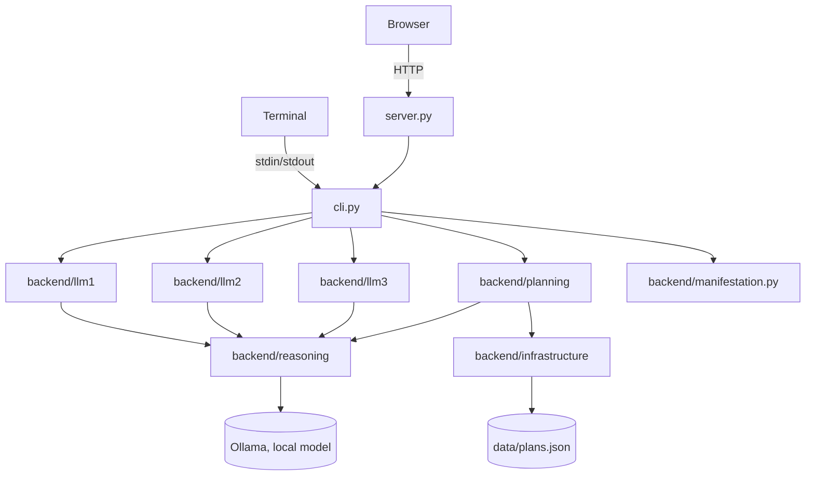

# 04 — Current State

What is true about `agent/` right now. Read this before anything else in `docs/` — see `COLLABORATION.md` for why, and for how to treat what's written here (fact vs. hypothesis vs. decision vs. open question).

This file is a snapshot, not a log — it describes the present, not how it got there. It goes stale the moment something changes; whoever changes it updates this file before finishing (see `COLLABORATION.md`, "Before finishing").

> Migration note: this is a fresh document written for `agent/`, not a migration of `current/docs/04-current-state.md` — that file describes prototype 0.1 (`current/`), a different, frozen codebase. See § 6 below for exactly what `agent/` carried over from it and what it left behind.

## Quick Structure

What the project consists of — scannable in a few seconds. See § Visual Overview below for how the main parts connect, and § 1–2 for what each piece means and who owns what.

```text
1. ENTRY POINTS
   ├── CLI              → cli.py (terminal loop, process_turn())
   ├── HTTP server      → server.py (stdlib http.server, one route: POST /api/message)
   └── Web UI           → ui/ (TypeScript, compiled to ui/dist/, one chat page)

2. BACKEND
   ├── Node 1 — Interface  → backend/llm1/interface.py
   ├── Node 2 — Parser     → backend/llm2/parser.py
   ├── Node 3 — Decision   → backend/llm3/select.py
   ├── Manifestation       → backend/manifestation.py
   ├── Planning (capability) → backend/planning/ (goal/, plan/, feedback/)
   ├── Module Library      → backend/module_library/ (built, not wired in)
   ├── Foundation          → backend/foundation/ (time/, math.py — the two Faculties)
   ├── Reasoning           → backend/reasoning/model_client.py (the Ollama boundary)
   └── Infrastructure      → backend/infrastructure/data_persistence.py

3. DATA
   └── plans.json           (only file actually written to by anything here)
```

## Visual Overview

How the main areas connect — not every file, function, or edge.



`cli.py`'s `process_turn()` is the one place all of this is actually wired together — see § 3. `server.py` doesn't duplicate that wiring; it imports `Session`/`process_turn()` from `cli.py` directly.

## 1. Project Structure

### i. Entry points

- `cli.py` — a terminal loop (`main()`) around `process_turn()`, the function that runs one turn through Node 1 → Node 2 → Node 3 → Planning → Node 1. Holds one `Session` (just `current_goal_id`) for the life of the process. If a turn still raises after `reasoning.model_client.call_with_retry()`'s own retries are exhausted (§ 3.iv), `main()` prints the real exception to the terminal and replies with a fixed, friendly line instead of the raw exception text (added 2026-09-11 — a raw Python exception had been standing in as "the agent's reply" until then).
- `server.py` — stdlib `http.server`, no framework, no new dependency. Serves `ui/`'s static files over `GET`, and exposes exactly one route, `POST /api/message`, which parses a JSON `{"text": ...}` body and calls `process_turn()` from `cli.py`. One process-wide `Session`, not per-browser — the same single-conversation limitation `cli.py` already has, only reachable over HTTP instead of a terminal. Same friendly-fallback-on-exhausted-retries behavior as `cli.py`, the exception printed server-side only.
- `ui/` — a minimal TypeScript chat page (`src/main.ts`, `src/api.ts`, `src/types.ts`, compiled by `tsc` into `ui/dist/`, served by `server.py`). One transcript, one textarea, one submit handler; renders an optional `PlanningNode` tree beneath a reply when `manifestation.to_planning_node()` returns one. No routing, no other page.

### ii. Backend

- Node 1 — `backend/llm1/interface.py` (`respond()`): the only role that talks to the user directly. Takes the user's message and an optional plain-text `system_update` string, returns one natural-language reply. Never sees a capability's own field names.
- Node 2 — `backend/llm2/parser.py` (`understand()`): one LLM call, returns `{"about": <neutral description>}` — capability-agnostic, falls back to the raw message if the model's JSON doesn't have the expected shape.
- Node 3 — `backend/llm3/select.py` (`select_capability()`): one LLM call, returns `"planning"` or `None`, given only Node 2's `{"about": ...}`. Exactly one capability exists to select — a deliberately thin stub, not real multi-capability reasoning.
- Manifestation — `backend/manifestation.py`: `surface_text()` (the one plain-text sentence Node 1 is allowed to see) and `to_planning_node()` (an optional generic `{id, label, status, children}` tree), both pure functions of an already-existing Planning record. Shared by `cli.py` and `server.py` so there is one translation, not two.
- Planning — `backend/planning/` (`goal/`, `plan/`, `feedback/`): the capability, originally copied from `current/backend/goals/` with import paths updated — see § 6 for exactly what did and didn't come across at that point. `plan/` itself has since changed further, 2026-09-11: `planner.py`'s two large inline prompt constants moved out to `plan_prompts.py` (prompt text only, no logic); the old `step_generator.py` (a fixed-count, content-only model call) was deleted and replaced by `plan_structure.py`, which reasons about both step count and content — including optional per-step microsteps — in one call, bounded only by a safety ceiling rather than a designed target count. See § 4 and § 8 for what this changed and why.
- Module Library — `backend/module_library/`: five reusable, LLM-backed Modules (`interpret`, `hypothesize`, `critique`, `reason`, `synthesize` in `interpretation.py`/`hypothesis.py`/`critique.py`/`reasoning.py`/`synthesis.py`, re-exported by `modules.py`), each `(text: str, purpose: str, context: str | None = None) -> dict`. Compiles cleanly, has no test file of its own, and — confirmed by search — is not imported anywhere outside itself. **Not wired into any Node.** See [[03-architecture]] Part 2 § 2.ii and [[06-development]] for the reverted Node-restructuring experiment this survived from.
- Foundation — `backend/foundation/time/` and `backend/foundation/math.py`: the two established Faculties. `math.py` unchanged from `current/`. `time/` had one thing removed 2026-09-11: `step_count()`/`MIN_STEPS`/`MAX_STEPS`/`TARGET_STEP_MINUTES` (a step-count-by-duration formula) — deleted once it was shown to collapse to a flat constant (exactly 6 steps) for any goal longer than ~2 hours, and because it was Planning-domain policy living inside the Time Faculty (confirmed by search: used only by Planning, never elsewhere in `time/`), not temporal understanding itself. That responsibility now lives in `backend/planning/plan/plan_structure.py` instead, as a reasoned model decision rather than a formula. `time/`'s own tests and `math.py`'s own tests both still pass (`python -m backend.foundation.time.test_time`, `python -m backend.foundation.test_math`).
- Reasoning — `backend/reasoning/model_client.py` (`send_message()`): the one boundary every model call — every Node's own LLM call, every Planning LLM call, and, if ever wired in, every Module call — passes through. `MODEL = "qwen3.5:9b"`, unchanged from `current/`. Also holds `call_with_retry()` (added 2026-09-11): retries a caller's own "call + parse + validate" sequence up to 3 times on `ValueError` before re-raising the last one, absorbing the live-model shape instability § 4 documents. Two current callers, both in Planning (§ 3.iv) — Node 1/2/3's own calls don't use it, each already has its own fallback behavior on a bad shape (Node 2 falls back to the raw message; Node 3 treats anything but exactly `"planning"` as no capability).
- Infrastructure — `backend/infrastructure/data_persistence.py`: byte-for-byte unchanged from `current/`. Still has full Vision persistence (`save_vision`, `get_vision`, `archive_vision`, `load_visions`) — none of it is currently called by any of `agent/`'s entry points (see § 6).

### iii. Data

`data/plans.json` only — the sole file anything in `agent/` currently reads or writes. No `data/visions.json`: Vision's persistence code exists (§ 1.ii above, Infrastructure) but nothing in `cli.py`/`server.py` ever calls `save_vision()` or passes a non-empty vision to `create_goal()`.

## 2. Responsibilities

### i. Entry-point responsibilities

Transport only. `cli.py` reads a line, calls `process_turn()`, prints the reply. `server.py` parses one JSON body, calls the same `process_turn()`, serializes the result. Neither decides anything about a Goal, Plan, or which capability applies — that's Node 1/2/3/Planning's job, already established in [[03-architecture]].

### ii. Backend responsibilities

This is where [[03-architecture]]'s Node/Module/Capability/Faculty/Infrastructure model is actually implemented today — three Nodes, one Capability, two Faculties, five built-but-unused Modules, one shared model-call boundary, one persistence module. See [[03-architecture]] Part 2 for the full, current definitional mapping; not repeated here.

Two things are true simultaneously and are worth stating plainly: Planning's own internal logic (Goal/Plan/Action/Feedback/Vision, `PLAN_KEYS`, Minimum Planability, ASK/SUGGEST/PLAN) is functionally identical to `current/`'s — see § 6. But almost everything *around* Planning is new: three real Nodes now sit in front of it instead of a Flask route calling it directly, and only one path into it (the free-text chat turn) is currently exercised.

### iii. Data responsibilities

Pure storage — plaintext JSON, no logic, no interpretation of what's stored. Same as `current/`.

## 3. Dependencies / Flow

### i. Browser/terminal → entry point

`server.py`: plain HTTP, one JSON route. `cli.py`: stdin/stdout. No other protocol.

### ii. process_turn() — the one real wiring

`cli.py`'s `process_turn(session, user_text)` is the entire orchestration layer:

```text
understanding = understand(user_text)              # Node 2
capability = select_capability(understanding)       # Node 3

if capability != "planning":
    reply = respond(user_text, None)                # Node 1, direct
    return ...

record = create_goal(...) or apply_feedback(...)    # Planning
surface = surface_text(record)                       # Manifestation
node = to_planning_node(record)                       # Manifestation
reply = respond(user_text, surface)                  # Node 1, grounded
```

Which existing Planning function to call — `create_goal()` vs. `apply_feedback()` — is decided by `session.current_goal_id is None`, not by any Node or LLM judgment. This is stated in `cli.py`'s own module docstring as harness/orchestration glue, deliberately the crudest thing that still lets more than one kind of turn be tested — not a designed piece of the architecture.

### iii. Backend → Data

`backend/infrastructure/data_persistence.py` is the only module that touches the filesystem under `data/`. Planning's `save_plan()`/`get_vision()`/`archive_vision()` calls go through it, same as `current/`.

### iv. Model-call boundary

`backend/reasoning/model_client.py`'s `send_message()` is the single function every LLM call in the project passes through — each Node's own call, and Planning's own `ask_model()` (`model_client.py`)/`generate_structure()` (`plan_structure.py`)/`acknowledge()` (`feedback/acknowledger.py`) built on top of it. `ask_model()` and `generate_structure()` additionally wrap their own call+validate sequence in the same module's `call_with_retry()` (added 2026-09-11) — `ask_model()`'s validation now also checks each `PLAN_KEYS` value is a string or null, not just that the key is present, after a live run returned an object (`{"value": "..."}`) instead of a string for several horizon fields and passed the old, presence-only check unnoticed.

## 4. What Works

The full round trip, both directions, runs end-to-end and is what [[03-architecture]]'s top diagram documents:

```text
User → Node 1 → Node 2 → Node 3 → Planning → Node 1 → User
                            ↓ (no capability needed)
                          Node 1 → User
```

Concretely:

| Capability | File |
|---|---|
| Neutral understanding of a turn | `backend/llm2/parser.py` (`understand()`) |
| Capability routing (planning / none) | `backend/llm3/select.py` (`select_capability()`) |
| "No capability needed" short-circuit | `cli.py`'s `process_turn()` — proven, not hypothetical: a greeting or small talk returns straight from Node 1, Planning never runs |
| Goal → plan (first turn of a session) | `backend/planning/plan/planner.py` (`create_goal()` → `generate_plan()`) |
| Feedback → replan (subsequent turns) | `backend/planning/plan/planner.py` (`apply_feedback()`) |
| Step count/content, each step optionally with microsteps | `backend/planning/plan/plan_structure.py` (`generate_structure()`) — reasoned per goal (e.g. a 2-year "climb Everest" plan produces ~10 top-level steps with real microsteps under most of them; a 10-minute "drink a glass of water" plan produces 4 flat steps, none), not a duration formula — see § 8 |
| Plan saved | `backend/infrastructure/data_persistence.py` |
| Result surfaced to Node 1 | `backend/manifestation.py` (`surface_text()`) — verified: `cli.py` always calls Node 1's `respond()` last, grounded in this |
| Result rendered as a step tree, each step's microsteps as its children, when steps exist | `backend/manifestation.py` (`to_planning_node()`) → `ui/src/main.ts` (`renderNode()`) — verified through the actual running browser UI, not only backend calls |
| Temporal understanding | `backend/foundation/time/` — unchanged, own test suite passes |
| Basic arithmetic | `backend/foundation/math.py` — unchanged, own test suite passes |
| Local web UI | `server.py` + `ui/` — one chat page, no other route |

"Works" means the mechanism runs correctly — the code calls the model, decides, saves, and displays a result. It does not mean the model's answers are always reliable: across this session's verification, `backend/planning/plan/test_planner.py`'s live-model assertions and `generate_structure()`'s own shape validation each failed on an occasional run (a returned step list missing an expected field, a `PLAN_KEYS` value returned as an object instead of a string) and passed cleanly on a re-run with no code change — repeatedly enough to call it an established pattern, not a one-off. Same live-model instability already documented for `current/` in its own `04-current-state.md` § 6, not a new regression here. `reasoning.model_client.call_with_retry()` (§ 1.ii, § 3.iv) now absorbs most of this automatically — up to 3 attempts before a caller ever sees a failure.

## 5. What's Half-Built or Not Reachable

Distinct from "not built" (§ 6) — this is code that exists and works in isolation, but nothing in `agent/`'s entry points currently exercises it:

- **Topic continuity within one process (confirmed defect, not just an unreached path)** — `cli.py`'s `Session` holds exactly one `current_goal_id`, set once `create_goal()` first runs, and nothing ever detects that a later message has moved on to an unrelated goal. Reproduced live, twice, 2026-09-11: once when an unrelated backend test call against the same running server left a stale `current_goal_id` active before a real conversation began, once when a user typed three genuinely different goals in one browser session and the third was silently folded into `apply_feedback()` on the second, producing an incoherent reply. Fix sketched, not built: persist `current_goal_id` to disk (same pattern `save_plan()`/`save_vision()` already use) so it survives a server restart, and give Node 3 (or a step before it) the job of deciding whether a new message is still about the active goal or something else — today Node 2 receives no context beyond the single current message (see § 9), so nothing in the pipeline has anywhere to make that call from.
- **Vision** — `create_goal()`, `set_goal_vision()`, `archive_vision()`, and `data_persistence.py`'s Vision persistence all still work exactly as in `current/`. But `cli.py`'s `process_turn()` always calls `create_goal(user_text, "", "")` — empty Vision text, empty Vision id, every time. There is no path in `cli.py`/`server.py`/`ui/` for a user to create, link, or archive a Vision. `data/visions.json` does not exist.
- **Multi-goal conversations** — `Session` holds exactly one `current_goal_id`. Once a goal exists for a session, every subsequent "planning" turn is routed to `apply_feedback()` against that same goal — there is no way to start a second goal, switch goals, or list existing goals without restarting the process. `current/`'s `get_latest_for_all_goals()` (multi-goal listing) is imported by `planner.py` but nothing in `agent/`'s entry points calls it.
- **Structured step-completion signal** — `advance_step()` (the `open`/`resolved`-per-step mechanism `current/`'s `/step` route drove) still exists in `planner.py`, but `agent/` has no equivalent route or UI control — `ui/`'s only input is free text, so a step's status can currently only change via whatever `apply_feedback()`'s free-text outcome parsing infers.
- **Module Library** — five Modules, individually working (compiles, matches its contract), built and proven as reusable functions, but reachable from nothing (§ 1.ii above).

## 6. What Was Left Behind, Migrating From `current/`

`current/backend/goals/` was copied to `agent/backend/planning/` with import paths updated (`backend.goals` → `backend.planning`) and, at that point, nothing else — confirmed by diff against `current/` at the time. `planner.py`'s core Goal/Plan/Feedback/Vision logic remains that same proven logic; its step-count-and-content mechanism has since been rebuilt (§ 1.ii, § 4, § 8) and its two large prompts moved to their own file, both `agent/`-only changes with no `current/` equivalent to diff against. What did not come across in the original copy:

- **`frontend/` (the Flask app)** — `current/`'s six work areas (Conversation, Set Goal, Vision, Active, Completed, History), 23 templates, and `frontend/view_data/` are not part of `agent/` as a running app. A verbatim, frozen copy lives at `agent/frontend-legacy/` (added 2026-09-11) as reference for `agent/`'s own, still-unbuilt `frontend/` — not wired to anything, not runnable as-is, not maintained going forward (see its own README's frozen-reference note). `ui/` is a from-scratch, single-page TypeScript prototype, not a port of `frontend/` or `frontend-legacy/`.
- **`backend/goals/plan/action_reader.py`** — not copied; its only job (`plan.now` as a standalone CLI read) has no `agent/` equivalent yet.
- **`memory/`, `world/`** — the empty placeholder packages `current/backend/` still carries are not present in `agent/backend/` at all.
- **`data/visions.json`, `data/knowledge/`** — neither exists under `agent/data/`.

(`tools/`'s `project_check.py`/`docs_check.py`/`docs_lint.py` *did* come across, since added 2026-09-11 — see the project-root `tools/`, not duplicated under `agent/`, per that tool's own docstring.)

## 7. What's Not Built

Same as `current/` — `agent/` has not extended Planning's own domain scope, only restructured what sits around it:

- **Memory** — no equivalent package exists in `agent/backend/` at all (§ 6).
- **Knowledge / RAG** — not built, no artifact of any kind under `agent/data/`.
- **Decomposition / zoom** — a step's microsteps (§ 4) are decided once, up front, alongside the step itself; there is still no mechanism to increase an already-generated step's resolution on demand afterward, or to go a level deeper than microsteps.
- **Acting** — the agent reasons about what should happen; it performs no external action.
- **Continuity / proactivity** — no scheduler or background behavior; the whole chain only runs in response to a CLI line or an HTTP request.
- **A second, real capability** — Node 3's `select_capability()` can only ever return `"planning"` or `None`; nothing exists yet to demonstrate the "which one" half of its job.

For the fuller conceptual picture behind Planning's own domain concepts, see [[planning-model.md|planning-model]] — unchanged by this migration.

## 8. Current Decisions

Stable, not casually revisited (see `COLLABORATION.md`):

- LLM backend: Ollama (local, `qwen3.5:9b`), unchanged from `current/` — see [[05-decisions]] #21.
- Storage: local plaintext JSON, unchanged.
- A Node's process is defined by its own code; adaptive depth (a Module called conditionally) is decided by code reading a Module's structured output, never by a model choosing which Modules to call — see [[03-architecture]] Part 2 § 2.ii.
- Module Library stays built but unwired until a concrete Node need demonstrates it, rather than being adopted as a default pipeline — see [[03-architecture]] Part 2 § 2.ii and [[06-development]] for the reverted experiment that tested the alternative.
- Which of today's interaction surfaces should skip Node 3 once a conversation is already scoped to a known capability is not decided — see [[03-architecture]] Part 3 § 8.
- A plan's step count is a reasoned model decision (`plan_structure.py`), not a duration formula — the "code decides, the model is told" split used for Time/Math doesn't apply here, because how many meaningfully distinct steps a goal needs is a complexity judgment (climbing Everest vs. tidying a desk, same duration, very different step counts), not deterministic arithmetic. Bounded only by a safety ceiling against a malformed response, not a target range.
- Step count and step content are decided in one model call, not two — an earlier two-call version (a separate structure decision, then a separate content call) measurably destabilized the second call against the local model; this was found and fixed within this same 2026-09-11 session, not a pre-existing constraint.
- A bad model-response shape gets a bounded retry (`call_with_retry()`, up to 3 attempts) before it's treated as a real failure, rather than surfacing on the first hiccup — matches the observed pattern that these failures are transient, not systematic (§ 4). If every attempt still fails, the user sees a fixed, friendly line, never the raw exception text (§ 1.i).

Full list with reasoning: [[05-decisions]].

## 9. Open Questions

- Whether Node 1 re-voices a capability's already-conversational output verbatim or in its own words — see [[03-architecture]] Part 3 § 8.
- How much conversational context Node 2 actually needs — no longer purely untested: § 5's topic-continuity defect is a live, concrete case where the absence of any context beyond the single current message produced an observably wrong result, not just a theoretical gap.
- Whether Vision, multi-goal support, or a structured completion signal should be rebuilt for `agent/`'s entry points, and in what form — not decided; § 5 only records that the underlying Planning code already supports the first and last of these.
- Whether solving topic continuity (§ 5) needs full conversation persistence (the still entirely unbuilt Memory Domain — § 7) or only a narrower, session-scoped form of context — no conversation transcript of any kind is saved anywhere today (confirmed by search: no such function or data structure exists), so this is currently unexplored territory, not a decision.
- Everything already open in [[planning-model.md|planning-model]] and [[03-architecture]] Part 3 § 8 — not duplicated here.

## 10. Next Step

Not tracked in this file — no `SESSION-TODO.md`-equivalent exists yet for `agent/`. Two concrete candidates were on the table as of 2026-09-11, in no particular order:

- Fix § 5's topic-continuity defect: persist `current_goal_id` (see § 1.i's `Session`) across restarts, and give something in the pipeline — likely an extension of Node 3's existing routing job, since it already decides "does this need a capability" and deciding "is this still the same capability-context as before" is a natural extension of that same responsibility, not a new component — the means to detect a topic switch. Discussed as roughly comparable in size to this session's `plan_structure.py` work, not a small fix.
- Give Node 3 a second real capability to select between — still nothing demonstrates the "which one" half of its job (§ 9, [[03-architecture]]).

Vision/multi-goal/structured-completion (§ 5) remain live candidates too, just not the two most recently discussed.
