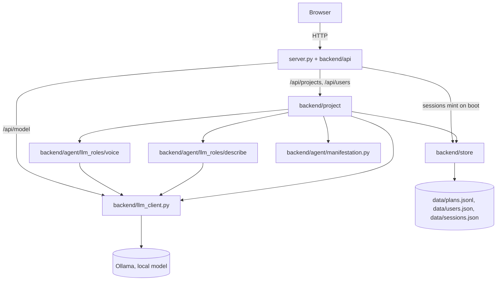

# 04 — Current State

What is true about `app/` right now. Read this before anything else in `docs/` — see `COLLABORATION.md` for why, and for how to treat what's written here (fact vs. hypothesis vs. decision vs. open question).

This file is a snapshot, not a log — it describes the present, not how it got there. It goes stale the moment something changes; whoever changes it updates this file before finishing (see `COLLABORATION.md`, "Before finishing").

> Migration note: this is a fresh document written for the application root (now `app/`, renamed from `agent/` on 2026-09-19), not a migration of `current/docs/04-current-state.md` — that file described prototype 0.1 (`current/`), a different codebase. See § 6 below for exactly what was carried over from it and what was left behind, and that section's own note on `current/`'s deletion (2026-09-11) - it is no longer possible to open `current/` directly to check any of this firsthand.

## Vocabulary (Planning → Project)

Older docs and conversations say **Planning**, **Goal**, and **map**. The product capability is now **Project**; the same mechanisms still apply under new folder names. Translate with this table (settled [[05-decisions]] #28):

| Older label | Read as today | Code / note |
|---|---|---|
| Planning (capability) | **Project** | `backend/project/` |
| Goal (product unit) | **Project** | Wire: `project_id` / `/api/projects` only ([[05-decisions]] #29; `/api/goals` + response `goal_id` mirror removed 2026-09-20) |
| map / WHAT progression | **canvas** | `project/panes/canvas/` |
| plan folder / Decide–Fill | **engine** | `project/engine/` — `judgment/` (decide, `run_stage3`, …) + `when/calendar`; `planner.py` facade (`generate_plan` alias); not a capability |
| Active board | **Projects** UI | `projects.html` |
| llm3 / free conversation | **Removed 2026-09-20** | Conversation page, `/api/message`, `cli.py`, `process_turn`, Node 3 deleted; chat is Projects-only ([[05-decisions]] #31) |
| Vision (optional link) | **Simulated user `id#N`** | Wire: `sim_user_id` / `/api/users` / `data/users.json` ([[05-decisions]] #30); stub plan `user_id` still `DEFAULT_USER_ID`; UI filters projects by active user |

Planning became the **product** Project; Decide/Fill became the **engine inside** Project. Dated history in `06-development.md` and older decision entries keeps the old words on purpose. Phase A + Phase B of [[goal-to-project-migration]] are done (including dropping `/api/goals` and the response `goal_id` mirror); remaining cleanup is renaming the display field `goal` / Python symbols. Simulated multi-user (`id#N`) filters the Projects sidebar; the sidebar shows a local `#1…n` ordinal per active id (wire `project_id` unchanged in parentheses — UI only, [[05-decisions]] #30).

## Quick Structure

What the project consists of — scannable in a few seconds. See § Visual Overview below for how the main parts connect, and § 1–2 for what each piece means and who owns what.

```text
1. ENTRY POINTS
   ├── HTTP server      → server.py (entry) + backend/api/ (routes, views, state)
   │                       Known-context Project routes (+ sessions);
   │                       Session mint on API import — see § 3)
   └── Web UI           → ui/ (TypeScript, compiled to ui/dist/; primary
                            home is Projects — sidebar (id menu + list +
                            create) | canvas + project tabs | chat — plus
                            Settings (General → About-style facts
                            incl. model; Directory → JSON-ish wire
                            inspect))

2. BACKEND
   ├── API (HTTP adapter)  → backend/api/ (routes.py, views.py, state.py)
   ├── Agent (roles + surface for Project chat)
   │     ├── Voice (ex Node 1)     → backend/agent/llm_roles/voice.py
   │     ├── Describe (ex Node 2)  → backend/agent/llm_roles/describe.py
   │     └── Manifestation         → backend/agent/manifestation.py
   ├── Project (capability) → backend/project/ (panes/{create,canvas,chat},
   │                       engine/{judgment,when} — panes mirror
   │                       Projects UI; judgment=Decide/Fill; when=calendar
   │                       dual; chat/feedback/ is note routing)
   ├── Module Library      → backend/module_library/ (built, not wired in)
   ├── Foundation          → backend/foundation/ (time/, math.py — the two Faculties)
   ├── Model boundary      → backend/llm_client.py (the Ollama boundary)
   └── Store               → backend/store/ (data_persistence.py, session.py)

3. DATA
   ├── plans.jsonl           (goal/plan history)
   ├── users.json           (simulated users; legacy visions.json promoted on load)
   └── sessions.json        (Session metadata - added 2026-09-12; "what
                              happened" is derived at read time, not
                              separately logged - see § 3.iii)
```

## Visual Overview

How the main areas connect — not every file, function, or edge.



Product chat is **Projects-only**: `POST /api/projects/<id>/feedback` → `project/panes/chat/turn.py` (`take_turn`: Describe in context → `route_note` → Voice). Free conversation (`/api/message`, Conversation page, `cli.py`, `process_turn`, Node 3) was removed 2026-09-20 (#31). `backend.api.state` still calls `start_session()` once on import; Settings → Logs reads the list via `GET /api/sessions`. Persistence lives under `backend/store/`.

## 1. Project Structure

### i. Entry points

- `server.py` — thin process entry: binds `ThreadingHTTPServer` to `backend.api.routes.Handler`. Route handlers, JSON views, and process-wide API state live under `backend/api/` (`routes.py`, `views.py`, `state.py`). Serves `ui/` static files; `Handler.error_message_format`/`error_content_type` keep 4xx/5xx as plain text for the UI. Known-context Project/users routes; Session mint on API import — see § 3.iii. Free conversation (`/api/message`, chat-focus, CLI) removed 2026-09-20 (#31).
- `ui/` — a TypeScript UI (`src/*.ts`, compiled by `tsc` into `ui/dist/`, served by `server.py`), no framework, no client-side router - each page is its own static HTML file under `ui/pages/` with its own small entry script. **Primary surface (2026-09-17; map/chat focus 2026-09-18; wire `project_id` 2026-09-20; sidebar id menu 2026-09-20):** `projects.html` / `projects.ts` — Notion-ish shell over Project records (`project_id` only on the wire): left **sidebar** = active `id#N` brand + in-flow id overview menu (`src/sidebar/idMenu.ts`: switch/create users, list projects per id, optional height resize) + create (`POST /api/projects`) + project list (local `#1…n` via `src/sidebar/projectListOrder.ts`, wire id in parentheses); center **project map** with closable project topbar tabs (`src/shell/tabs/tabStrip.ts`; root label = project title; nested outline from `plan.progression`); right full-height chat (`POST /api/projects/<id>/feedback`, optional `focus_label` / `focus_step_id`). Live map is DOM rows (`map/treeWords.ts`) + line overlay (`map/mapLines.ts`); **Copy as ASCII** exports ordinary text (`map/copyAsText.ts`); **Paste structure** (added 2026-09-19) is the way back in — an outline or ASCII tree (e.g. another LLM's answer) pasted into a form (`map/pasteTree.ts`), parsed by `text_to_tree.py`, appended under the selected node or the root (`POST .../progression/import`). Three entry points into the same import: the topbar-level form (any node or the root; opens with a `scrollIntoView` so it's reachable from a menu click deep in a long tree), the node **⋯** menu's own **Paste structure** (pre-targets that node), and sending multi-line text from chat while a node is focused — tried **on Send**, not on paste itself (a paste only fills the compose box, same as typing, so an accidental or exploratory paste never fires on its own); falls back to an ordinary chat message if nothing recognizable parses out. The topbar/menu form previews as the user types/pastes (debounced `POST /api/parse-outline-preview`) into a working `PreviewNode[]` tree where **every** node, not just the outer title, renders muted and clickable — click any label to drop it and promote its children to where it stood, or click again to bring it back (`previewTreeElement()`/`applyExclusions()`; only the single droppable outer title starts pre-excluded, matching `parse_outline()`'s own default guess). Import then sends the user's exact edited tree directly (`POST .../progression/import` with a `nodes` forest, not `text` — `import_progression_outline()`'s `forest` param, bypassing `parse_outline()`/`unwrap` entirely) rather than re-parsing raw text server-side, so what gets created matches exactly what was previewed (added 2026-09-19 — see § 8). The chat-Send path has no preview, so it doesn't guess at all: `unwrap=false` always (fixed 2026-09-19 — was the default `unwrap=true` guess, which chat has no way to catch or correct if wrong, unlike the form). Everything typed/pasted becomes a real node; an unwanted wrapper is a visible, reversible × away, not a silent loss. Map: click a node to **select** ("Looking at: …") — does **not** auto-zoom; click empty map space to clear selection. Nested **+** / **×** (`POST .../progression` with optional `parent_id`, `POST .../progression/<id>/remove`) with no LLM. Node **⋯** menu: **Add here** (same as +), **Suggest structure** (cold zoom on request), **Talk about this** (select + compose placeholder), **Paste structure** (added 2026-09-19; opens the same import form, pre-targeted at this node). Focused chat steers Voice/Describe to that node; asking for ideas under focus can mint children via chat-grounded suggest (`suggest_progression_from_chat`); consecutive focused turns render as framed **About "…"** blocks in the thread (`map_focus` / `focus_step_id` stamped on history; click a frame re-selects the node). Each About-frame also has a **Show only this →** button (added 2026-09-19) that filters the thread to just that focus label's messages, with a banner and **← Show full conversation** button to return; returning restores the scroll position the user was at before isolating (`preIsolationScrollTop`) instead of snapping to the bottom, which every other thread re-render still does. Sidebar and chat columns are both resizable (`columnResize.ts`, widths in `localStorage`). Action/`now` is not parked above the map. Archive lives in the project topbar (`#project-topbar`) when a project tab is open — outside the map scroll area. `GET /` serves `projects.html`. Other pages:
  - Simulated users (`id#N`): sidebar brand label `Manager` (`ID_BRAND` in `activeUser.ts`) + in-flow menu (`src/sidebar/idMenu.ts`: switch/create/delete=archive, name-only cards); `?tab=users` / `?tab=vision` still opens that menu. Wire: `/api/users`, `data/users.json`.
  - `pages/settings/general.html` / `src/pages/settings/general/` — **Settings → General**: model facts. Shared chrome: `css/pages/settings/chrome.css`. Sidebar footer links here. Flat `settings.html` / `model.html` redirect here.
  - `pages/settings/directory.html` / `src/pages/settings/directory/` — **Settings → Directory**: Id left / projects right. Flat `directory.html` redirects here.
  - `pages/settings/logs.html` / `src/pages/settings/logs/` — **Settings → Logs**: process sessions. Flat `log.html` redirects here.
  - Shared register UI: `src/pages/settings/paragraphs/` — `registerTemplate.ts` (visual recipe: title + facts for all three tabs) + `lineKinds` / `drawLine` / `arrange` / `liveAge`; styles in `css/pages/settings/paragraphs.css`.
  - `src/map/` — Projects live map visual stack: `treeWords.ts` (labels/rows, +/×, ⋯), `mapFamily.ts` (who-under-who), `mapLines.ts` (SVG spines), `copyAsText.ts` (Copy as ASCII), `pasteTree.ts` (Paste structure preview).
  - `src/shell/` — `columnResize.ts` (three-column rules sidebar|map|chat; `maxFraction` caps; chat via `installChatResize` → collapse rail); `tabs/tabStrip.ts`; `columnRail/`; `busy.ts` + `css/shell/spinner.css`.
  - `src/sidebar/` — `idMenu.ts` (switch/create/delete `id#N`, projects-per-id overview; column resize does not dismiss open menu); `projectListOrder.ts` (local `#1…n` labels).
  - `src/user/` — `activeUser.ts` (`ID_BRAND`, active `id#N` in `localStorage`).
  - `css/sidebar/sidebar.css` — left rail + id menu styles (was `css/create/`).
  - `src/chat/messageRow.ts` — shared You/Agent message DOM row (Projects).
  - `src/chat/isolateChat.ts` — About-frames and "Show only this" filter for the Projects chat thread (uses `messageRow`).

### ii. Backend

- Agent — `backend/agent/` (moved 2026-09-19): conversation roles and manifestation for Project chat. Free-conversation Node 3 / `process_turn` removed 2026-09-20 (#31).
  - Voice — `backend/agent/llm_roles/voice.py` (`respond()`; was Node 1 / `llm1/interface.py`): the only role that talks to the user directly. Takes the user's message and an optional plain-text `system_update` string, returns one natural-language reply. Never sees a capability's own field names.
  - Describe — `backend/agent/llm_roles/describe.py` (`describe_in_context(message, setting)` for project chat; was Node 2 / `llm2/parser.py`): one LLM call, returns `{"about": <neutral description>}` — capability-agnostic, falls back to the raw message if the model's JSON doesn't have the expected shape.
  - Manifestation — `backend/agent/manifestation.py`: `surface_text()` (the one plain-text sentence Voice is allowed to see) and `to_planning_node()` (optional `{id, label, status, children}` tree from `plan.progression` only — display SoT since 2026-09-20 A3; legacy `plan.steps` is WHEN fill, not shown as the project map).
- Project — `backend/project/panes/canvas/bead.py`, `panes/canvas/call_suggest.py`, and `panes/canvas/edit_map.py`: `bead.py` is the recursive Step/bead shape. `construct_first_map.py` can mint shallow WHAT trees under `plan.progression` (**2–4** coarse phase labels) when asked — **not** auto-called on PLAN since 2026-09-19 (A2); middle comes from user `+` / Paste / Suggest. `edit_map` writes into that field: cold zoom (`zoom_into`, soft timeframe grounding if none — used by ⋯ **Suggest structure**, not by plain click), user **add** / **remove** (optional `parent_id` for nested add), and **chat-grounded suggest** (`suggest_progression_from_chat`, 2026-09-18 — children from conversation when the user asks under a map focus). `panes/canvas/text_to_tree.py` (was parse_outline, 2026-09-19) parses a pasted outline or ASCII tree — markdown bullets, numbered lists, this app's own box-drawing export, or plain lines, indent-column based so mixed styles all work — into `import_progression_outline()`'s append, same shape as user add. A single title-line wrapper unwraps once by default (`unwrap=True`) — earlier unwrapped repeatedly, which silently ate a genuinely meaningful two-level paste ("New Hospital" → "Current State" → real content), fixed 2026-09-19 to unwrap once only. But even a single unwrap is a positional guess, not a content judgment — `parse_outline()` cannot tell a throwaway title line ("PROJECT") from a meaningful one ("NEW CONTRACTS") apart, since it only reads position, never meaning (confirmed live 2026-09-19: both were dropped identically). Per the product's own "user steers" direction ([[05-decisions]] #25), the guess is no longer applied silently: `parse_outline(text, unwrap=)` takes an explicit flag, `import_progression_outline(..., unwrap=)` passes it through, and `POST /api/parse-outline-preview` (new, goal-agnostic, no model call) returns both readings (`stripped`/`kept`) so `ui/`'s Paste structure form can preview the actual tree either way and let the user pick — the droppable title renders muted and clickable in place, toggling in/out, rather than a separate checkbox. No model call anywhere in this path. Steps page `/api/tree` remains scratch-only. See § 5 / § 8 / § 9.
- Project — `backend/project/` (`panes/create/`, `panes/canvas/`, `panes/chat/`, `engine/`): the capability, originally copied from `current/backend/goals/` (then lived as `backend/planning/`; renamed to `project/` 2026-09-19) with import paths updated — see § 6 for exactly what did and didn't come across at that point. Split further 2026-09-14: `panes/create/lifecycle.py` mints or abandons a goal (`create_goal()`/`cancel_goal()`); `panes/chat/feedback/route_note.py` is the deterministic note router (moved out of `planner.py`); `panes/chat/turn.py` is the goal-scoped turn (`take_turn()`: Describe in context, `route_note()`, Voice — known project id). Since 2026-09-18, `take_turn()` accepts optional `map_focus` / `focus_step_id`: stamps them on the latest history record (`stamp_map_focus`), scopes Voice when focused, and may call chat-grounded suggest when the note asks for structure. `panes/chat/thread.py` tags focused turns with `focus` / `focus_step_id` so the UI can frame About-sections. `panes/create/planability_slots.py` names four dimensions (CONTENT, TIME, CURRENT_STATE, CAPACITY) and is imported by nothing. (Unread calendar grain recipe `plan_skeleton` deleted 2026-09-20 — live layout in Time's `week_windows()`/`day_windows()` and `when/calendar.py`; ambient timeline later.) `create_goal()` calls `planner.generate_plan(..., opening=True)` (alias for `judgment.run_stage3`): strips `suggested_action` on opening; missing duration no longer blocks a planable mint (2026-09-17 — End clarity via Decide; time optional). Later Stage 3 calls stay `opening=False`. Stage 3 layout (2026-09-20): `engine/judgment/decide.py` (ASK/SUGGEST/PLAN); `run_stage3.py` (decide → Fill → optional calendar); `prompts.py` / `shape.py` (`PLAN_KEYS`) / `current_time.py` / `ask.py`; `engine/planner.py` is a facade (`generate_plan` → `run_stage3`, plus `replan` / Vision / legacy `advance_step`). Since 2026-09-19 (A2), planable mints do **not** auto-write `plan.progression` children — middle is user-steered (`edit_map` / Paste / Suggest); `construct_first_map` remains available on request. `to_planning_node()` uses progression **only** (A3, 2026-09-20); legacy `plan.steps` remains WHEN fill via `when/calendar.py`, not the project-map display. Calendar `generate_structure()` may soft-fail without blocking the WHAT map. Prompts: `DECIDE_SYSTEM_PROMPT` / `FILL_SYSTEM_PROMPT` / `REPLAN_SYSTEM_PROMPT` in `prompts.py` — all three use **project / map** language (Fill/REPLAN updated 2026-09-19). See § 4 and § 8.
- Module Library — `backend/module_library/`: five reusable, LLM-backed Modules (`interpret`, `hypothesize`, `critique`, `reason`, `synthesize` in `interpretation.py`/`hypothesis.py`/`critique.py`/`reasoning.py`/`synthesis.py`, re-exported by `modules.py`), each `(text: str, purpose: str, context: str | None = None) -> dict`. Compiles cleanly, has no test file of its own, and — confirmed by search — is not imported anywhere outside itself. **Not wired into any Node.** See [[03-architecture]] Part 2 § 2.ii and [[06-development]] for the reverted Node-restructuring experiment this survived from.
- Foundation — `backend/foundation/time/` and `backend/foundation/math.py`: the two established Faculties. `math.py` unchanged from `current/`. `time/` had one thing removed 2026-09-11: `step_count()`/`MIN_STEPS`/`MAX_STEPS`/`TARGET_STEP_MINUTES` (a step-count-by-duration formula) — deleted once it was shown to collapse to a flat constant (exactly 6 steps) for any goal longer than ~2 hours, and because it was Planning-domain policy living inside the Time Faculty (confirmed by search: used only by Planning, never elsewhere in `time/`), not temporal understanding itself. Step *content* judgment moved to `calendar.py`; as of 2026-09-16, week-scale *count and dates* come back into Time as `week_windows()` (deterministic candles from a frozen span), which Planning fills rather than invents. `time/`'s own tests and `math.py`'s own tests both still pass (`python -m backend.foundation.time.test_time`, `python -m backend.foundation.test_math`).
- Model boundary — `backend/llm_client.py` (`send_message()`): the one boundary every model call — Voice, Describe, every Planning LLM call, and, if ever wired in, every Module call — passes through. `MODEL = "qwen3.5:9b"`. Global `TEMPERATURE = 0.2` (added 2026-09-17) is set once here for all calls — see [[05-decisions]] #23. Also holds `call_with_retry()` (added 2026-09-11): retries a caller's own "call + parse + validate" sequence up to 3 times on `ValueError` before re-raising the last one. Since 2026-09-14, `send_message()` also takes an optional `schema` (a JSON Schema dict) instead of `json_mode`'s `format="json"`. Additive - most callers still use `json_mode`; `project/panes/canvas/call_suggest.py` is the only schema caller today. Two `call_with_retry()` callers in Planning (§ 3.v) — Voice/Describe have their own fallbacks on bad shape.
- Store — `backend/store/data_persistence.py` (projects/plans/simulated users) and `backend/store/session.py` (sessions). History identity on disk is `project_id` (legacy `goal_id` promoted on load and rewritten — [[05-decisions]] #29). Simulated-user FK is `sim_user_id` (legacy `vision_id` promoted). Persistence (`save_user`, `get_user`, `archive_user`, `load_users`) is called from `/api/users` routes and `planner.py`'s `set_project_user()`/`archive_user()` (§ 1.i, § 4). Session (added 2026-09-12; split into `session.py` 2026-09-19): `start_session()` mints a `{id, user_id, started_at, ended_at}` record and appends it to `data/sessions.json` - called once per HTTP process start (`backend.api.state`), not per turn. Deliberately minimal; no UI reads Sessions since Log was replaced by Backend (2026-09-20). `ended_at` is always `None` here - no graceful-shutdown hook sets it yet (§ 5).

### iii. Data

`data/plans.jsonl`, `data/users.json` (legacy `visions.json` promoted on load), and, since 2026-09-12, `data/sessions.json` (`session.start_session()`, one record per HTTP process start via `backend.api.state`). `/api/users` calls `save_user()`/`archive_user()`; Projects sidebar id menu is the UI. Stub plan `user_id` remains `DEFAULT_USER_ID` (not the multi-user filter).

## 2. Responsibilities

Orientation for where code belongs — settled [[05-decisions]] #26. Top level already matches roughly; WHAT-tree do-stack is under `project/panes/canvas/` (2026-09-19); judgment and WHEN are under `engine/judgment/` and `engine/when/` (2026-09-20). Package renamed from `planning/` → `project/` 2026-09-19.

| Bucket | Owns | Does not own |
|---|---|---|
| **Visual** | `app/ui/` — pages, map DOM/SVG, chrome, client fetch wrappers | Persistence, Decide, LLM calls, plan mutation |
| **Do** | `app/backend/` + `server.py` — Project, `backend/agent/` (Voice/Describe/manifestation), faculties, model boundary, HTTP routing into those | Raw JSON files, pixel/layout of the map |
| **Data** | `store/data_persistence.py` + `data/*.json` | Product rules, UI, ASK/SUGGEST/PLAN judgment |

`manifestation.py` is **do** (plan → surface text / tree for Voice and API), not visual.

### i. Entry-point responsibilities

Transport only. `server.py` parses JSON bodies, calls Project/`take_turn`, serves `ui/` static files (`/` → `projects.html`), serializes JSON. Entry is the glue between visual and do, not a fourth bucket.

### ii. Backend responsibilities

This is where [[03-architecture]]'s Node/Module/Capability/Faculty/Infrastructure model is actually implemented today — three Nodes, one Capability, two Faculties, five built-but-unused Modules, one shared model-call boundary, one persistence module. See [[03-architecture]] Part 2 for the full, current definitional mapping; not repeated here.

Two things are true simultaneously and are worth stating plainly: Planning's own internal logic (Goal/Plan/Action/Feedback/Vision, `PLAN_KEYS`, Minimum Planability, ASK/SUGGEST/PLAN) is functionally identical to `current/`'s — see § 6. But almost everything *around* Planning is new: three real Nodes now sit in front of it instead of a Flask route calling it directly, and only one path into it (the free-text chat turn) is currently exercised.

### iii. Data responsibilities

Pure storage — plaintext JSON, no logic, no interpretation of what's stored. Same as `current/`. `stamp_map_focus` and similar helpers that only attach fields to an already-saved record stay here; they do not decide what to say or what the map means.

### iv. Planning inventory (do — subgroups)

All under `backend/project/`. WHAT-tree (canvas) lives in `panes/canvas/` (was map/, then tree/; 2026-09-19); judgment and WHEN live under `engine/judgment/` and `engine/when/` (split 2026-09-20).

| Subgroup | Files | Role |
|---|---|---|
| **Create / identity** | `panes/create/lifecycle.py`, `panes/create/resolver.py` | Mint/cancel project; read history by `project_id` (Python params still named `goal_id` this round) |
| **Judgment + fill** | `engine/judgment/` (`decide`, `run_stage3`, `prompts`, `shape`, `current_time`, `ask`); facade `engine/planner.py` (`generate_plan` → `run_stage3`; owns `replan` / Vision / legacy `advance_step`) | ASK/SUGGEST/PLAN; horizons; replan; ask model |

| **Canvas (WHAT tree)** | `panes/canvas/bead.py`, `panes/canvas/construct_first_map.py`, `panes/canvas/edit_map.py`, `panes/canvas/text_to_tree.py`, `panes/canvas/call_suggest.py` | Bead shape; coarse-middle helper (not auto on PLAN); write map (+/×/import/Suggest); paste→tree; LLM suggest call (Steps scratch also uses `call_suggest`) |
| **WHEN / calendar** | `engine/when/calendar.py` | Legacy step labels (still written; not map SoT). Ambient timeline later — Queue |
| **Chat turn** | `panes/chat/turn.py`, `panes/chat/thread.py` | Goal-scoped Send; thread + focus framing for UI |
| **Feedback** | `panes/chat/feedback/feedback_parser.py`, `panes/chat/feedback/route_note.py`, `panes/chat/feedback/acknowledger.py` | Phrase signals; act on note; display-only ack |
| **Unread** | `panes/create/planability_slots.py` | Named dimensions; nothing imports |

Tests live beside their modules (`test_*.py`). Package `__init__.py` files only re-export / describe.

### v. UI inventory (visual)

All under `app/ui/src/` (compiled to `ui/dist/`).

| Area | Files | Role |
|---|---|---|
| **Projects shell** | `pages/projects.html`, `src/pages/projects.ts` | List / map column / chat; selection; import preview UX; calls `api.ts` |
| **Map stack** | `map/treeWords.ts`, `map/mapFamily.ts`, `map/mapLines.ts`, `map/copyAsText.ts`, `map/pasteTree.ts` | Labels/rows, who-under-who, SVG lines, text copy, paste preview |
| **Chrome** | `shell/columnResize.ts`, `shell/tabs/tabStrip.ts`, `shell/busy.ts`, `sidebar/idMenu.ts`, `sidebar/projectListOrder.ts`, `user/activeUser.ts`, `style.css` → `css/*.css` (incl. `shell/spinner.css`), `pages/settings/{general,directory,logs}.html` + `src/pages/settings/{general,directory,logs}/` | Column widths; project tabs; busy spinner; id overview + local ordinals; active `id#N`; styles; Settings tabs under pages/ (General, Directory, Logs) |
| **Projects chat UI** | `chat/messageRow.ts`, `chat/isolateChat.ts` | Message rows; About-frames; isolate / restore scroll |
| **Client API** | `api.ts`, `types.ts` | Fetch + shared types (visual edge of do — no plan mutation logic) |

**Cleanup signal (not a dual path):** `projects.ts` still orchestrates shell + chat; map under `map/`, id under `sidebar/` + `user/activeUser.ts`, message rows under `chat/messageRow.ts`, About/isolate under `chat/isolateChat.ts`. Split further only if `projects.ts` keeps growing — still **visual**.

## 3. Dependencies / Flow

### i. Browser/terminal → entry point

`server.py`: plain HTTP. No CLI free-conversation entry (removed #31).

### ii. Project chat — `take_turn()` (known context)

Free conversation (`process_turn` / Node 3 / `/api/message`) was removed 2026-09-20 (#31). The live chat path is project-scoped:

```text
understanding = describe_in_context(note, setting)   # Describe
record / reply bits = route_note(...)                # Project engine
reply = respond(note, surface_text(record))          # Voice
```

`POST /api/projects/<id>/feedback` → `project/panes/chat/turn.take_turn()` — the project id is already in the URL, so nothing guesses which project the message is about.

### iii. server.py's other routes — known capability context, no Node 1/2/3

Added 2026-09-11/12, alongside `ui/`'s five new pages. Each of these routes calls Project directly, keyed by an id the caller already has (from the URL or the request body) rather than by guessing which project a free-text message is about. `POST /api/projects/<id>/feedback` is the project-scoped chat: `project/panes/chat/turn.py` runs Describe in context, then `route_note()`, then Voice — unable to pick the wrong project.

```text
GET  /api/projects              → get_latest_for_all_goals(), filtered to active
POST /api/projects               → create_goal(text, "", "")
POST /api/projects/<id>/feedback → chat.take_turn(latest, text, map_focus?, focus_step_id?)
POST /api/projects/<id>/cancel   → cancel_goal(id)
POST /api/projects/<id>/user     → planner.set_project_user(id, sim_user_id)
POST /api/projects/<id>/zoom/<step_id> → edit_map.zoom_progression_step(latest, step_id)
POST /api/projects/<id>/progression → edit_map.add_progression_bead(latest, label, parent_id?)
POST /api/projects/<id>/progression/import → edit_map.import_progression_outline(latest, text?, parent_id?, unwrap?, forest?) - text (parsed fresh) or forest (already-built, ui/'s edited preview), exactly one
POST /api/projects/<id>/progression/<step_id>/remove → edit_map.remove_progression_bead(latest, step_id)
GET  /api/users               → store.data_persistence.load_users()
POST /api/users                → store.data_persistence.save_user(text)
POST /api/users/<id>/archive   → planner.archive_user(id)
```

This is the "known capability context" path named in [[03-architecture]] Part 3 § 8: the caller already knows it wants Project and already knows which project or simulated user, Most of these routes also skip Voice/Describe and return manifestation text directly. The exception is `POST /api/projects/<id>/feedback`: `chat.take_turn()` runs Describe in context and Voice on the surface. Optional body fields `focus_label` / `focus_step_id` (2026-09-18) are the Projects map node the user is Looking at / Talking about — stamped onto history and used to scope the reply (and optionally mint children when the note asks for structure).

Session records are still minted on HTTP process start (`backend.api.state` → `start_session()`); there is no `GET /api/sessions` / `/api/history` / `/api/projects/completed` since Log was replaced, and no scratch `/api/tree` since Steps was removed (2026-09-20).

A fourth, added 2026-09-19, touches nothing at all - stateless, no project needed, not even under `/api/projects`:

```text
POST /api/parse-outline-preview → {"stripped": parse_outline(text, unwrap=True), "kept": parse_outline(text, unwrap=False)}
```

`ui/src/pages/projects.ts`'s Paste structure form is the only caller - fetched (debounced) as the user types/pastes, so the form can show both readings before Import is pressed, rather than committing to `parse_outline()`'s positional guess unseen. See § 1.i / § 8.

### iv. Backend → Data

`backend/store/` (`data_persistence.py`, `session.py`) is the only package that touches the filesystem under `data/`. Planning's `save_plan()`/`get_user()`/`archive_user()` calls go through `data_persistence`; Session mint/list through `session.py`. `/api/users` routes (§ 3.iii) also go through Store directly, not via a CLI.

### v. Model-call boundary

`backend/llm_client.py`'s `send_message()` is the single function every LLM call in the project passes through — each Node's own call, and Planning's own `ask()` (`judgment/ask.py`)/`generate_structure()` (`when/calendar.py`)/`acknowledge()` (`feedback/acknowledger.py`) built on top of it. `ask()` and `generate_structure()` additionally wrap their own call+validate sequence in the same module's `call_with_retry()` (added 2026-09-11) — `ask()`'s validation now also checks each `PLAN_KEYS` value is a string or null, not just that the key is present, after a live run returned an object (`{"value": "..."}`) instead of a string for several horizon fields and passed the old, presence-only check unnoticed.

## 4. What Works

The full round trip, both directions, runs end-to-end and is what [[03-architecture]]'s top diagram documents:

```text
User → Projects chat (`take_turn`) → Describe → route_note / engine → Voice → User
                            ↓ (no capability needed)
                          Node 1 → User
```

Concretely:

| Capability | File |
|---|---|
| Neutral description of a turn | `backend/agent/llm_roles/describe.py` (`describe()`) |
| Goal → plan (first turn of a session) | `backend/project/panes/create/lifecycle.py` (`create_goal()` → `generate_plan()`) |
| Feedback → replan (subsequent turns) | `backend/project/panes/chat/turn.py` (`take_turn()` → `route_note()`) |
| WHAT progression (user-steered Step tree) | `plan.progression` via `edit_map` / Paste / Suggest; `construct_first_map.construct_progression` available on request but **not** auto-called on PLAN (A2, 2026-09-19); preferred by `to_planning_node()` when present |
| Legacy calendar/session step fill | `backend/project/engine/when/calendar.py` (`generate_structure()`) — week/session grains; soft-fails without blocking progression — see § 5 / § 8 |
| Plan saved | `backend/store/data_persistence.py` |
| Result surfaced to Voice | `backend/agent/manifestation.py` (`surface_text()`) |
| Result rendered as a tree on Projects | `backend/agent/manifestation.py` (`to_planning_node()` from `progression` only) → Projects map |
| Temporal understanding | `backend/foundation/time/` — unchanged, own test suite passes |
| Basic arithmetic | `backend/foundation/math.py` — unchanged, own test suite passes |
| List/create projects, give feedback, cancel, assign simulated user, without free text guessing which project | `server.py`'s `GET/POST /api/projects`, `POST /api/projects/<id>/feedback`, `POST /api/projects/<id>/cancel`, `POST /api/projects/<id>/user` (§ 3.iii) + `ui/projects.html`/`projects.ts` |
| Inspect wire identities (label ↔ `sim_user_id`, project ↔ `project_id`) | `ui/pages/settings/directory.html` + `src/pages/settings/directory/` via `GET /api/users` + `GET /api/projects` |
| Inspect which local model the server is using | `ui/pages/settings/general.html` + `src/pages/settings/general/modelFacts.ts` via `GET /api/model` (reads `llm_client.MODEL` / `TEMPERATURE`) |
| Inspect HTTP process sessions | `ui/pages/settings/logs.html` + `src/pages/settings/logs/` via `GET /api/sessions` (`data/sessions.json`) |
| Create / switch / delete simulated users (`id#N`), filter projects by active user | `GET/POST /api/users` + `POST …/archive`; Projects sidebar id menu (`sidebar/idMenu.ts`, `user/activeUser.ts`) |
| Raise one step's resolution on demand, one level at a time, to any depth | `backend/project/panes/canvas/call_suggest.py` (`zoom_into()`) + `bead.py` — callers: Projects cold Suggest (`edit_map` + `POST .../zoom/<step_id>`); Projects chat-grounded suggest under map focus (2026-09-18). Scratch Steps `/api/tree` removed 2026-09-20. |
| Projects map focus ↔ chat framing | `stamp_map_focus` + `panes/chat/thread.py` focus tags → framed About-sections in `projects.ts`; click frame re-selects the tree node; clear selection by clicking empty map space |
| Isolate the chat thread to one "About X" focus, and return to the full thread at the same scroll position | `ui/src/chat/isolateChat.ts` (`createIsolateChat`; rows via `messageRow.ts`) — used by Projects only (§ 1.i) |
| Paste an outline/ASCII tree (markdown bullets, numbered lists, this app's own box-drawing export, or plain lines) and import it as progression steps | `backend/project/panes/canvas/text_to_tree.py` (`parse_outline()`) + `edit_map.py` (`import_progression_outline()`) via `POST /api/projects/<id>/progression/import`; three entry points in `ui/src/pages/projects.ts` — the topbar **Paste structure** form, the node **⋯** menu's own **Paste structure**, and sending multi-line text from the chat compose box while a node is focused (tried on **Send**, not on paste itself — a paste only fills the compose box, same as typing; falls back to an ordinary chat message if nothing parses) — Projects only |

"Works" means the mechanism runs correctly — the code calls the model, decides, saves, and displays a result. It does not mean the model's answers are always reliable: across this session's verification, `backend/project/engine/test_planner.py`'s live-model assertions and `generate_structure()`'s own shape validation each failed on an occasional run (a returned step list missing an expected field, a `PLAN_KEYS` value returned as an object instead of a string) and passed cleanly on a re-run with no code change — repeatedly enough to call it an established pattern, not a one-off. Same live-model instability already documented for `current/` in its own `04-current-state.md` § 6, not a new regression here. `model.client.call_with_retry()` (§ 1.ii, § 3.v) now absorbs most of this automatically — up to 3 attempts before a caller ever sees a failure.

## 5. What's Half-Built or Not Reachable

Distinct from "not built" (§ 6) — this is code that exists and works in isolation, but nothing in `app/`'s entry points currently exercises it:

- **~~Topic continuity within free conversation~~** (moot 2026-09-20 — free conversation / `ChatFocus` / CLI removed; #31). Historical note retained: — `cli.py`'s `Session` owns exactly one `ChatFocus` (`chat_focus.goal_id`), set once `create_goal()` first runs, and nothing ever detects that a later message has moved on to an unrelated goal. Reproduced live, twice, 2026-09-11: once when an unrelated backend test call against the same running server left a stale `current_goal_id` active before a real conversation began, once when a user typed three genuinely different goals in one browser session and the third was silently folded into `route_note()` on the second, producing an incoherent reply. `GET/POST /api/chat-focus` (§ 3.iii, § 4, added 2026-09-12) makes the otherwise-invisible `chat_focus.goal_id` visible and gives a manual way to set or clear it - a real mitigation for the *first* reproduction above (a stale value from a previous, unrelated turn), since it can now be seen and cleared before it causes a wrong reply - but it does nothing for the *second*: nothing added here detects a topic switch mid-conversation, only gives a manual escape hatch once one is noticed. Fix sketched, not built, for the underlying defect itself: persist `chat_focus.goal_id` to disk (same pattern `save_plan()`/`save_user()` already use) so it survives a server restart, and give Node 3 (or a step before it) the job of deciding whether a new message is still about the active goal or something else — today Node 2 receives no context beyond the single current message (see § 9), so nothing in the pipeline has anywhere to make that call from.
- **Sim-user linking** — Projects sidebar id menu (`id#N`) owns create/active-user/filter (#30). New projects from Projects carry the active `sim_user_id`.
- **Multi-goal conversations** — resolved: Projects lists every active project and chat is keyed by the selected project's id. Free-conversation single-focus path removed (#31).
- **Structured step-completion signal** — `advance_step()` (the `open`/`resolved`-per-step mechanism `current/`'s `/step` route drove) still exists in `planner.py`, but `app/` has no equivalent route or UI control — `ui/`'s only input is free text, so a step's status can currently only change via whatever `route_note()`'s free-text outcome parsing infers.
- **Accepting a `suggested_action` never produces a step tree** — confirmed live 2026-09-12: a goal that lands on SUGGEST (`generate_plan()` decided the goal's content wasn't specific enough to plan directly - see [[planning-model.md]], the authority on ASK/SUGGEST/PLAN) can only ever get a step tree by later reaching `generate_plan()`'s final `if duration:` branch, which calls `generate_structure()`. `route_note()`'s acceptance branch (`_accepts_suggestion(note)` true) never takes that path - it sets `new_plan["now"] = suggested_action` directly and returns, with `steps` left `None` (planner.py's own comment on that branch: "Nothing else here is real yet"). A reply not recognized as acceptance re-runs `generate_plan()` from scratch instead (the prior suggestion and the reply passed as context) - which can itself land on another `suggested_action` rather than ever reaching the `steps`-generating branch: observed live, a chat message ("I need a plan for this") on a goal already sitting on SUGGEST returned a second, reworded `suggested_action` instead of a plan. Not a code defect in `generate_structure()` itself - the SUGGEST-acceptance branch simply has no call to it at all, by design - and this is the first time the gap was reproduced through the real `ui/` rather than only read in the code.
- **~~A `clarification`+`now` leak~~ (fixed 2026-09-16)** — Decide returns only judgment fields; ASK/SUGGEST never run Fill, so horizons stay null. The old combined call could return `clarification` with a stray `now`; that path is gone.
- **~~Clarification/suggested_action replies could silently wipe `plan.progression`~~ (fixed 2026-09-19)** — confirmed live: while a goal sat on a recurring `clarification` (e.g. Decide re-asking the same opening question), every chat reply routed through `route_note()`'s clarification branch, which called `generate_plan()` fresh and saved its result directly. `generate_plan()` always starts `plan["progression"] = None` and only overwrites it via `construct_progression()` if it reaches a full PLAN outcome — so an ASK/SUGGEST reply saved `progression: None`, discarding a tree built since via manual +/-, cold Suggest, or chat-grounded suggest, even though conversation history and the map-focus selection survived (the tree just went empty under it). The bottom `outcome`/`replan()` branch already carried `steps`/`progression` forward for the same reason ("a data-loss fix" — see § 8); the clarification branch and the suggested_action-not-accepted branch did not. Both now carry `steps`/`progression` forward from `latest["plan"]` whenever `generate_plan()`'s own result is `None` for that key (`route_note.py`).
- **~~Removing the selected node left `selectedNodeId` stale~~ (fixed 2026-09-19)** — confirmed live: deleting a bead that was currently selected didn't clear `selectedNodeId`/`selectedNodeLabel` in `projects.ts`, so a later action (Paste structure, a focused chat send) silently targeted a `parent_id` that no longer existed — surfaced this way as a 422 from `import_progression_outline()`. `removeBead()` now clears selection when the removed step is the selected one.
- **~~An open Paste structure form's target could be silently swapped to the project root~~ (fixed 2026-09-19)** — confirmed live: the same "click empty map space to clear selection" handler that makes the (now generously padded) canvas easy to deselect on was still armed while the paste form was open and mid-composed against a node - an incidental click on the surrounding empty canvas cleared `selectedNodeId` before Import was pressed, so the import silently landed at the project root instead of under the intended node, with no error (the hint even showed "at the project root" instead of the node's name, but that same hint was also separately stale - see below). The click-to-deselect handler now no-ops entirely while the paste form is visible; its target is the active operation, not something an incidental click should be able to change out from under it.
- **~~The paste form's "Will import under: …" hint could go stale~~ (fixed 2026-09-19)** — confirmed live alongside the bug above: the hint text was computed once, when the form's DOM was first built for this render pass, not reactively - selecting a node afterward (the ⋯ menu's own **Paste structure**, which selects a node then opens this same form; a plain map click; a chat-focus frame click) changed `selectedNodeId` without ever updating the already-rendered hint. `updatePasteHint()` is now called every time the form opens or the selection changes while it's open, not just once at construction.
- **~~Zoom is not connected to Goal progression yet~~ (wired 2026-09-17; Projects UX 2026-09-18)** — Plain click on the Projects map **selects** a node (does not zoom). Cold zoom runs from ⋯ **Suggest structure** (`POST .../zoom/<step_id>` → `edit_map.zoom_progression_step()`). Asking for ideas in chat while focused can mint children via `suggest_progression_from_chat`. Steps page `/api/tree` remains a separate scratch tree. Free-text naming of a step *without* map focus is still unbuilt. Legacy `plan.steps` may still exist beside progression. See Item 12 / § 9.
- **Zoom cannot ask for anything** — `zoom_into()` has exactly two outcomes, children or none. [[planning-model.md|planning-model]] § Minimum planability's gate has three: KNOWN → use it, UNKNOWN and NECESSARY → **ask**, UNKNOWN but suggestible → propose a default. The third state exists on goal creation (`clarification`/`suggested_action`/`suggested_duration`) and has no equivalent in zoom.
- **`create_goal()` opening refuses `suggested_action`, not a planable mint without duration** — `generate_plan(..., opening=True)` still strips `suggested_action` (opening is not "do this now"). Since 2026-09-17, missing timeframe no longer forces `OPENING_CLARIFICATION` or wipes a planable Decide/Fill result: co-build starts from a clear enough End, and time stays optional. Decide (2026-09-18) speaks **project / map** language and asks what "far enough for now" looks like when the aim is vague; it must not block PLAN solely for missing span. Click-zoom into `plan.progression` also works without a timeframe (soft grounding string in `edit_map`, 2026-09-17) — Steps-page scratch zoom still requires an extracted span. `panes/create/planability_slots.py` remains unread. Queue item 20 narrowed.
- **Projects shell (Phase A + B done)** — UI home is Projects; Decide/Fill/REPLAN use project/map language; no auto-mint of progression children on PLAN; display SoT = `plan.progression` only. Wire: `project_id` / `/api/projects` only (#29; `/api/goals` + response `goal_id` mirror removed). Direction [[05-decisions]] #25; plan [[goal-to-project-migration]].
- **A session-grain step tree can be painted across a longer frozen span** — confirmed live 2026-09-14: after "Gym, this month…", `generate_structure()` produced one gym visit painted across September. Fix 2026-09-16: for week-scale spans, Time's `week_windows()` fixes week count/dates as abutting calendar blocks (`round(calendar_days/7)` — a `1 month` span yields four), and `day_windows()` puts **consecutive calendar days** under each week (not equal time-slices, which skipped weekdays). Short weeks pad to seven; the last week keeps every remaining day in the span. `calendar.py` fills week + day labels into those windows; dates travel on the step/microstep. Verified live for weeks (#24) and full month tree (#26). **Week/day baseline parked** the same day (unread `plan_skeleton` recipe deleted 2026-09-20 — live rules stay in Time + `calendar.py`; year face / ambient timeline left as follow-ons). Session grain remains for shorter spans. Related open: opening-gate / practice (item 20 / 17).
- **Parallel / dual paths (keep visible so they do not silently rot or double)** — not every pair is a bug; some are intentional grains, some are unfinished migrations. **Dual code is allowed; unnamed dual code is not** — every active pair must have a row in root `TODO.md` § Parallel paths (anti-mess rule there + `COLLABORATION.md` Before finishing). Revisit when consolidating. Ledger:

  | Pair | Status | Notes |
  |---|---|---|
  | Week grain vs session grain in `calendar.py` | **Intentional dual** | Week = Time fixes week+day candles; session = `now` + model continuation for short spans. Do not delete session path until year grain exists and short goals still have a home. |
  | `step_plan` even-slice vs dates stored on the step | **Both live** | Even-slice only for undated (session) steps; week steps carry `start_label`/`end_label`. |
  | Projects display: `plan.progression` vs calendar `plan.steps` | **Intentional dual** (display SoT settled) | Map/tree from `progression` only (`to_planning_node`, A3). `plan.steps` still written by `generate_structure` when calendar fill succeeds (WHEN); not shown as the project map. Item 12 / TODO P3. |
  | Auto-`construct_progression` on PLAN vs user-steered map | ~~Retired~~ (A2) | `generate_plan` no longer auto-mints progression children (2026-09-19); middle via + / Paste / Suggest. TODO P9 / [[goal-to-project-migration]] A2. |
  | `planability_slots.py` vs `_planability()` one verdict | **Unread vs live** | Slots name dimensions; nothing reads them. Item 22. |
  | Opening duration-proxy vs necessity test | **Proxy (narrowed)** | Missing time no longer blocks PLAN/zoom; Item 20 / TODO P5. |
  | Module Library vs nothing calling it | **Built, unwired** | Item 8. |

- **Module Library** — five Modules, individually working (compiles, matches its contract), built and proven as reusable functions, but reachable from nothing (§ 1.ii above).
- **Session end detection** — `session.start_session()` never gets an `ended_at`: no graceful-shutdown hook exists to set one when `server.py` actually stops running. Records remain mint-only bookkeeping until a future surface needs them.
- **User-archive timing** — `data_persistence.archive_user()` only ever stamps `created_at` (when the simulated user was made), never when it was archived.

## 6. What Was Left Behind, Migrating From `current/`

**`current/` itself no longer exists.** It was deleted from the repository in commit `27eb674` ("Rename v4/ -> agent/", 2026-09-11) as an apparently unintentional side effect - that commit's own message describes only path-reference updates and says nothing about removing `current/`, which its diff nonetheless did in full (confirmed via `git log --diff-filter=D -- current/` and `git ls-tree -d HEAD -- current`; found 2026-09-12 while auditing `SESSION-TODO.md`, itself a `current/`-only artifact removed the same day - see § 10). `README.md` said otherwise ("the existing, verified prototype... own README.md to run it") until corrected the same day. Nothing that actually runs was lost - Planning was copied into what was then `agent/backend/planning/` beforehand (`agent/frontend-legacy/` was a later frozen Flask snapshot, removed 2026-09-19 once `ui/` covered the same work areas; the application root was renamed `agent/` → `app/` the same day, and `planning/` → `project/` shortly after) - but every "confirmed by diff against `current/`" claim below, and everywhere else in this project's docs, can no longer be re-verified by opening `current/` directly; take them as accurate for when they were written, not as independently re-checkable today.

`current/backend/goals/` was copied to `app/backend/project/` with import paths updated (`backend.goals` → `backend.project`) and, at that point, nothing else — confirmed by diff against `current/` at the time. `planner.py`'s core Goal/Plan/Feedback/Vision logic remains that same proven logic; its step-count-and-content mechanism has since been rebuilt (§ 1.ii, § 4, § 8) and its two large prompts moved to their own file, both `app/`-only changes with no `current/` equivalent to diff against. What did not come across in the original copy:

- **`frontend/` (the Flask app)** — `current/`'s six work areas (Conversation, Set Goal, Vision, Active, Completed, History), 23 templates, and `frontend/view_data/` never ran under `app/`. A frozen copy lived briefly at `app/frontend-legacy/` (2026-09-11 → 2026-09-19) as structural reference while `ui/` was rebuilt in TypeScript; that copy is gone. `ui/` is the only web surface now (§ 1.i, § 4).
- **`backend/goals/plan/action_reader.py`** — not copied; its only job (`plan.now` as a standalone CLI read) has no `app/` equivalent yet.
- **`memory/`, `world/`** — the empty placeholder packages `current/backend/` still carries are not present in `app/backend/` at all.
- **`data/knowledge/`** — does not exist under `app/data/`. (`data/users.json` does — § 1.iii; legacy `visions.json` promoted on load.)

(`tools/`'s `project_check.py`/`docs_check.py`/`docs_lint.py` *did* come across, since added 2026-09-11 — see the project-root `tools/`, not duplicated under `app/`, per that tool's own docstring.)

## 7. What's Not Built

Same as `current/` — `app/` has not extended Planning's own domain scope, only restructured what sits around it:

- **Memory** — no equivalent package exists in `app/backend/` at all (§ 6).
- **Knowledge / RAG** — not built, no artifact of any kind under `app/data/`.
- **Decomposition / zoom** — mechanism exists (`call_suggest.py`/`bead.py`); shallow WHAT trees are persisted as `plan.progression` and shown on Projects/Active. Nested +/- , cold Suggest (zoom), and chat-grounded suggest under map focus write that field (`edit_map`). Steps page remains scratch-only. Free-text step naming without map focus, and zoom-ask (Item 16), still unbuilt. See § 5 / § 9.
- **Acting** — the agent reasons about what should happen; it performs no external action.
- **Continuity / proactivity** — no scheduler or background behavior; the whole chain only runs in response to a CLI line or an HTTP request.
- **A second, real capability** — Node 3's `select_capability()` can only ever return `"planning"` or `None`; nothing exists yet to demonstrate the "which one" half of its job.

For the fuller conceptual picture behind Planning's own domain concepts, see [[planning-model.md|planning-model]] — unchanged by this migration.

## 8. Current Decisions

Stable, not casually revisited (see `COLLABORATION.md`):

- LLM backend: Ollama (local, `qwen3.5:9b`), unchanged from `current/` — see [[05-decisions]] #21. Global sampling temperature `0.2` for every `send_message()` call — [[05-decisions]] #23.
- Storage: local plaintext JSON, unchanged.
- On PLAN, Planning may fill optional horizons / `now` and calendar `plan.steps`; it does **not** auto-mint WHAT children. User-steered `plan.progression` is the display SoT (`to_planning_node`) — [[05-decisions]] #24 / #25; [[goal-to-project-migration]] A2–A3. Projects: cold Suggest and chat-grounded suggest persist children; user may **add/remove** nested beads; plain click selects. Steps page scratch unchanged.
- Primary web home is **Projects** (`/` → `projects.html`); Active is legacy. Product direction (Project / mental-map; user steers; time optional; Goal engine until rename) — [[05-decisions]] #25. Decide + opening + map/chat focus UX + resizable sidebar/chat + SVG map overlay advanced 2026-09-18; remaining Phase A/B work — [[goal-to-project-migration]] (`TODO.md` Active 23).
- A Node's process is defined by its own code; adaptive depth (a Module called conditionally) is decided by code reading a Module's structured output, never by a model choosing which Modules to call — see [[03-architecture]] Part 2 § 2.ii.
- Module Library stays built but unwired until a concrete Node need demonstrates it, rather than being adopted as a default pipeline — see [[03-architecture]] Part 2 § 2.ii and [[06-development]] for the reverted experiment that tested the alternative.
- Which of today's interaction surfaces should skip Node 3 once a conversation is already scoped to a known capability is not decided — see [[03-architecture]] Part 3 § 8.
- Legacy calendar `plan.steps` on week-scale spans: top-level count from Time (`week_windows()`: `round(span_days/7)` dated candles); model fills labels (`calendar.py`, 2026-09-16). Session-scale: `now` + model continuation. **WHAT progression** is user-steered (not auto-counted on PLAN since A2); `construct_progression` still caps at **2–4** when explicitly called. Year-scale candles not built. Soft-fail of calendar fill does not block the WHAT map.
- Step count and step content (on the legacy calendar/session path) are decided in one model call, not two — an earlier two-call version measurably destabilized the second call against the local model (2026-09-11).
- A bad model-response shape gets a bounded retry (`call_with_retry()`, up to 3 attempts) before it's treated as a real failure, rather than surfacing on the first hiccup — matches the observed pattern that these failures are transient, not systematic (§ 4). If every attempt still fails, the user sees a fixed, friendly line, never the raw exception text (§ 1.i).
- A request scoped to a known capability and a known id (a project or sim-user id already in the URL) calls Project directly (§ 3.iii). Most of those routes also skip Voice/Describe and return manifestation text. `POST /api/projects/<id>/feedback` is the exception: it runs Describe in context and Voice (`take_turn`). Free-conversation Node 3 routing was removed (#31).
- The plan-tree numbering convention (`1./2./3.` for steps, `i./ii./iii.` for microsteps, `global-standards/_CONTENT_HIERARCHY.md`'s scheme) is computed at render time from a node's position among its siblings (`ui/src/map/tree.ts`'s `treeLabel()`), never stored in `data/plans.jsonl` or produced by the model — the model decides step/microstep membership and content, not their eventual display numbers, so there is nothing to keep in sync if a step is ever reordered or removed.
- `GET/POST /api/chat-focus` (§ 3.iii, § 4) is a deliberately manual bridge, not an attempt at the automatic topic-switch detection § 5/§ 9 still describe as unbuilt — it only ever changes `chat_focus.goal_id` when a person clicks "Continue in chat" or "Clear", never inferred from message content. Two genuinely different problems (name a specific existing goal explicitly vs. detect an implicit topic switch in free text), addressed separately rather than folding the smaller, cheaper one into the larger, undecided one.
- ~~"Chat focus" vs "Session"~~ — free-conversation `ChatFocus` removed (#31). Persisted Session records (`data/sessions.json`) remain as process bookkeeping; Log → Sessions UI and `GET /api/sessions` were removed with Backend (2026-09-20).
- ~~A Session's "what happened" log~~ — retired with Log; history/users timestamps still exist on disk for other reasons.
- A zoom's depth verdict is asked in its own model call, separately from producing the level (`zoom.py`'s `is_too_coarse()` then `children_of()`) — and measured to need to be, 2026-09-14. Asked to judge *and* decompose in one call, the local model always took the cheap branch: given a schema where "no children" was valid, it returned empty for all five test steps, a 2-year "climb Mount Everest" included. Asked only to judge, it was unanimous and correct on five of seven cases; forbidden to stop, it decomposed well. It can do either job and collapses when one call has to do both. Not a reversal of the one-call rule above: what destabilized `calendar.py` was a second call *consuming* the first's output, where here the verdict only gates whether the second call runs at all. See [[05-decisions]] #22.
- Where decomposition stops is asked in [[planning-model.md|planning-model]] § Adaptive depth's own words — can an Action be projected from this step yet — not in an invented paraphrase. Load-bearing, not stylistic: an earlier prompt asked whether a step was "concrete enough to just do", which the model could not judge in either direction (it called Everest finished two times in three, and once that was tightened it broke "drink a glass of water" into six steps).
- A step is never force-expanded and the user chooses what to zoom into, so a wrong depth verdict costs a zoom offered that shouldn't have been, not a wrong tree. This is why the verdict's known weak spot (§ 9) is tolerable rather than blocking.

Full list with reasoning: [[05-decisions]].

## 9. Open Questions

- Whether Node 1 re-voices a capability's already-conversational output verbatim or in its own words — see [[03-architecture]] Part 3 § 8.
- How much conversational context Describe needs — project chat uses `describe_in_context` with a setting string. Free-conversation single-message Describe path removed (#31).
- Whether a structured completion signal should be rebuilt for `app/`'s entry points, and in what form — not decided; § 5 only records that the underlying `advance_step()` mechanism already exists in `planner.py`. (Vision, multi-goal listing, and Vision-to-Goal linking are no longer open in this sense — all reachable via `ui/`, § 4 — though offering a Vision choice at goal-creation time, on Set Goal or in free conversation, specifically still is, § 5.)
- Whether solving topic continuity (§ 5) needs full conversation persistence (the still entirely unbuilt Memory Domain — § 7) or only a narrower, session-scoped form of context — no conversation transcript of any kind is saved anywhere today (confirmed by search: no such function or data structure exists), so this is currently unexplored territory, not a decision.
- Whether zoomed content is persisted on a Goal's `plan.progression`, and how chat selects which Step to expand — click-zoom / Suggest / nested +/- / chat-grounded suggest under map focus now write `progression` (2026-09-17/18); map-focus framing shows which stretch of chat was about which node. Free-text naming of a step *without* selecting it on the map is still unbuilt. [[planning-model.md|planning-model]] § Decomposition / zoom still leaves some data-shape questions open; `step.py` is the shape in use.
- **Goal → Project** — direction settled [[05-decisions]] #25; phased plan [[goal-to-project-migration]] (product A1–A4, then wire B); ledger `TODO.md` Active 23.
- Whether the depth verdict can be trusted without knowing anything about the person — `is_too_coarse()` judges the wording of a step, and [[planning-model.md|planning-model]] § Structural axis already says resolution is "not a property of the text itself". Its measured weak spot sits exactly where that matters: "open the document and write the first paragraph", § Structural axis's own example of an Action, was called too coarse twice in three (2026-09-14). The same blind spot has a named precedent on the temporal axis - `relative_time.py`'s own docstring defers "what an activity NEEDS (a 45-minute run and a 45-minute stretch aren't 'the same 45 minutes')" as a separate, unbuilt question - so this may be one absent input showing up on both axes rather than two independent gaps. Not decided, and not investigated beyond the observation.
- Everything already open in [[planning-model.md|planning-model]] and [[03-architecture]] Part 3 § 8 — not duplicated here.

## 10. Next Step

Tracked in `../TODO.md` (project root, not the `docs/` vault - added 2026-09-12, replacing the candidate list this section used to hold directly, same reasoning that retired `SESSION-TODO.md`, § 6): a **Queue** of every known gap/bug/unbuilt piece identified so far, numbered for a quick sense of total scope, each pointing back to the relevant section above rather than repeating its reasoning; and a small **Active** subset, populated only once something is deliberately chosen as next. Keep this file (the facts and their reasoning) and `TODO.md` (the count and what's actually being worked on) in sync in that direction - update here first when something changes, then `TODO.md` if the item's status changes too.
