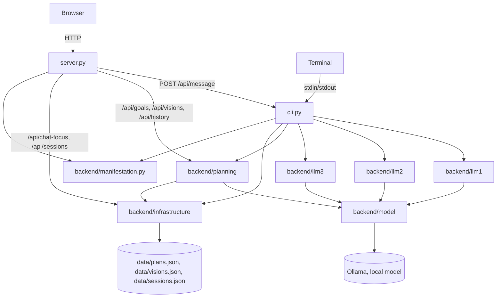

# 04 — Current State

What is true about `agent/` right now. Read this before anything else in `docs/` — see `COLLABORATION.md` for why, and for how to treat what's written here (fact vs. hypothesis vs. decision vs. open question).

This file is a snapshot, not a log — it describes the present, not how it got there. It goes stale the moment something changes; whoever changes it updates this file before finishing (see `COLLABORATION.md`, "Before finishing").

> Migration note: this is a fresh document written for `agent/`, not a migration of `current/docs/04-current-state.md` — that file described prototype 0.1 (`current/`), a different codebase. See § 6 below for exactly what `agent/` carried over from it and what it left behind, and that section's own note on `current/`'s deletion (2026-09-11) - it is no longer possible to open `current/` directly to check any of this firsthand.

## Quick Structure

What the project consists of — scannable in a few seconds. See § Visual Overview below for how the main parts connect, and § 1–2 for what each piece means and who owns what.

```text
1. ENTRY POINTS
   ├── CLI              → cli.py (terminal loop, process_turn())
   ├── HTTP server      → server.py (stdlib http.server - free conversation via
   │                       cli.py's process_turn(), plus direct, Node-1/2/3-free
   │                       routes onto Planning - see § 3.ii)
   └── Web UI           → ui/ (TypeScript, compiled to ui/dist/, eight pages:
                            Conversation, Vision, Set Goal, Active, Completed,
                            History, Sessions, Steps)

2. BACKEND
   ├── Node 1 — Interface  → backend/llm1/interface.py
   ├── Node 2 — Parser     → backend/llm2/parser.py
   ├── Node 3 — Decision   → backend/llm3/select.py
   ├── Manifestation       → backend/manifestation.py
   ├── Planning (capability) → backend/planning/ (goal/, plan/, feedback/ -
   │                       plan/ also holds step.py/zoom.py, added 2026-09-14,
   │                       reachable only from the Steps page, not from plans)
   ├── Module Library      → backend/module_library/ (built, not wired in)
   ├── Foundation          → backend/foundation/ (time/, math.py — the two Faculties)
   ├── Model boundary      → backend/model/client.py (the Ollama boundary)
   └── Infrastructure      → backend/infrastructure/data_persistence.py

3. DATA
   ├── plans.json           (goal/plan history)
   ├── visions.json         (Vision records)
   └── sessions.json        (Session metadata - added 2026-09-12; "what
                              happened" is derived at read time, not
                              separately logged - see § 3.iii)
```

## Visual Overview

How the main areas connect — not every file, function, or edge.



`cli.py`'s `process_turn()` wires Node 1 → Node 2 → Node 3 → Planning → Node 1 together for free conversation - see § 3.i. `server.py` doesn't duplicate that wiring for `/api/message`; it imports `Session`/`process_turn()` from `cli.py` directly. Its other routes (`/api/goals`, `/api/visions`, `/api/history`) call Planning directly instead, skipping Node 1/2/3 entirely - see § 3.ii for why. `/api/chat-focus` and `/api/sessions` (both added 2026-09-12) go straight to Infrastructure, bypassing Planning entirely - the former reads/writes the chat's own `ChatFocus.goal_id`, the latter derives "what happened" from Planning's own already-saved records, but neither calls into `backend/planning` itself. `cli.py`'s own `Session.__init__` also calls Infrastructure directly (`data_persistence.start_session()`), independent of `process_turn()`.

## 1. Project Structure

### i. Entry points

- `cli.py` — a terminal loop (`main()`) around `process_turn()`, the function that runs one turn through Node 1 → Node 2 → Node 3 → Planning → Node 1. Holds one `Session` for the life of the process - its own persisted `id`/`started_at` (§ 1.ii, added 2026-09-12) plus a `ChatFocus` (`chat_focus`, `goal_id`) it owns, split into its own class the same day once the two had been flattened onto `Session` directly and the shared "session" name got confusing (see § 8). If a turn still raises after `model.client.call_with_retry()`'s own retries are exhausted (§ 3.v), `main()` prints the real exception to the terminal and replies with a fixed, friendly line instead of the raw exception text (added 2026-09-11 — a raw Python exception had been standing in as "the agent's reply" until then).
- `server.py` — stdlib `http.server`, no framework, no new dependency. Serves `ui/`'s static files over `GET`. Two distinct kinds of route (added 2026-09-11/12, see § 3 for the full list and why they're shaped differently): `POST /api/message` calls `process_turn()` from `cli.py`, same one process-wide `Session` limitation `cli.py` already has; `GET/POST /api/goals[...]`, `GET/POST /api/visions[...]`, `GET /api/history` call Planning directly, keyed by an explicit id in the URL rather than session state. Same friendly-fallback-on-exhausted-retries behavior as `cli.py` for every route that calls the model, the exception printed server-side only. `GET/POST /api/chat-focus` (added 2026-09-12) is the manual bridge between the two: reads or overwrites the free-conversation `session`'s own `chat_focus.goal_id` - which goal the chat is currently "focused" on, named to keep it distinct from the Session below - otherwise invisible and unsettable from any page. `GET /api/sessions` (also added 2026-09-12) is a third kind of thing again - it reads Infrastructure's own, separate Session records, not Planning - see § 3.iii for all of these.
- `ui/` — a TypeScript UI (`src/*.ts`, compiled by `tsc` into `ui/dist/`, served by `server.py`), eight pages, no framework, no client-side router - each is its own static HTML file with its own small entry script:
  - `index.html`/`main.ts` — free conversation (`POST /api/message`). One transcript, one textarea; renders an optional plan tree beneath a reply. A chat-focus bar (added 2026-09-12, `GET /api/chat-focus`) shows which goal, if any, `cli.py`'s own `Session.chat_focus.goal_id` currently has - otherwise invisible state that decides whether the next planning message starts a new goal or is read as feedback on whatever the chat is currently focused on - with a button to clear it (`POST /api/chat-focus` with `goal_id: null`). Refreshed after every turn, not just on page load. Named "chat focus", not "session" - see § 3.iii for why.
  - `active.html`/`active.ts` — every non-completed, non-cancelled goal (`GET /api/goals`) as its own card, each with its own feedback box (`POST /api/goals/<id>/feedback`), a Vision-link dropdown (`POST /api/goals/<id>/vision` → `planner.set_goal_vision()` - every active, non-archived Vision plus "Vision: none", pre-selected to the goal's current `vision_id`, matching `frontend-legacy/templates/active_goal/_goal.html`'s same dropdown), and, added 2026-09-12, a "Cancel goal" button (`POST /api/goals/<id>/cancel` → `planner.cancel_goal()`) and a "Continue in chat" button (`POST /api/chat-focus` with this goal's id, then redirects to Conversation - the other half of `main.ts`'s chat-focus bar, § 1.i) at the bottom of the card, "Cancel goal" matching `frontend-legacy/templates/active_goal/_cancel.html`'s same placement and no-confirmation-step precedent - see § 3.ii for why this shape is immune to § 5's topic-continuity defect.
  - `set-goal.html`/`set-goal.ts` — one textarea, posts to `POST /api/goals` (`create_goal(text, "", "")` - a new goal still always starts with no Vision link; use Active's dropdown to add one afterward, see below), redirects to Active. Below the form, a plain `GET /api/goals` listing (goal text + `#<goal_id>`, one line per goal, no plan tree or feedback box) - an overview to orient among existing goals without opening Active's full cards, added 2026-09-12 matching `frontend-legacy/templates/set_goal/_goal_list.html`'s same, previously-dropped precedent.
  - `vision.html`/`vision.ts` — create (`POST /api/visions`), list active and archived separately (`GET /api/visions`), archive (`POST /api/visions/<id>/archive`, via `planner.archive_vision()` so goal-detachment still happens). Each Vision card also lists its currently-linked active goals (added 2026-09-12, client-side grouping of `GET /api/goals` by `vision_id` - no new backend route needed, matching `frontend-legacy/templates/vision/_vision_form.html`'s same `group_goals_by_vision_id()` display, "(no Goals yet)" included; only active goals, same as that precedent - completed isn't wired into this relation). Read-only here - linking or changing a Vision still only happens from Active's own dropdown.
  - `completed.html`/`completed.ts` — every completed goal (`GET /api/goals/completed`), read-only (no feedback box - a completed goal takes no further feedback).
  - `history.html`/`history.ts` — the full, unfiltered log (`GET /api/history`, every record ever saved, not just the latest per goal), plain key:value lines.
  - `sessions.html`/`sessions.ts` — added 2026-09-12, next to History. Every persisted Session (`GET /api/sessions`) as its own card: `started_at`, `ended_at` (or "(ongoing)" when `null`), and a merged, oldest-first timeline of that Session's own goal/Vision events - "goal created" vs. a feedback event is distinguished by whether `SessionGoalEvent.feedback` is `null`, matching `data_persistence.save_plan()`'s own convention. See § 3.iii for how "what happened" is derived rather than logged, and § 4/§ 8 for the window-bounding fix a live bug in this same round required.
  - `steps.html`/`steps.ts` — added 2026-09-14, last in the nav. A workbench for `step.py`'s recursive Step (§ 1.ii), not a second way to create a Goal: typed text becomes one root step (`POST /api/tree`), and every level below it is generated only when that step is clicked (`POST /api/tree/<step_id>/zoom`). Renders to whatever depth the tree actually has, and marks a step "(actionable)" once it has been zoomed and came back with no children - without that marker, an unexplored step and a settled one look identical. Its own recursive walker rather than `src/tree.ts`'s `renderNode()` (every step here is a clickable control with per-step state, which `renderNode()` has no notion of), but it imports that module's `treeLabel()` so its numbering cannot drift from the other pages. Nothing is persisted - see § 5.
  - `src/tree.ts` — the plan-tree renderer shared by `main.ts`/`active.ts`/`completed.ts`, numbered `1./2./3.` for steps and `i./ii./iii.` for microsteps (same convention as `global-standards/_CONTENT_HIERARCHY.md`, computed from list position, never stored in the data). `treeLabel()` was exported 2026-09-14 so `steps.ts` shares the numbering convention without reimplementing it; `renderNode()`/`planElement()` are unchanged and `steps.ts` does not use them.
  - `src/nav.ts` — added 2026-09-12, called once by every page's own entry script: puts a live `(N)` count next to the Vision/Active/Completed nav links (`GET /api/visions`/`/api/goals`/`/api/goals/completed`, independent of whatever the current page itself already loaded) - the three that name a concrete, countable set; Conversation, Set Goal, History, Sessions, and Steps don't (Steps holds one unsaved scratch tree, not a collection). Vision's count is active (non-archived) visions only, same "live, not terminal" scope Active already applies by excluding completed/cancelled goals.

### ii. Backend

- Node 1 — `backend/llm1/interface.py` (`respond()`): the only role that talks to the user directly. Takes the user's message and an optional plain-text `system_update` string, returns one natural-language reply. Never sees a capability's own field names.
- Node 2 — `backend/llm2/parser.py` (`understand()`): one LLM call, returns `{"about": <neutral description>}` — capability-agnostic, falls back to the raw message if the model's JSON doesn't have the expected shape.
- Node 3 — `backend/llm3/select.py` (`select_capability()`): one LLM call, returns `"planning"` or `None`, given only Node 2's `{"about": ...}`. Exactly one capability exists to select — a deliberately thin stub, not real multi-capability reasoning.
- Manifestation — `backend/manifestation.py`: `surface_text()` (the one plain-text sentence Node 1 is allowed to see) and `to_planning_node()` (an optional generic `{id, label, status, children}` tree), both pure functions of an already-existing Planning record. Shared by `cli.py` and `server.py` so there is one translation, not two.
- Planning — `backend/planning/plan/step.py` and `plan/zoom.py` (both added 2026-09-14, both reachable only from the Steps page - nothing in Planning's own flow imports either): `step.py` is one recursive `Step` dataclass used at every depth, with a stable minted `id`, its own `children`, `ordered` and `resolved`, and `to_dict()`/`from_dict()`. Depth becomes data rather than type - "Goal", "Step" and "substep" name where a step sits, not what class it is ([[planning-model.md|planning-model]] § Structural axis) - which is what the plan record's own `{"label", "microsteps": [str]}` shape cannot express, a bare-string microstep having no children, status, or identity of its own. `zoom.py` raises the resolution of ONE step on request, one level at a time, via two model calls: `is_too_coarse()` is a named verdict on whether an Action can be projected from the step yet (§ Adaptive depth's own question), and `children_of()` produces the level only once that verdict came back true. See § 8 for why two calls rather than one, and § 5/§ 9 for what it still can't do.
- Planning — `backend/planning/` (`goal/`, `plan/`, `feedback/`): the capability, originally copied from `current/backend/goals/` with import paths updated — see § 6 for exactly what did and didn't come across at that point. `plan/` itself has since changed further, 2026-09-11: `planner.py`'s two large inline prompt constants moved out to `plan_prompts.py` (prompt text only, no logic); the old `step_generator.py` (a fixed-count, content-only model call) was deleted and replaced by `plan_structure.py`, which reasons about both step count and content — including optional per-step microsteps — in one call, bounded only by a safety ceiling rather than a designed target count. See § 4 and § 8 for what this changed and why.
- Module Library — `backend/module_library/`: five reusable, LLM-backed Modules (`interpret`, `hypothesize`, `critique`, `reason`, `synthesize` in `interpretation.py`/`hypothesis.py`/`critique.py`/`reasoning.py`/`synthesis.py`, re-exported by `modules.py`), each `(text: str, purpose: str, context: str | None = None) -> dict`. Compiles cleanly, has no test file of its own, and — confirmed by search — is not imported anywhere outside itself. **Not wired into any Node.** See [[03-architecture]] Part 2 § 2.ii and [[06-development]] for the reverted Node-restructuring experiment this survived from.
- Foundation — `backend/foundation/time/` and `backend/foundation/math.py`: the two established Faculties. `math.py` unchanged from `current/`. `time/` had one thing removed 2026-09-11: `step_count()`/`MIN_STEPS`/`MAX_STEPS`/`TARGET_STEP_MINUTES` (a step-count-by-duration formula) — deleted once it was shown to collapse to a flat constant (exactly 6 steps) for any goal longer than ~2 hours, and because it was Planning-domain policy living inside the Time Faculty (confirmed by search: used only by Planning, never elsewhere in `time/`), not temporal understanding itself. That responsibility now lives in `backend/planning/plan/plan_structure.py` instead, as a reasoned model decision rather than a formula. `time/`'s own tests and `math.py`'s own tests both still pass (`python -m backend.foundation.time.test_time`, `python -m backend.foundation.test_math`).
- Model boundary — `backend/model/client.py` (`send_message()`): the one boundary every model call — every Node's own LLM call, every Planning LLM call, and, if ever wired in, every Module call — passes through. `MODEL = "qwen3.5:9b"`, unchanged from `current/`. Also holds `call_with_retry()` (added 2026-09-11): retries a caller's own "call + parse + validate" sequence up to 3 times on `ValueError` before re-raising the last one, absorbing the live-model shape instability § 4 documents. Since 2026-09-14, `send_message()` also takes an optional `schema` (a JSON Schema dict) instead of `json_mode`'s `format="json"`: a schema constrains generation itself, so a wrong *shape* cannot come back at all, where `format="json"` only guarantees valid syntax and leaves shape to the caller's own validation. Additive - every existing caller still uses `json_mode` unchanged; `planning/plan/zoom.py` is the only schema caller today. Two `call_with_retry()` callers, both in Planning (§ 3.v) — Node 1/2/3's own calls don't use it, each already has its own fallback behavior on a bad shape (Node 2 falls back to the raw message; Node 3 treats anything but exactly `"planning"` as no capability).
- Infrastructure — `backend/infrastructure/data_persistence.py`: Goal/Plan persistence unchanged from `current/`. Vision persistence (`save_vision`, `get_vision`, `archive_vision`, `load_visions`) is no longer unused — `server.py`'s Vision routes and `planner.py`'s `set_goal_vision()`/`archive_vision()` call it directly (§ 1.i, § 4). A fourth section, Session (added 2026-09-12): `start_session()` mints a `{id, user_id, started_at, ended_at}` record and appends it to `data/sessions.json` - called once per real run of `cli.py`'s `Session.__init__`, not per turn. Deliberately minimal: it does not itself log what happened during a Session - `load_sessions()` just returns these bare records; server.py's `_session_log_view()` derives "what happened" at read time from `load_history()`/`load_visions()` instead (§ 3.iii, § 8). `ended_at` is always `None` here - no graceful-shutdown hook sets it yet (§ 5).

### iii. Data

`data/plans.json`, `data/visions.json`, and, since 2026-09-12, `data/sessions.json` (`data_persistence.start_session()`, one record per real run of `cli.py`'s `Session.__init__`). `server.py`'s Vision routes call `save_vision()`/`archive_vision()` directly; `set-goal.html` still always creates a goal with no Vision link (linking happens afterward, via Active's dropdown - see § 5).

## 2. Responsibilities

### i. Entry-point responsibilities

Transport only. `cli.py` reads a line, calls `process_turn()`, prints the reply. `server.py` parses one JSON body, calls the same `process_turn()`, serializes the result. Neither decides anything about a Goal, Plan, or which capability applies — that's Node 1/2/3/Planning's job, already established in [[03-architecture]].

### ii. Backend responsibilities

This is where [[03-architecture]]'s Node/Module/Capability/Faculty/Infrastructure model is actually implemented today — three Nodes, one Capability, two Faculties, five built-but-unused Modules, one shared model-call boundary, one persistence module. See [[03-architecture]] Part 2 for the full, current definitional mapping; not repeated here.

Two things are true simultaneously and are worth stating plainly: Planning's own internal logic (Goal/Plan/Action/Feedback/Vision, `PLAN_KEYS`, Minimum Planability, ASK/SUGGEST/PLAN) is functionally identical to `current/`'s — see § 6. But almost everything *around* Planning is new: three real Nodes now sit in front of it instead of a Flask route calling it directly, and only one path into it (the free-text chat turn) is currently exercised.

### iii. Data responsibilities

Pure storage — plaintext JSON, no logic, no interpretation of what's stored. Same as `current/`.

## 3. Dependencies / Flow

### i. Browser/terminal → entry point

`server.py`: plain HTTP, one JSON route. `cli.py`: stdin/stdout. No other protocol.

### ii. process_turn() — the one real wiring

`cli.py`'s `process_turn(chat_focus, user_text)` is the entire orchestration layer - it takes a `ChatFocus` (§ 1.i), not a whole `Session`, since it never needs a Session's own `id`/`started_at`:

```text
understanding = understand(user_text)              # Node 2
capability = select_capability(understanding)       # Node 3

if capability != "planning":
    reply = respond(user_text, None)                # Node 1, direct
    return ...

record = create_goal(...) or apply_feedback(...)    # Planning
surface = surface_text(record)                       # Manifestation
node = to_planning_node(record)                       # Manifestation
reply = respond(user_text, surface)                  # Node 1, grounded
```

Which existing Planning function to call — `create_goal()` vs. `apply_feedback()` — is decided by `chat_focus.goal_id is None`, not by any Node or LLM judgment. This is stated in `cli.py`'s own module docstring as harness/orchestration glue, deliberately the crudest thing that still lets more than one kind of turn be tested — not a designed piece of the architecture.

### iii. server.py's other routes — known capability context, no Node 1/2/3

Added 2026-09-11/12, alongside `ui/`'s five new pages. Each of these routes calls Planning directly, keyed by an id the caller already has (from the URL or the request body) rather than by guessing which goal a free-text message is about:

```text
GET  /api/goals              → planning.goal.resolver.get_latest_for_all_goals(), filtered to active
POST /api/goals               → planner.create_goal(text, "", "")
POST /api/goals/<id>/feedback → planner.apply_feedback(id, text)
POST /api/goals/<id>/cancel   → planner.cancel_goal(id)
POST /api/goals/<id>/vision   → planner.set_goal_vision(id, vision_id)
GET  /api/goals/completed     → get_latest_for_all_goals(), filtered to completed
GET  /api/history             → infrastructure.data_persistence.load_history()
GET  /api/visions             → infrastructure.data_persistence.load_visions()
POST /api/visions              → infrastructure.data_persistence.save_vision(text)
POST /api/visions/<id>/archive → planner.archive_vision(id)
```

This is the "known capability context" path named in [[03-architecture]] Part 3 § 8: the caller already knows it wants Planning and already knows which goal or vision, so Node 2's "what is this about" and Node 3's "which capability" are redundant work with nothing to add — and, as a side effect, this path cannot exhibit § 5's topic-continuity defect, since it never infers which goal is meant from conversation state. `manifestation.surface_text()`/`to_planning_node()` are still reused (§ 1.ii) for shaping the response, but Node 1 never runs — the deterministic field text is returned directly, not re-voiced.

A separate pair, added 2026-09-12 as `/api/session`, renamed the same day to `/api/chat-focus` once § 3.iii's third route (below) made the shared "session" name actively confusing - two different concepts (`cli.py`'s `Session` object flattened both onto itself as sibling attributes) had ended up sharing one word. `cli.py`'s `Session` was restructured the same day to own a separate `ChatFocus` object (`chat_focus`) instead, rather than just renaming around the same flattened shape - see § 8. Doesn't touch Planning at all - it reads/writes the *other* path's own state instead:

```text
GET  /api/chat-focus → {goal_id, goal} for cli.py's Session.chat_focus.goal_id
POST /api/chat-focus → overwrites it ({"goal_id": <int|null>})
```

This is the manual bridge between the two paths: `active.ts`'s "Continue in chat" button calls it to point the free-conversation chat's focus at a specific goal before handing off to Conversation; `main.ts`'s chat-focus bar calls it to clear that state back to `None`. It does not fix § 5's topic-continuity defect (nothing here detects a *mid-conversation* topic switch) - it only makes the chat's otherwise-invisible current focus visible and gives an explicit, manual way to set or clear it, instead of only ever being set implicitly by whatever `create_goal()` last ran in the chat itself.

A third, also added 2026-09-12, doesn't touch the live `session` object's `chat_focus` at all - it reads Infrastructure's own, separately-persisted Session records instead:

```text
GET /api/sessions → every data_persistence.load_sessions() record, each merged with its own derived "what happened"
```

A fourth, added 2026-09-14, touches neither Planning nor Infrastructure - it reads and mutates one in-memory tree the server itself holds (§ 5), so nothing it does is saved:

```text
GET  /api/tree                    → the scratch tree as it stands, or {"root": null}
POST /api/tree                    → replaces it with a new root step from {"text": ...}
POST /api/tree/<step_id>/zoom     → generates that step's children in place, returns the whole tree
```

`ui/steps.html`/`steps.ts` is the only caller. `POST /api/tree` rejects text with no recognizable time phrase in it (422) *before* any model call, the same deterministic `extract_duration_phrase()` gate `planner.create_goal()` already applies - there is nothing honest to break a step into without the timeframe it has to fit inside. The real Set Goal flow answers that case with a clarification question or a proposed default instead ([[planning-model.md|planning-model]] § Minimum planability); this page deliberately doesn't reimplement either. Zoom returns the whole tree rather than just the new children (one response shape, and the tree is small), and re-zooming a step replaces its existing children - the step keeps its `id` while the understanding underneath it changes, which is the point of § Decomposition / zoom. `GET` exists so leaving the page and coming back doesn't discard work that costs two model calls per level.

`ui/sessions.html`/`sessions.ts` is the only caller. Each record's `ended_at` in the response is NOT simply the stored field (always `None` - no graceful-shutdown hook exists): `do_GET` sorts every Session by `started_at`, then bounds each one's event window at the *next* Session's `started_at`, falling back to `None` (genuinely still open) only for the single most recent one. Without this, a live bug found and fixed within this same round would have matched every subsequent event against every not-yet-"ended" Session, not just the current one - see `_session_log_view()`'s own docstring and § 8.

### iv. Backend → Data

`backend/infrastructure/data_persistence.py` is the only module that touches the filesystem under `data/`. Planning's `save_plan()`/`get_vision()`/`archive_vision()` calls go through it, same as `current/`; `server.py`'s Vision routes (§ 3.iii) also go through it directly, not via `cli.py`.

### v. Model-call boundary

`backend/model/client.py`'s `send_message()` is the single function every LLM call in the project passes through — each Node's own call, and Planning's own `ask_model()` (`json_request.py`)/`generate_structure()` (`plan_structure.py`)/`acknowledge()` (`feedback/acknowledger.py`) built on top of it. `ask_model()` and `generate_structure()` additionally wrap their own call+validate sequence in the same module's `call_with_retry()` (added 2026-09-11) — `ask_model()`'s validation now also checks each `PLAN_KEYS` value is a string or null, not just that the key is present, after a live run returned an object (`{"value": "..."}`) instead of a string for several horizon fields and passed the old, presence-only check unnoticed.

## 4. What Works

The full round trip, both directions, runs end-to-end and is what [[03-architecture]]'s top diagram documents:

```text
User → Node 1 → Node 2 → Node 3 → Planning → Node 1 → User
                            ↓ (no capability needed)
                          Node 1 → User
```

Concretely:

| Capability | File |
|---|---|
| Neutral understanding of a turn | `backend/llm2/parser.py` (`understand()`) |
| Capability routing (planning / none) | `backend/llm3/select.py` (`select_capability()`) |
| "No capability needed" short-circuit | `cli.py`'s `process_turn()` — proven, not hypothetical: a greeting or small talk returns straight from Node 1, Planning never runs |
| Goal → plan (first turn of a session) | `backend/planning/plan/planner.py` (`create_goal()` → `generate_plan()`) |
| Feedback → replan (subsequent turns) | `backend/planning/plan/planner.py` (`apply_feedback()`) |
| Step count/content, each step optionally with microsteps | `backend/planning/plan/plan_structure.py` (`generate_structure()`) — reasoned per goal (e.g. a 2-year "climb Everest" plan produces ~10 top-level steps with real microsteps under most of them; a 10-minute "drink a glass of water" plan produces 4 flat steps, none), not a duration formula — see § 8 |
| Plan saved | `backend/infrastructure/data_persistence.py` |
| Result surfaced to Node 1 | `backend/manifestation.py` (`surface_text()`) — verified: `cli.py` always calls Node 1's `respond()` last, grounded in this |
| Result rendered as a step tree, each step's microsteps as its children, when steps exist | `backend/manifestation.py` (`to_planning_node()`) → `ui/src/main.ts` (`renderNode()`) — verified through the actual running browser UI, not only backend calls |
| Temporal understanding | `backend/foundation/time/` — unchanged, own test suite passes |
| Basic arithmetic | `backend/foundation/math.py` — unchanged, own test suite passes |
| Free-conversation web UI | `server.py` (`POST /api/message`) + `ui/index.html`/`main.ts` |
| List/create active goals, give feedback, cancel a goal, link/unlink its Vision, without free text guessing which goal | `server.py`'s `GET/POST /api/goals`, `POST /api/goals/<id>/feedback`, `POST /api/goals/<id>/cancel`, `POST /api/goals/<id>/vision` (§ 3.iii) + `ui/active.html`/`active.ts`, `ui/set-goal.html`/`set-goal.ts` |
| List completed goals, read-only | `server.py`'s `GET /api/goals/completed` + `ui/completed.html`/`completed.ts` |
| Full unfiltered history log | `server.py`'s `GET /api/history` + `ui/history.html`/`history.ts` |
| Create, list, archive a Vision, and see its currently-linked active goals | `server.py`'s `GET/POST /api/visions`, `POST /api/visions/<id>/archive` + `ui/vision.html`/`vision.ts` (goals grouped client-side from `GET /api/goals`) |
| See and manually set/clear the free-conversation chat's current focus, and point it at a specific goal from Active | `server.py`'s `GET/POST /api/chat-focus` + `ui/index.html`/`main.ts`'s chat-focus bar, `ui/active.html`/`active.ts`'s "Continue in chat" button |
| Raise one step's resolution on demand, one level at a time, to any depth | `backend/planning/plan/zoom.py` (`zoom_into()`) + `backend/planning/plan/step.py` + `server.py`'s `/api/tree` routes (§ 3.iii) + `ui/steps.html`/`steps.ts` — verified through the running browser UI, 2026-09-14: a 2-year "take a master in architecture" root produced 4 top-level steps, one of which stopped immediately as actionable while another expanded into 5, so depth genuinely differed **across branches of the same goal** rather than being uniform. Scratch only, nothing saved (§ 5) |
| See every persisted Session and a derived, oldest-first timeline of what happened during it | `server.py`'s `GET /api/sessions` (`_session_log_view()`, window-bounded per Session - § 3.iii) + `ui/sessions.html`/`sessions.ts` |

"Works" means the mechanism runs correctly — the code calls the model, decides, saves, and displays a result. It does not mean the model's answers are always reliable: across this session's verification, `backend/planning/plan/test_planner.py`'s live-model assertions and `generate_structure()`'s own shape validation each failed on an occasional run (a returned step list missing an expected field, a `PLAN_KEYS` value returned as an object instead of a string) and passed cleanly on a re-run with no code change — repeatedly enough to call it an established pattern, not a one-off. Same live-model instability already documented for `current/` in its own `04-current-state.md` § 6, not a new regression here. `model.client.call_with_retry()` (§ 1.ii, § 3.v) now absorbs most of this automatically — up to 3 attempts before a caller ever sees a failure.

## 5. What's Half-Built or Not Reachable

Distinct from "not built" (§ 6) — this is code that exists and works in isolation, but nothing in `agent/`'s entry points currently exercises it:

- **Topic continuity within one process (confirmed defect, not just an unreached path)** — `cli.py`'s `Session` owns exactly one `ChatFocus` (`chat_focus.goal_id`), set once `create_goal()` first runs, and nothing ever detects that a later message has moved on to an unrelated goal. Reproduced live, twice, 2026-09-11: once when an unrelated backend test call against the same running server left a stale `current_goal_id` active before a real conversation began, once when a user typed three genuinely different goals in one browser session and the third was silently folded into `apply_feedback()` on the second, producing an incoherent reply. `GET/POST /api/chat-focus` (§ 3.iii, § 4, added 2026-09-12) makes the otherwise-invisible `chat_focus.goal_id` visible and gives a manual way to set or clear it - a real mitigation for the *first* reproduction above (a stale value from a previous, unrelated turn), since it can now be seen and cleared before it causes a wrong reply - but it does nothing for the *second*: nothing added here detects a topic switch mid-conversation, only gives a manual escape hatch once one is noticed. Fix sketched, not built, for the underlying defect itself: persist `chat_focus.goal_id` to disk (same pattern `save_plan()`/`save_vision()` already use) so it survives a server restart, and give Node 3 (or a step before it) the job of deciding whether a new message is still about the active goal or something else — today Node 2 receives no context beyond the single current message (see § 9), so nothing in the pipeline has anywhere to make that call from.
- **Vision-to-Goal linking, from Set Goal / free conversation** — resolved from both the Active and Vision sides 2026-09-12 (`active.ts`'s Vision-link dropdown makes/changes the link; `vision.ts` shows each Vision's currently-linked active goals - see § 1.i, § 4). What's still missing: `set-goal.html` still always posts `create_goal(text, "", "")` (a new goal starts unlinked, then gets linked via Active afterward, not in one step), and `cli.py`'s `process_turn()` has the same always-empty call for the free-conversation path - neither has ever offered a Vision choice at goal-creation time.
- **Multi-goal conversations** — resolved for the known-capability-context path: `active.html`/`ui/api.ts`'s `fetchActiveGoals()` calls `GET /api/goals`, which does use `get_latest_for_all_goals()` (§ 3.iii), and each goal gets its own feedback box keyed by its own id, so a user can hold several goals at once from that page. Still unresolved for free conversation: `cli.py`'s `Session` owns exactly one `ChatFocus`, so once a goal exists for a CLI/`/api/message` session, every subsequent "planning" turn there is routed to `apply_feedback()` against that same goal, with no way to start a second goal or switch from that surface alone.
- **Structured step-completion signal** — `advance_step()` (the `open`/`resolved`-per-step mechanism `current/`'s `/step` route drove) still exists in `planner.py`, but `agent/` has no equivalent route or UI control — `ui/`'s only input is free text, so a step's status can currently only change via whatever `apply_feedback()`'s free-text outcome parsing infers.
- **Accepting a `suggested_action` never produces a step tree** — confirmed live 2026-09-12: a goal that lands on SUGGEST (`generate_plan()` decided the goal's content wasn't specific enough to plan directly - see [[planning-model.md]], the authority on ASK/SUGGEST/PLAN) can only ever get a step tree by later reaching `generate_plan()`'s final `if duration:` branch, which calls `generate_structure()`. `apply_feedback()`'s acceptance branch (`_accepts_suggestion(note)` true) never takes that path - it sets `new_plan["now"] = suggested_action` directly and returns, with `steps` left `None` (planner.py's own comment on that branch: "Nothing else here is real yet"). A reply not recognized as acceptance re-runs `generate_plan()` from scratch instead (the prior suggestion and the reply passed as context) - which can itself land on another `suggested_action` rather than ever reaching the `steps`-generating branch: observed live, a chat message ("I need a plan for this") on a goal already sitting on SUGGEST returned a second, reworded `suggested_action` instead of a plan. Not a code defect in `generate_structure()` itself - the SUGGEST-acceptance branch simply has no call to it at all, by design - and this is the first time the gap was reproduced through the real `ui/` rather than only read in the code.
- **A `clarification`+`now` leak, carried over unfixed from `current/`** — `generate_plan()`'s `if plan.get("suggested_action"):` branch defensively nulls `now` ("in case the model filled it in anyway", `planner.py`'s own comment), but the `if plan.get("clarification"):` branch right above it does not - confirmed still present in `agent/backend/planning/plan/planner.py` today (2026-09-12), unchanged from a gap `current/`'s own `SESSION-TODO.md` recorded as confirmed empirically and left unfixed on 2026-09-08 (that file, and `current/` itself, no longer exist - see § 6). Effect: a response the model classifies as `clarification` can still carry a stray, unrelated `now` value alongside the question, shown together in the UI. Not reproduced live against `agent/`'s own `ui/` yet - found by re-reading the code while auditing `SESSION-TODO.md`'s remaining content, not by a fresh live test.
- **The recursive Step, and zoom, are not connected to real plans** — `step.py`/`zoom.py` and the Steps page work end to end (§ 4), but only against one in-memory scratch tree `server.py` holds process-wide: one at a time, replaced by the next `POST /api/tree`, gone on restart, and never written through `data_persistence.py`. Real Goal records still carry `plan_structure.py`'s two-level `{"label", "microsteps": [str]}` shape, so nothing a user does on Active or Set Goal produces or consumes a `Step`. Not an oversight: [[planning-model.md|planning-model]] § Decomposition / zoom explicitly leaves whether zoomed content is persisted — and if so, as a container, a tree, a replacement, or something read alongside the original Step — undecided, so the page exists to look at the shape before that call is made (§ 9).
- **Zoom cannot ask for anything** — `zoom_into()` has exactly two outcomes, children or none. [[planning-model.md|planning-model]] § Minimum planability's gate has three: KNOWN → use it, UNKNOWN and NECESSARY → **ask**, UNKNOWN but suggestible → propose a default. The third state exists in `planner.py`'s goal-creation path (`clarification`/`suggested_action`/`suggested_duration`, § 3.iii) and has no equivalent here, so a step whose decomposition genuinely depends on something personal and unstated gets a plausible invented breakdown instead of a question — observed 2026-09-14: an Everest root produced "Hire experienced Sherpa guide and finalize expedition logistics" knowing nothing about the user. That per-level asking is exactly what the necessity test describes (an unknown becomes necessary when it blocks the specific thing being produced *now*, not the Goal as a whole), so this is the gap where that test would actually apply.
- **Module Library** — five Modules, individually working (compiles, matches its contract), built and proven as reusable functions, but reachable from nothing (§ 1.ii above).
- **Session end detection** — `data_persistence.start_session()` never gets an `ended_at`: no graceful-shutdown hook exists to set one when `cli.py`/`server.py` actually stops running. `GET /api/sessions` (§ 1.i, § 3.iii) works around this by treating the *next* Session's `started_at` as a stand-in boundary for every earlier one, so the derived log is still accurate today - but a Session killed mid-run (rather than superseded by a new one) currently has no way to be told apart from one still genuinely active, beyond "is this the most recent row."
- **Vision-archive timing in the Session log** — `data_persistence.archive_vision()` only ever stamps `created_at` (when the Vision was made), never when it was archived, so `_session_vision_event()` (§ 3.iii) can only show a Vision's creation, never surface an archive event under the Session it actually happened in.

## 6. What Was Left Behind, Migrating From `current/`

**`current/` itself no longer exists.** It was deleted from the repository in commit `27eb674` ("Rename v4/ -> agent/", 2026-09-11) as an apparently unintentional side effect - that commit's own message describes only path-reference updates and says nothing about removing `current/`, which its diff nonetheless did in full (confirmed via `git log --diff-filter=D -- current/` and `git ls-tree -d HEAD -- current`; found 2026-09-12 while auditing `SESSION-TODO.md`, itself a `current/`-only artifact removed the same day - see § 10). `README.md` said otherwise ("the existing, verified prototype... own README.md to run it") until corrected the same day. Nothing that actually runs was lost - `agent/backend/planning/` and `agent/frontend-legacy/` were both copied out beforehand - but every "confirmed by diff against `current/`" claim below, and everywhere else in this project's docs, can no longer be re-verified by opening `current/` directly; take them as accurate for when they were written, not as independently re-checkable today.

`current/backend/goals/` was copied to `agent/backend/planning/` with import paths updated (`backend.goals` → `backend.planning`) and, at that point, nothing else — confirmed by diff against `current/` at the time. `planner.py`'s core Goal/Plan/Feedback/Vision logic remains that same proven logic; its step-count-and-content mechanism has since been rebuilt (§ 1.ii, § 4, § 8) and its two large prompts moved to their own file, both `agent/`-only changes with no `current/` equivalent to diff against. What did not come across in the original copy:

- **`frontend/` (the Flask app)** — `current/`'s six work areas (Conversation, Set Goal, Vision, Active, Completed, History), 23 templates, and `frontend/view_data/` are not part of `agent/` as a running app. A verbatim, frozen copy lives at `agent/frontend-legacy/` (added 2026-09-11) as reference for `agent/`'s own `ui/` — not wired to anything, not runnable as-is, not maintained going forward (see its own README's frozen-reference note). `ui/` is a from-scratch TypeScript rebuild that now covers the same six work areas (§ 1.i, § 4), built using `frontend-legacy/` as a structural reference for filter/sort/display conventions (e.g. `resolver.created_at_key()`'s sort, `frontend-legacy/view_data/goal_overview.py`'s active/completed split) — not a port of its Flask/Jinja code, which stays untouched.
- **`backend/goals/plan/action_reader.py`** — not copied; its only job (`plan.now` as a standalone CLI read) has no `agent/` equivalent yet.
- **`memory/`, `world/`** — the empty placeholder packages `current/backend/` still carries are not present in `agent/backend/` at all.
- **`data/knowledge/`** — does not exist under `agent/data/`. (`data/visions.json` now does — § 1.iii.)

(`tools/`'s `project_check.py`/`docs_check.py`/`docs_lint.py` *did* come across, since added 2026-09-11 — see the project-root `tools/`, not duplicated under `agent/`, per that tool's own docstring.)

## 7. What's Not Built

Same as `current/` — `agent/` has not extended Planning's own domain scope, only restructured what sits around it:

- **Memory** — no equivalent package exists in `agent/backend/` at all (§ 6).
- **Knowledge / RAG** — not built, no artifact of any kind under `agent/data/`.
- **Decomposition / zoom** — no longer unbuilt as a mechanism, but still unbuilt *for real plans*: `zoom.py`/`step.py` do increase a step's resolution on demand, to any depth, and are demonstrated end to end (§ 4) — against the Steps page's own scratch tree only. A real Goal's microsteps (§ 4) are still decided once, up front, alongside the step itself, and nothing on Active or Set Goal can go a level deeper than microsteps. See § 5 for the two things separating the two, and § 9 for the persistence question that has to be answered before they can be one thing.
- **Acting** — the agent reasons about what should happen; it performs no external action.
- **Continuity / proactivity** — no scheduler or background behavior; the whole chain only runs in response to a CLI line or an HTTP request.
- **A second, real capability** — Node 3's `select_capability()` can only ever return `"planning"` or `None`; nothing exists yet to demonstrate the "which one" half of its job.

For the fuller conceptual picture behind Planning's own domain concepts, see [[planning-model.md|planning-model]] — unchanged by this migration.

## 8. Current Decisions

Stable, not casually revisited (see `COLLABORATION.md`):

- LLM backend: Ollama (local, `qwen3.5:9b`), unchanged from `current/` — see [[05-decisions]] #21.
- Storage: local plaintext JSON, unchanged.
- A Node's process is defined by its own code; adaptive depth (a Module called conditionally) is decided by code reading a Module's structured output, never by a model choosing which Modules to call — see [[03-architecture]] Part 2 § 2.ii.
- Module Library stays built but unwired until a concrete Node need demonstrates it, rather than being adopted as a default pipeline — see [[03-architecture]] Part 2 § 2.ii and [[06-development]] for the reverted experiment that tested the alternative.
- Which of today's interaction surfaces should skip Node 3 once a conversation is already scoped to a known capability is not decided — see [[03-architecture]] Part 3 § 8.
- A plan's step count is a reasoned model decision (`plan_structure.py`), not a duration formula — the "code decides, the model is told" split used for Time/Math doesn't apply here, because how many meaningfully distinct steps a goal needs is a complexity judgment (climbing Everest vs. tidying a desk, same duration, very different step counts), not deterministic arithmetic. Bounded only by a safety ceiling against a malformed response, not a target range.
- Step count and step content are decided in one model call, not two — an earlier two-call version (a separate structure decision, then a separate content call) measurably destabilized the second call against the local model; this was found and fixed within this same 2026-09-11 session, not a pre-existing constraint.
- A bad model-response shape gets a bounded retry (`call_with_retry()`, up to 3 attempts) before it's treated as a real failure, rather than surfacing on the first hiccup — matches the observed pattern that these failures are transient, not systematic (§ 4). If every attempt still fails, the user sees a fixed, friendly line, never the raw exception text (§ 1.i).
- A request scoped to a known capability and a known id (a goal or vision id already in the URL, from `ui/`'s explicit-navigation pages) skips Node 1/2/3 entirely and calls Planning directly (§ 3.iii), rather than reconstructing that same context by re-running the free-conversation understand → route pipeline on a message that already carries it. Node 1/2/3 exist to figure out what an ambiguous, free-text message is about; once the caller already knows, re-deriving it is redundant work, and, in `cli.py`'s single-`Session` design, actively wrong (§ 5's topic-continuity defect can only happen on the free-conversation path, never on this one).
- The plan-tree numbering convention (`1./2./3.` for steps, `i./ii./iii.` for microsteps, `global-standards/_CONTENT_HIERARCHY.md`'s scheme) is computed at render time from a node's position among its siblings (`ui/src/tree.ts`'s `treeLabel()`), never stored in `data/plans.json` or produced by the model — the model decides step/microstep membership and content, not their eventual display numbers, so there is nothing to keep in sync if a step is ever reordered or removed.
- `GET/POST /api/chat-focus` (§ 3.iii, § 4) is a deliberately manual bridge, not an attempt at the automatic topic-switch detection § 5/§ 9 still describe as unbuilt — it only ever changes `chat_focus.goal_id` when a person clicks "Continue in chat" or "Clear", never inferred from message content. Two genuinely different problems (name a specific existing goal explicitly vs. detect an implicit topic switch in free text), addressed separately rather than folding the smaller, cheaper one into the larger, undecided one.
- "Chat focus" (`ChatFocus.goal_id`, § 1.i, § 3.iii) and "Session" (`data/sessions.json`'s own id/`started_at`/`ended_at`, § 1.ii, § 3.iii) are kept structurally separate, not just separately named: `cli.py`'s `Session` *owns* a `ChatFocus` (`session.chat_focus`) rather than flattening `goal_id` onto itself alongside `id`/`started_at`. Both the naming split and this structural split happened the same day, 2026-09-12, once the two concepts had been sharing one flattened Python object and one word ("session") and the collision became actively confusing in practice - naming alone was judged not enough once the underlying object shape was what actually caused the confusion. Two different things: which goal the chat is pointed at, vs. how long a process has been running and what happened during it.
- A Session's "what happened" log (`GET /api/sessions`, § 3.iii, § 4) is derived at read time from `load_history()`/`load_visions()`'s own existing timestamps, not a new write-path logged by every mutating route — both were already timestamped for other reasons, so reconstructing "what happened when" needed a read-side query, not new instrumentation threaded through `create_goal()`/`apply_feedback()`/`cancel_goal()`/`set_goal_vision()`/`save_vision()`/`archive_vision()`.
- A zoom's depth verdict is asked in its own model call, separately from producing the level (`zoom.py`'s `is_too_coarse()` then `children_of()`) — and measured to need to be, 2026-09-14. Asked to judge *and* decompose in one call, the local model always took the cheap branch: given a schema where "no children" was valid, it returned empty for all five test steps, a 2-year "climb Mount Everest" included. Asked only to judge, it was unanimous and correct on five of seven cases; forbidden to stop, it decomposed well. It can do either job and collapses when one call has to do both. Not a reversal of the one-call rule above: what destabilized `plan_structure.py` was a second call *consuming* the first's output, where here the verdict only gates whether the second call runs at all. See [[05-decisions]] #22.
- Where decomposition stops is asked in [[planning-model.md|planning-model]] § Adaptive depth's own words — can an Action be projected from this step yet — not in an invented paraphrase. Load-bearing, not stylistic: an earlier prompt asked whether a step was "concrete enough to just do", which the model could not judge in either direction (it called Everest finished two times in three, and once that was tightened it broke "drink a glass of water" into six steps).
- A step is never force-expanded and the user chooses what to zoom into, so a wrong depth verdict costs a zoom offered that shouldn't have been, not a wrong tree. This is why the verdict's known weak spot (§ 9) is tolerable rather than blocking.
- A Session's derived event window is bounded by the *next* Session's `started_at`, not left open until a real `ended_at` exists — found and fixed within this same 2026-09-12 session: the first version left every Session open indefinitely (since nothing sets `ended_at` yet), so any event after the second Session started matched every earlier Session's window too, not just the current one. Only the single most recent Session (no successor) is treated as genuinely still open.

Full list with reasoning: [[05-decisions]].

## 9. Open Questions

- Whether Node 1 re-voices a capability's already-conversational output verbatim or in its own words — see [[03-architecture]] Part 3 § 8.
- How much conversational context Node 2 actually needs — no longer purely untested: § 5's topic-continuity defect is a live, concrete case where the absence of any context beyond the single current message produced an observably wrong result, not just a theoretical gap. Since 2026-09-12, this is narrower than it was: it is only reachable through the free-conversation path (`cli.py`/`/api/message`) — a user who instead uses `active.html` to manage multiple goals never hits it, because that path never infers which goal a message is about (§ 3.iii, § 8). Still entirely unfixed for free conversation itself.
- Whether a structured completion signal should be rebuilt for `agent/`'s entry points, and in what form — not decided; § 5 only records that the underlying `advance_step()` mechanism already exists in `planner.py`. (Vision, multi-goal listing, and Vision-to-Goal linking are no longer open in this sense — all reachable via `ui/`, § 4 — though offering a Vision choice at goal-creation time, on Set Goal or in free conversation, specifically still is, § 5.)
- Whether solving topic continuity (§ 5) needs full conversation persistence (the still entirely unbuilt Memory Domain — § 7) or only a narrower, session-scoped form of context — no conversation transcript of any kind is saved anywhere today (confirmed by search: no such function or data structure exists), so this is currently unexplored territory, not a decision.
- Whether zoomed content is persisted at all, and in what form — unchanged from [[planning-model.md|planning-model]] § Decomposition / zoom, which states the resolution-increase framing and deliberately commits to no data shape. `step.py` now gives that shape a concrete candidate (one recursive type, stable ids, `to_dict()`/`from_dict()` already JSON-safe), but nothing decides that it is the answer, and § 5 records that no real plan uses it.
- Whether the depth verdict can be trusted without knowing anything about the person — `is_too_coarse()` judges the wording of a step, and [[planning-model.md|planning-model]] § Structural axis already says resolution is "not a property of the text itself". Its measured weak spot sits exactly where that matters: "open the document and write the first paragraph", § Structural axis's own example of an Action, was called too coarse twice in three (2026-09-14). The same blind spot has a named precedent on the temporal axis - `relative_time.py`'s own docstring defers "what an activity NEEDS (a 45-minute run and a 45-minute stretch aren't 'the same 45 minutes')" as a separate, unbuilt question - so this may be one absent input showing up on both axes rather than two independent gaps. Not decided, and not investigated beyond the observation.
- Everything already open in [[planning-model.md|planning-model]] and [[03-architecture]] Part 3 § 8 — not duplicated here.

## 10. Next Step

Tracked in `../TODO.md` (project root, not the `docs/` vault - added 2026-09-12, replacing the candidate list this section used to hold directly, same reasoning that retired `SESSION-TODO.md`, § 6): a **Queue** of every known gap/bug/unbuilt piece identified so far, numbered for a quick sense of total scope, each pointing back to the relevant section above rather than repeating its reasoning; and a small **Active** subset, populated only once something is deliberately chosen as next. Keep this file (the facts and their reasoning) and `TODO.md` (the count and what's actually being worked on) in sync in that direction - update here first when something changes, then `TODO.md` if the item's status changes too.
