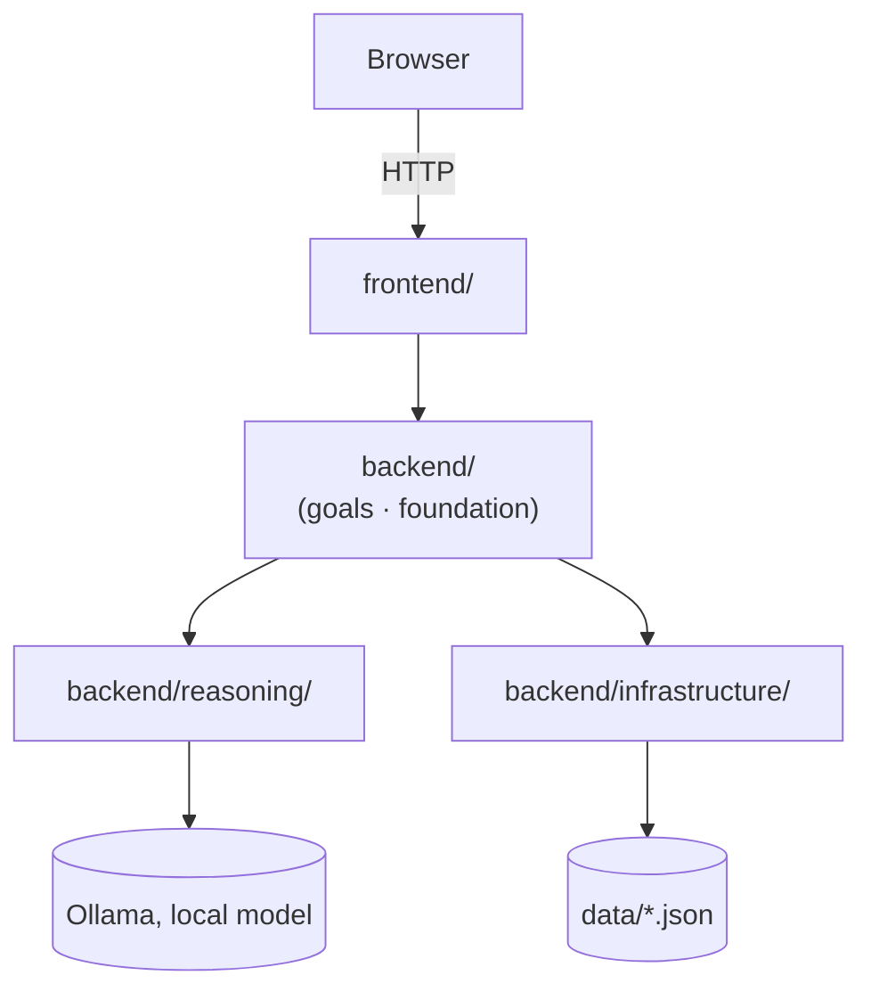

# 04 — Current State

What is true about the project right now. Read this before anything else in `docs/` — see `COLLABORATION.md` for why, and for how to treat what's written here (fact vs. hypothesis vs. decision vs. open question).

This file is a snapshot, not a log — it describes the present, not how it got there. It goes stale the moment something changes; whoever changes it updates this file before finishing (see `COLLABORATION.md`, "Before finishing").

## Quick Structure

What the project consists of — scannable in a few seconds. See § Visual Overview below for how the main parts connect, and § 1–4 for what each boundary means and who owns what.

```text
1. FRONTEND
   ├── Application      → frontend/app.py
   ├── Templates        → frontend/templates/
   ├── CSS              → frontend/css/
   └── view_data/       → goal_overview.py / text_formatting.py / plan_horizons.py

2. BACKEND
   ├── Goals
   │   ├── Goal         → goal/resolver.py
   │   ├── Plan         → plan/
   │   └── Feedback     → feedback/
   ├── Foundation       → time/ (the established Faculty)
   ├── Reasoning        → model_client.py (the Ollama boundary)
   ├── Infrastructure   → data_persistence.py
   └── memory/, world/  — empty placeholders

3. DATA
   ├── plans.json
   ├── visions.json
   └── knowledge/       → example_chunks.json (sketch, unused)

4. TOOLS
   ├── project_check.py
   ├── docs_check.py
   └── docs_lint.py
```

## Visual Overview

How the main areas connect — not every file, function, or edge. § 3 below has the full, verified dependency detail, including the direct Frontend → Infrastructure edge this simplified view leaves out.



## 1. Project Structure

### i. Frontend

- Application entry point — `frontend/app.py`: Flask setup, Jinja global/filter registration, seven routes (`/`, `/vision`, `/goal`, `/feedback`, `/step`, `/history`, `/completed`), and the CLI entry point (`-m frontend.app`).
- Templates — `frontend/templates/`, 14 Jinja templates organized by page: `index.html`, `set_goal/`, `active_goal/`, `completed_goal/`, `goal_log/`.
- CSS — `frontend/css/style.css`.
- View-data modules — `frontend/view_data/goal_overview.py` (groups/composes goals for the overview page), `frontend/view_data/text_formatting.py` (pure text formatting for display), `frontend/view_data/plan_horizons.py` (Plan-horizon labels for the UI). Prepare already-decided backend information for `templates/` to render — not the views themselves.

### ii. Backend

- Goals — `backend/goals/goal/resolver.py`: goal identity/history reading (`get_latest_for_goal`, `get_latest_for_all_goals`, `get_history_for_goal`).
- Plans — `backend/goals/plan/`: `planner.py` (goal → plan, `replan()`, and the decision logic behind creating a goal and reacting to feedback), `model_client.py` (Plan-specific JSON-shape validation on top of Reasoning), `step_generator.py` (fills in a plan's step list), `action_reader.py` (reads the current Action from the latest plan).
- Feedback — `backend/goals/feedback/`: `feedback_parser.py` (deterministic outcome/duration-change parsing), `acknowledger.py` (display-only acknowledgment via Reasoning, for feedback `feedback_parser.py` can't classify).
- Infrastructure — `backend/infrastructure/data_persistence.py`: saves/loads `data/plans.json` and `data/visions.json`.
- Reasoning — `backend/reasoning/model_client.py`: the one call to the local Ollama model every other component goes through.
- World / domain areas — `backend/foundation/time/` (the established temporal-understanding Faculty, split into `time_data/`/`time_logic/`), `backend/memory/` (empty), `backend/world/` (empty).

### iii. Data

`data/plans.json`, `data/visions.json` — local, git-ignored. `data/knowledge/example_chunks.json` also exists, a leftover sketch artifact — no backend code reads it yet (Knowledge/RAG is not built, see § 7).

### iv. Tools

`tools/project_check.py`, `tools/docs_check.py`, `tools/docs_lint.py` — standalone dev utilities, no runtime relationship to the agent.

## 2. Responsibilities

### i. Frontend responsibilities

Receive an HTTP request, read/validate form input, call one backend function per route, choose a template, redirect. No domain decisions — the view-data modules (`goal_overview.py`, `text_formatting.py`, `plan_horizons.py`) shape how data is displayed, they don't decide anything about a Goal, Plan, or Vision.

### ii. Backend responsibilities

Own every Goal/Plan/Vision/Feedback decision and its persistence. This is where the architectural concepts from `03-architecture.md` — Domains, Faculties, Infrastructure — are actually implemented today.

The only established Faculty is **temporal understanding** (`backend/foundation/time/`). Time (the Domain) and temporal understanding (the Faculty) are related but distinct: Time is what the system operates on, temporal understanding is the capability the agent uses to make sense of it. No other Faculty is established yet — speculative empty scaffolds for unproven Faculties (formerly `foundation/language/`, `foundation/meaning(maybe)/`) were removed 2026-08-27 rather than kept as placeholders; a Faculty is added only once real code earns it through demonstrated reuse, not proposed ahead of any.

**Vision** (added 2026-08-26) is a fifth concept, deliberately none of the above — not a Domain, Faculty, or pipeline stage. It's optional, cross-goal context (`data/visions.json`, an optional `vision_id` on a Goal record); see `03-architecture.md` § Vision for what it is and isn't. The conceptual model is **Vision / Goal / Plan / Action / Feedback** — "Action" replaces "Task"/"today's action" as the term used across docs and the UI (the `right_now` field name is unchanged, still embedded in persisted data/the LLM prompts — see `06-development.md`, 2026-08-20, for why).

`data_persistence.py` is Infrastructure, not a Faculty: it stores and retrieves data without understanding what it represents.

Full architectural definitions and relationships: `03-architecture.md`.

### iii. Data responsibilities

Pure storage — plaintext JSON, no logic, no interpretation of what's stored.

### iv. Tools responsibilities

Deterministic, mechanical checks (git status, imports, pyflakes, stale path mentions, docs structure) — no runtime relationship to the agent, and no judgment about whether the project's design is correct.

## 3. Dependencies / Flow

### i. Browser → Frontend

Plain HTTP request/response — form submissions and page renders, no other protocol.

### ii. Frontend → Backend

`frontend/app.py` imports directly from four backend areas:

```text
from backend.foundation.time import describe_duration, duration_progress, step_plan
from backend.goals.goal.resolver import get_history_for_goal, get_latest_for_goal
from backend.goals.plan.planner import advance_step, apply_feedback, create_goal
from backend.infrastructure.data_persistence import load_history, load_visions, save_vision
```

The last import is a direct Frontend → Infrastructure edge for these three specific read/write calls — it bypasses `backend.goals` rather than going through it.

### iii. Backend → Data

`backend/infrastructure/data_persistence.py` is the only module that touches the filesystem under `data/`. Every other backend module that persists something goes through it:

- `backend/goals/plan/planner.py` — `save_plan`, `save_vision`
- `backend/goals/goal/resolver.py` — `load_history`
- `backend/goals/plan/action_reader.py` — `get_latest_plan`

### iv. Relevant module relationships

`backend/reasoning/model_client.py` (`send_message()`) is the single boundary every model call passes through. Three independent modules call it:

- `backend/goals/plan/model_client.py`
- `backend/goals/plan/step_generator.py`
- `backend/goals/feedback/acknowledger.py`

`backend/goals/plan/planner.py` also imports `backend/goals/feedback/feedback_parser.py` and `backend/goals/feedback/acknowledger.py` directly, for the feedback-handling logic it now owns (`apply_feedback()`, `advance_step()`).

## 4. Architectural Boundaries

### i. What belongs in frontend

Routing, reading HTTP input, choosing a template, redirecting, and view-data preparation (the three modules in § 1.i).

### ii. What belongs in backend

Domain decisions (what a Goal/Plan/Vision/Feedback record should look like or become), persistence, and model calls.

### iii. What should not be moved into backend

`frontend/view_data/goal_overview.py`, `frontend/view_data/text_formatting.py`, `frontend/view_data/plan_horizons.py` — view-data preparation logic with no backend dependency beyond reading already-decided data (`goal_overview.py`'s only backend import is `backend.goals.goal.resolver`, for reading, not deciding). Moving them into `backend/` would put view preparation inside the agent's own domain logic.

### iv. What should not be placed in frontend

Anything that decides and then persists — the boundary `create_goal()`, `apply_feedback()`, and `advance_step()` in `backend/goals/plan/planner.py` were built to enforce: a route reads input and calls one of these, it doesn't itself decide what the resulting Goal/Plan should be.

## 5. What Works

Prototype 0.1's full loop is closed end-to-end:

```text
Goal
 ↓
Plan
 ↓
Action
 ↓
User feedback
 ↓
Replan
 ↓
New action
```

Concretely:

| Capability | File |
|---|---|
| Goal → plan | `backend/goals/plan/planner.py` (`generate_plan`) |
| Plan saved | `backend/infrastructure/data_persistence.py` |
| Action (right now) | `backend/goals/plan/action_reader.py` reads `plan.right_now` |
| User reports progress | `frontend/app.py` (`/feedback`) |
| Plan adjusts | `backend/goals/plan/planner.py` (`replan`) |
| Temporal understanding | `backend/foundation/time/` |
| Vision created / linked to a Goal | `frontend/app.py` (`/vision`, `/goal`) |
| Local web UI | `frontend/app.py` — vision form, goal form, feedback, per-step done/no, history, completed |

"Works" means the mechanism runs correctly — the code calls the LLM, saves, and displays a result. It does not mean the LLM's answers are always accurate; it has already been caught hallucinating a specific, unfounded detail (see `06-development.md`).

## 6. What's Half-Built

- **Vision** — create and link-to-a-goal are built; editing/deleting an existing Vision is not. A Goal's Vision is never actually supplied to the LLM yet (`generate_plan()`/`replan()` both ignore `vision_id`) — deliberate for now, see `03-architecture.md` § Vision.

## 7. What's Not Built

- **Memory** — the agent doesn't yet use its own history; `memory/` is an empty placeholder (a Domain, not nested under `foundation/`).
- **Hierarchical step list** — a goal's plan is currently one flat step list, not nested phases with their own sub-steps.
- **Knowledge / RAG** — sketched, not implemented; `data/knowledge/example_chunks.json` exists as an early sketch artifact, not read by any backend code yet.
- **Acting** — the agent reasons about what should happen; it doesn't yet perform external actions such as creating files or calling APIs.
- **Live external data** — `world/` is a deliberate empty placeholder.
- **Goal auto-completion** — finishing every step does not automatically mark a goal complete; the user still confirms explicitly. Deliberate, not an oversight.

## 8. Current Decisions

Stable, not casually revisited (see `COLLABORATION.md` rule 4):

- LLM backend: Ollama (local, `llama3.1:8b`), not a paid API — no cost, no internet dependency.
- Storage: local plaintext JSON, append history, never overwrite. Not moving to SQL.
- Feedback outcome (action_completed/action_not_completed/action_in_progress/goal_completed) is parsed deterministically, never left to the LLM to judge.
- Testing on real use takes priority over adding more features.
- Vision is optional, lightweight context (an id+text store, an optional foreign-key-style reference on a Goal) — not a relational hierarchy, not duplicated free text per goal.

**Security status:** whole-disk encryption via macOS FileVault is on for this machine (covers the "stolen/lost laptop" scenario). No application-level encryption of `data/plans.json` itself yet — deferred until this becomes a multi-user or cloud product, see `05-decisions.md`. No encryption in transit — not relevant while Ollama is local-only.

Full list with reasoning: `05-decisions.md`.

## 9. Open Questions

- Flat vs. hierarchical step list — not designed, needs its own pass.
- Should a goal auto-complete when every step is done? Real tension between one-shot goals and ongoing habit goals, not resolved.
- Future Faculties should emerge from demonstrated reuse, not be predetermined now — none beyond temporal understanding are settled.
- Visual design — wants a holistic pass, not one color fixed at a time.
- Whether/how a Goal's Vision ever gets summarized into the LLM's context when planning/replanning — deliberately not decided or built yet, see `03-architecture.md` § Vision.
- Whether editing/deleting an existing Vision is worth building, once there's real usage to learn from.

## 10. Next Step

1. Pick one of Memory / hierarchical steps / Knowledge-RAG / Acting to actually build — not more than one at a time.

(The Action/Task/`right_now`/"today's task" terminology drift an earlier architectural pass flagged as worth resolving before picking one of these is now done, alongside implementing Vision — see `06-development.md`, 2026-08-26.)
