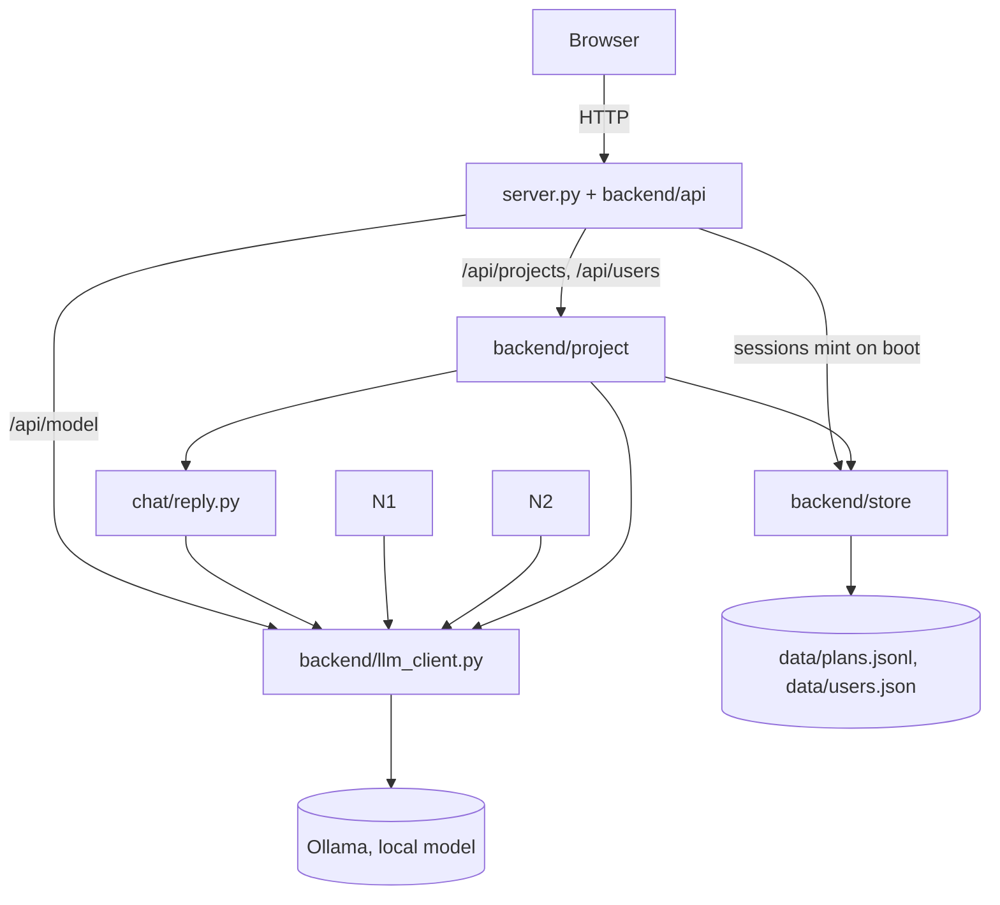

# 04 — Current State

What is true about `app/` right now. Read this before anything else in `docs/` — see `COLLABORATION.md` for why, and for how to treat what's written here (fact vs. hypothesis vs. decision vs. open question).

This file is a snapshot, not a log — it describes the present, not how it got there. It goes stale the moment something changes; whoever changes it updates this file before finishing (see `COLLABORATION.md`, "Before finishing").

> Migration note: this is a fresh document written for the application root (now `app/`, renamed from `agent/` on 2026-09-19), not a migration of `current/docs/04-current-state.md` — that file described prototype 0.1 (`current/`), a different codebase. See § 6 below for exactly what was carried over from it and what was left behind, and that section's own note on `current/`'s deletion (2026-09-11) - it is no longer possible to open `current/` directly to check any of this firsthand.

## Vocabulary (Planning → Project)

Older docs and conversations say **Planning**, **Goal**, and **map**. The product capability is now **Project**; the same mechanisms still apply under new folder names. Translate with this table (settled [[05-decisions]] #28):

| Older label | Read as today | Code / note |
|---|---|---|
| Planning (capability) | **Project** | `backend/project/` |
| Goal (product unit) | **Project** | Wire: `project_id` / `/api/projects` only ([[05-decisions]] #29; `/api/goals` + response `goal_id` mirror removed 2026-09-20) |
| map / WHAT progression | **canvas** | `project/panes/canvas/` |
| plan folder / Decide–Fill | **gone** | leftover names on disk (`plan`, `duration`, `frozen_duration`); no `project/engine/` |
| Active board | **Projects** UI | `index.html` |
| llm3 / free conversation | **Removed 2026-09-20** | Conversation page, `/api/message`, `cli.py`, `process_turn`, Node 3 deleted; chat is Projects-only ([[05-decisions]] #31) |
| Vision (optional link) | **Simulated user `id#N`** | Wire: `sim_user_id` / `/api/users` / `data/users.json` ([[05-decisions]] #30); stub plan `user_id` still `DEFAULT_USER_ID`; UI filters projects by active user |

Planning became the **product** Project. Decide/Fill (the old engine) is gone. Dated history in `06-development.md` and older decision entries keeps the old words on purpose. Phase A + Phase B of [[goal-to-project-migration]] are done (including dropping `/api/goals` and the response `goal_id` mirror); remaining cleanup is renaming the display field `goal` / Python symbols. Simulated multi-user (`id#N`) filters the Projects sidebar; the sidebar shows a local `#1…n` ordinal per active id (wire `project_id` unchanged in parentheses — UI only, [[05-decisions]] #30).

## Quick Structure

What the project consists of — scannable in a few seconds. See § Visual Overview below for how the main parts connect, and § 1–2 for what each piece means and who owns what.

```text
1. ENTRY POINTS
   ├── HTTP server      → server.py (entry) + backend/api/
   │                       (requests_from_browser, answers_to_browser,
   │                       activity_log) — known-context Project routes
   │                       and the activity log — see § 3)
   └── Web UI           → ui/ (TypeScript, compiled to ui/dist/; primary
                            home is Projects — sidebar (id menu + list +
                            create) | canvas + project tabs | chat — plus
                            Settings (General → About-style facts
                            incl. model; Directory → JSON-ish wire
                            inspect))

2. BACKEND
   ├── API (HTTP adapter)  → backend/api/ (requests_from_browser.py, answers_to_browser.py, activity_log.py, files_to_browser.py)
   ├── Project (capability) → backend/project/ (panes/{create,canvas,chat}
   │                       — panes mirror Projects UI;
   │                       chat/reply.py is one Send;
   │                       chat/model_input/ is what the model is sent;
   │                       chat/screen/ is the chat thread + talk chart)
   ├── Foundation          → backend/foundation/ (time/, math.py — the two Faculties)
   ├── Model boundary      → backend/llm_client.py (the Ollama boundary)
   └── Store               → backend/store/ (data_persistence.py)

3. DATA
   ├── plans.jsonl           (goal/plan history)
   └── users.json           (simulated users; legacy visions.json promoted on load)

   The activity log (Settings → Logs) is read from plans.jsonl; nothing
   is logged separately.
```

## Visual Overview

How the main areas connect — not every file, function, or edge.



Product chat is **Projects-only**: `POST /api/projects/<id>/feedback` → `project/panes/chat/reply.py` (`reply()`: one plain chat call with map + earlier turns; not a plan door). Free conversation (`/api/message`, Conversation page, `cli.py`, `process_turn`, Node 3) was removed 2026-09-20 (#31). Persistence lives under `backend/store/`.

## 1. Project Structure

### i. Entry points

- `server.py` — thin process entry: binds `ThreadingHTTPServer` to `backend.api.requests_from_browser.Handler`. Request handlers and the JSON the screen gets live under `backend/api/` (`requests_from_browser.py`, `answers_to_browser.py`, `activity_log.py`; renamed from `routes.py` / `views.py` 2026-09-25). `ui/` files (HTML/JS/CSS) are handed out by `api/files_to_browser.py`, kept apart from the `/api/...` requests; `Handler.error_message_format`/`error_content_type` keep 4xx/5xx as plain text for the UI. Known-context Project/users routes — see § 3.iii. Free conversation (`/api/message`, chat-focus, CLI) removed 2026-09-20 (#31).
- `ui/` — a TypeScript UI (`src/*.ts`, compiled by `tsc` into `ui/dist/`, served by `server.py`), no framework, no client-side router - each page is its own static HTML file (`ui/index.html`, `ui/settings/*.html`; moved up from `ui/pages/` 2026-09-25) with its own small entry script. **Primary surface (2026-09-17; map/chat focus 2026-09-18; wire `project_id` 2026-09-20; sidebar id menu 2026-09-20):** `index.html` / `src/index.ts` (renamed from `projects.html` / `pages/projects.ts` 2026-09-25) — Notion-ish shell over Project records (`project_id` only on the wire): left **sidebar** = active `id#N` brand + in-flow id overview menu (`src/panes/create/manager/`: switch/create users, list projects per id; open remembered in `localStorage`, closes only via Manager; optional list-height pin on the Manager | Projects separator) + quiet **Create** (`POST /api/projects`; empty name → `New project N` via `panes/create/defaultNames.ts`, display strips a legacy `#`) + project list (local `#1…n` via `src/panes/create/projectOrder.ts`, titles via `displayProjectTitle`, wire id in parentheses); center **project map** (canvas expression 2026-09-21: wire `#N` → project title → optional tree from `plan.progression`), or the **Create pane** when nothing is open or the sidebar's Create was pressed (`src/panes/create/createForm.ts`, 2026-09-22 — the project you came from stays selected in the sidebar, which is the way back); right full-height chat (`POST /api/projects/<id>/feedback`, optional `focus_label` / `focus_step_id`). Live map is DOM rows (`panes/canvas/drawNodes.ts`) + nest strokes (`panes/canvas/lines/` — anchor to bead-box edges); empty project lands at natural size (1×) in Text (not a zoomed-out overview of empty space); **Copy as ASCII** exports ordinary text (`panes/canvas/copyAsText.ts`); **Paste structure** (added 2026-09-19) is the way back in — an outline or ASCII tree (e.g. another LLM's answer) pasted into a form (`panes/canvas/pasteForm.ts`), parsed by `text_to_tree.py`, appended under the selected node or the root (`POST .../progression/import`). Three entry points into the same import: the topbar-level form (any node or the root; opens with a `scrollIntoView` so it's reachable from a menu click deep in a long tree), the node **⋯** menu's own **Paste structure** (pre-targets that node), and sending multi-line text from chat while a node is focused — tried **on Send**, not on paste itself (a paste only fills the compose box, same as typing, so an accidental or exploratory paste never fires on its own); falls back to an ordinary chat message if nothing recognizable parses out. The topbar/menu form previews as the user types/pastes (debounced `POST /api/parse-outline-preview`) into a working `PreviewNode[]` tree where **every** node, not just the outer title, renders muted and clickable — click any label to drop it and promote its children to where it stood, or click again to bring it back (`previewTreeElement()`/`applyExclusions()`; only the single droppable outer title starts pre-excluded, matching `parse_outline()`'s own default guess). Import then sends the user's exact edited tree directly (`POST .../progression/import` with a `nodes` forest, not `text` — `import_progression_outline()`'s `forest` param, bypassing `parse_outline()`/`unwrap` entirely) rather than re-parsing raw text server-side, so what gets created matches exactly what was previewed (added 2026-09-19 — see § 8). The chat-Send path has no preview, so it doesn't guess at all: `unwrap=false` always (fixed 2026-09-19 — was the default `unwrap=true` guess, which chat has no way to catch or correct if wrong, unlike the form). Everything typed/pasted becomes a real node; an unwanted wrapper is a visible, reversible remove away, not a silent loss. Map: click a node to **select** ("Looking at: …") — does **not** auto-zoom; click empty map space to clear selection. Bead chrome is a light box around label + **⋯**; **Add here** / **Remove** / **Suggest structure** / **Talk about this** / **Paste structure** live in that menu (`POST .../progression` with optional `parent_id`, `POST .../progression/<id>/remove` — no LLM for add/remove). A spine-level **+** under the tree still adds a root waypoint. Focused chat names that node to the chat model; asking for ideas under focus can mint children via chat-grounded suggest (`suggest_progression_from_chat`); consecutive focused turns render as framed **About "…"** blocks in the thread (`map_focus` / `focus_step_id` stamped on history; click a frame re-selects the node). Each About-frame also has a **Show only this →** button (added 2026-09-19) that filters the thread to just that focus label's messages, with a banner and **← Show full conversation** button to return; returning restores the scroll position the user was at before isolating (`preIsolationScrollTop`) instead of snapping to the bottom, which every other thread re-render still does. Sidebar and chat columns are both resizable (`columnWidths.ts`, widths in `localStorage`). Action/`now` is not parked above the map. Frame chrome since 2026-09-22 is two full-width rules, not a box: a sticky top bar inside the frame (`×` close, `↑` back to top — scrolling over the strip also goes to top — then grain `−`/`+` and Text|Line) that the tree pans underneath, and a bar below the canvas holding **Copy as ASCII** / **Paste structure** / **Read map** on the left and **Archive** on the right. Grain and Text|Line survive a page refresh per project (`localStorage`), as does which project was last open per `id#N`. `GET /` serves `projects.html`. Other pages:
  - Simulated users (`id#N`): sidebar brand label `Manager` (`ID_BRAND` in `activeId.ts`) + in-flow menu (`src/panes/create/manager/`: switch/create/delete=archive, id columns + ⋯). Open state survives refresh (`localStorage`); closes only via the Manager brand (not outside click, Escape, or picking a project). `?tab=users` / `?tab=vision` still opens that menu. Wire: `/api/users`, `data/users.json`. Since 2026-09-22: the sidebar's own `#project-list` (under the Projects brand) has its own manual show/hide, independent of Manager — a `#project-list-toggle` button (labeled "Projects", styled like the Manager brand button) flips `listManuallyOpen` (remembered in `localStorage` under `projects.listOpen`); `renderList()` in `src/index.ts` hides/shows the list and the toggle's `is-active` state from that flag alone. (An earlier version of this also force-hid the list whenever Manager was open, to avoid it duplicating Manager's own per-id project columns; reverted the same day once the manual toggle made that automatic coupling unwanted — the two panels can now be open together.) Also since 2026-09-22: the Manager panel ends with a plain one-click id mint — `buildCreateIdButton()` (`panes/create/manager/newIdButton.ts`, was `buildCreateIdForm`) dropped its "Optional label…" input, so minting an id is a single "+" click (`createUser("user")`) with no typing step, using `userLabel()`'s existing "user" → `id#N` display fallback — same one-click-with-autoname shape as empty-name project Create. Renaming an id after creation is not yet built. The Create entry (`#create-open`, opens the Create pane) is a "+" rather than the word "Create" — the same square glyph as the Manager panel's id mint, sharing one `.sidebar-add` rule (`sidebar.css`; `.sidebar-id-menu-create` in `idMenu.css` now carries only its own extra top spacing). It sits at the foot above Settings (`margin-top: auto` on `#create-open`), not under the Projects header. Which section a "+" belongs to is read from where it sits. Both are `getElementById`-based, so neither the move nor the relabel changed behavior. The sidebar has two edge-to-edge rules, no background tint or boxed frame around any part. Projects | Settings is `.sidebar-more::before` (bleeds past `.sidebar`'s own inline padding via `left`/`right: calc(-1 * var(--space-3))`) — a plain rule, nothing draggable. Manager | Projects is `.id-menu-resize` (`sidebar.css`; markup in `index.html`, wired through `IdMenuOptions.resizeHandle`): one element that is both the rule and the drag handle for the Manager panel's height, built as the horizontal twin of `.sidebar-resize`/`.chat-resize` (`css/shell/layout.css`) — a real `role="separator"` **between** `#sidebar-id` and `#project-list-toggle` rather than a strip inside the panel, so it spans the sidebar's full width without fighting any container's `overflow`. The element itself is the 1px line; its `::before` only widens the drag target; hover and `body.is-resizing-id-menu` turn it `var(--color-accent)`. `manager/index.ts` shows and hides it with the panel (it marks a live resize target, not a permanent structural divider) and passes it to `installResize()`, which is unchanged — it always took its handle as a parameter. `#project-list-toggle` (the "Projects" show/hide button, `src/index.ts`) owns no rule of its own, so the line is never also a click target for something unrelated. Dragging it pins the id list's **height** (not only `maxHeight` — a max alone cannot grow past content, so the Settings auto-margin stayed unreachable). Ceiling per drag is current list height plus what can still be stolen from `.project-list` and the slack above the project "+" (`margin-top: auto` on `#create-open`); measured once per drag. What keeps the Projects header, the "+", and Settings visible is CSS — `.project-list` has `flex-shrink: 100` so it yields first, while those three are `flex: 0 0 auto`. Extra list height past the cards stays empty scroll space: `.sidebar-id-menu-list` uses `align-content: start` so id columns stay packed under each other instead of stretching toward the handle. Earlier same-day attempts kept the handle inside `.sidebar-id-menu` and tried to reach the sidebar edges from there — one was clipped by the nested `overflow: hidden`, and one relaxing `overflow-x` to `visible` hit the CSS Overflow spec rule that resolves a `visible`/non-`visible` axis pairing to `auto`, producing a real (and unwanted) horizontal scrollbar. Moving the element out from under those containers removed the constraint rather than working around it. Sidebar and chat also each start with a `.column-top-bar` (`css/shell/layout.css`) — an empty strip matching the canvas's own `.map-top-bar` in height and rule, so a horizontal line lands at the same height in all three columns; purely visual, no controls in it yet. The sidebar's footer does the same at the bottom: `.sidebar-more` mirrors `.map-copy-row`'s `min-height: 1.75rem` + `border-top` and bleeds past `.sidebar`'s padding on three sides to sit flush in the frame, so the Settings rule meets the canvas's bottom-bar rule. For that to hold on a project with no tree yet, the empty-canvas hint (`.project-hint`, "Add steps with +…") moved above `.map-copy-row` rather than below it — the bar is a status line flush with the column bottom (`css/panes/canvas/pane.css`), and a paragraph under it pushed that line off. `.sidebar-more` also opts out of `css/base.css`'s generic `nav` bottom border, which is there for the Settings pages' top nav.
  - `settings/general.html` / `src/settings/general/` — **Settings → General**: Appearance (light/dark via `user/theme.ts` + `tokens.css` `[data-theme]`) then model facts. Shared chrome: `css/settings/chrome.css`. Sidebar footer links here. (The old flat `settings.html` / `model.html` redirect pages were removed 2026-09-25.)
  - `settings/directory.html` / `src/settings/directory/` — **Settings → Directory**: Id left / projects right. Flat `directory.html` redirects here.
  - `settings/logs.html` / `src/settings/logs/activity.ts` — **Settings → Logs**: activity log, every saved change newest first (`GET /api/log`). (The old `log.html` redirect page was removed 2026-09-25.)
  - Shared register UI: `src/settings/paragraphs/` — `registerTemplate.ts` (visual recipe: title + facts for all three tabs) + `lineKinds` / `drawLine` / `arrange` / `liveAge`; styles in `css/settings/paragraphs.css`.
  - `src/panes/canvas/` — Projects live map (canvas): `drawNodes.ts`, `spacing.ts`, `nodeFamily.ts`, `copyAsText.ts`, `pasteForm.ts`; `zoomAndPan/` (chrome: grain −/+ + Text|Line; camera: furthest = visible grain in frame, closest = 1×; empty project → 1× + Text); `lines/` (shared nest SVG; content measure excludes overlay / frame width); `lineView/` (view mode — Line forced below ~20% zoom; toolbar pin keeps Text|Line until the opposite zoom threshold) + `css/panes/canvas/skeleton.css`. Styles: `css/panes/canvas/`. Column roles / layout: [[surfaces]].
  - `src/shell/` — `columnWidths.ts` (three-column rules sidebar|map|chat; `maxFraction` caps; chat via `installChatResize` → `collapseToRail.ts`: hard min while open, edge-trigger collapse/expand, collapsed icon rail + grip); `busyButton.ts` + `css/shell/spinner.css` / `columnRail.css`. Project tabs (`tabs/tabStrip.ts`, `css/shell/tabs.css`, `#project-topbar`) removed 2026-09-22: only ever one project is open at a time, so the strip was a second copy of the sidebar selection. Close moved into the map's own top bar.
  - `src/panes/create/` — `manager/` (switch/create/delete `id#N`, column overview; open remembered; brand-only close; `resizeList.ts` pins Manager list height via the Manager | Projects separator — separate from shell column widths); `projectOrder.ts` (local `#1…n` labels).
  - `src/panes/create/` — `createForm.ts` (middle-column mint; sidebar **Create** opens it); `defaultNames.ts` (empty field → `New project N`; display strips a legacy `#` in that pattern).
  - `src/user/` — `activeId.ts` (`ID_BRAND`, active `id#N` in `localStorage`); `theme.ts` (light/dark preference → `html[data-theme]`).
  - `css/panes/create/` — `sidebar.css` (rail chrome + `.id-menu-resize` + Create entry + list + Settings footer); `idMenu.css` (Manager panel; id grid `align-content: start`).
  - UI look tokens: `css/tokens.css` (imported first from `css/style.css`; light default + `[data-theme="dark"]`); areas mirror `src/` (`shell/`, `panes/create/`, `panes/canvas/`, `panes/chat/`, `settings/`). Identity direction “ink on stone”; general vs area ownership — [[visual-reset]]. Design principles (hierarchy → glass → complexity budget) — [[visual-principles]]. Column roles + canvas layout — [[surfaces]]. Scrollbars are thin everywhere, not just the browser default (`css/base.css`, global `*` rule — `scrollbar-width`/`scrollbar-color` + `::-webkit-scrollbar*`), added 2026-09-23 once the wide OS bar stood out against every scroll container (sidebar id columns, project list, chat thread, map viewport).
  - `src/panes/chat/messageRow.ts` — shared You/Agent message DOM row (Projects).
  - `src/panes/chat/showOnlyThis.ts` — About-frames and "Show only this" filter for the Projects chat thread (uses `messageRow`).
  - `src/panes/chat/talkChart/` — chat chart in the chat column: same beads as the file map (`treeWordsElement`; from `talk` on the project view; click isolates that stretch). Not written into `progression`. Height pin via `talkChart/resizeChart.ts`. Talk brand toggles the pane like Manager — open/height are shell-global in `localStorage` (not per project); an open empty pane still shows the resize handle. Hidden with the thread when the chat rail is collapsed. Styles: `css/panes/chat/chart.css`.

### ii. Backend

- Chat — `backend/project/panes/chat/` (rebuilt 2026-09-25, [[05-decisions]] #33). `reply.py` `reply()` is one Send: when a node is selected and the note asks for structure (a keyword list), children are suggested onto it (`suggest_progression_from_chat`, canvas) and the reply is a fixed "Added under …" line; otherwise one `send_chat()` call answers. `model_input/build_prompt.py` `build_messages()` is what the model receives: a short system text (project name, all map labels from `model_input/map_as_text.py`, the selected node's path, and that only labels are visible), then earlier Talk turns as real user/assistant messages (last 20; a turn about a node is tagged `[about: <label>]`), then the note. `screen/` is what the user sees: `chat_thread.py` (the messages) and `talk_chart.py` (talk chart). Voice and Describe (`backend/agent/llm_roles/`, briefly `chat/llm_roles/`) were removed — Describe's output had no consumer after Node 3 (#31), and Voice's constraints were the main cause of shallow replies.
- Map tree for the screen — `backend/api/answers_to_browser.py` `map_tree()` (moved from `translate_nodes.py` 2026-09-25, #33): optional `{id, label, status, children}` tree from `plan.progression` only — display SoT since 2026-09-20 A3; bead status is resolved → done, else open; leftover `current_step` / `plan.steps` are not read for the map. The chat thread's one-line map summary, `surface_text()`, moved to `chat/screen/chat_thread.py` (its only user); the unused `surface` field was dropped from the project view.
- Project — `backend/project/panes/canvas/bead.py`, `panes/canvas/call_suggest.py`, `panes/canvas/read_map/`, and `panes/canvas/edit_map.py`: `bead.py` is the recursive Step/bead shape. `read_map/` (added 2026-09-22) runs the opposite direction from everything else here: `prompt.py` is the instruction only; `read.py` `read_tree(goal_label, steps)` flattens an existing tree into indented lines (the same shape `text_to_tree.py` parses) and asks for `{summary}` — what the map appears to be about. Writes nothing, same rule as `call_suggest.py`; the reading is returned and then gone, since whether these are worth keeping can only be answered after looking at some (§ 9). Reads the **whole** stored tree regardless of the UI's grain — grain is a browser-side display filter and never reaches the server — capped at 400 lines. Middle comes from user `+` / Paste / Suggest. The old coarse-middle helper (`construct_first_map`) is gone. `edit_map` writes into that field: cold zoom (`zoom_into`, no leftover duration read — used by ⋯ **Suggest structure**, not by plain click), user **add** / **remove** (optional `parent_id` for nested add), and **chat-grounded suggest** (`suggest_progression_from_chat`, 2026-09-18 — children from conversation when the user asks under a map focus). `panes/canvas/text_to_tree.py` (was parse_outline, 2026-09-19) parses a pasted outline or ASCII tree — markdown bullets, numbered lists, this app's own box-drawing export, or plain lines, indent-column based so mixed styles all work — into `import_progression_outline()`'s append, same shape as user add. A single title-line wrapper unwraps once by default (`unwrap=True`) — earlier unwrapped repeatedly, which silently ate a genuinely meaningful two-level paste ("New Hospital" → "Current State" → real content), fixed 2026-09-19 to unwrap once only. But even a single unwrap is a positional guess, not a content judgment — `parse_outline()` cannot tell a throwaway title line ("PROJECT") from a meaningful one ("NEW CONTRACTS") apart, since it only reads position, never meaning (confirmed live 2026-09-19: both were dropped identically). Per the product's own "user steers" direction ([[05-decisions]] #25), the guess is no longer applied silently: `parse_outline(text, unwrap=)` takes an explicit flag, `import_progression_outline(..., unwrap=)` passes it through, and `POST /api/parse-outline-preview` (new, goal-agnostic, no model call) returns both readings (`stripped`/`kept`) so `ui/`'s Paste structure form can preview the actual tree either way and let the user pick — the droppable title renders muted and clickable in place, toggling in/out, rather than a separate checkbox. No model call anywhere in this path. Steps page `/api/tree` remains scratch-only. See § 5 / § 8 / § 9.
- Project — `backend/project/` (`panes/create/`, `panes/canvas/`, `panes/chat/`): the capability, originally copied from `current/backend/goals/` (then lived as `backend/planning/`; renamed to `project/` 2026-09-19). `panes/create/lifecycle.py` mints or abandons a project (`create_project()`/`cancel_goal()`). Ordinary mint is a name and an empty `plan.progression` — **no model call**; the typed text is only a label. The tree arrives afterwards (by hand, Paste, Add folder, or Suggest); `read_map` can describe it later. `panes/chat/reply.py` is the project-scoped Send (`reply()` — known project id; not a plan door). It accepts optional `map_focus` / `focus_step_id`: stamps them on the latest history record (`stamp_map_focus`), names the selected node to the model, and may call chat-grounded suggest when the note asks for structure. `panes/chat/screen/chat_thread.py` tags focused turns with `focus` / `focus_step_id` so the UI can frame About-sections. Decide/Fill (`engine/judgment/`), calendar fill (`engine/time/`), and the chat plan-note router (`panes/chat/feedback/`) are gone. Leftover field names (`plan`, `duration`, `frozen_duration`, `plan.steps`) may still sit on old disk records; new Create/chat turns do not write a project duration or reopen Stage 3. Since 2026-09-19 (A2), planable mints do **not** auto-write `plan.progression` children — middle is user-steered (`edit_map` / Paste / Suggest); `map_tree()` uses progression **only** (A3, 2026-09-20). See § 4 and § 8.
- Module Library — removed 2026-09-25 ([[05-decisions]] #34). The five unwired Modules (`interpret`, `hypothesize`, `critique`, `reason`, `synthesize`) are in git history; the design stays in [[03-architecture]] Part 2 § 2.ii.
- Foundation — `backend/foundation/time/` and `backend/foundation/math.py`: the two established Faculties. `math.py` unchanged from `current/`. `time/` had one thing removed 2026-09-11: `step_count()`/`MIN_STEPS`/`MAX_STEPS`/`TARGET_STEP_MINUTES` (a step-count-by-duration formula) — deleted once it was shown to collapse to a flat constant (exactly 6 steps) for any goal longer than ~2 hours, and because it was Planning-domain policy living inside the Time Faculty (confirmed by search: used only by Planning, never elsewhere in `time/`), not temporal understanding itself. Step *content* judgment moved to `calendar.py`; as of 2026-09-16, week-scale *count and dates* come back into Time as `week_windows()` (deterministic candles from a frozen span), which Planning fills rather than invents. `time/`'s own tests and `math.py`'s own tests both still pass (`python -m backend.foundation.time.test_time`, `python -m backend.foundation.test_math`).
- Model boundary — `backend/llm_client.py` (`send_message()`): the one boundary every model call — Talk (`send_chat()`, a whole conversation), every Project LLM call, and, if ever wired in, every Module call — passes through. `MODEL = "qwen3.5:9b"`. Global `TEMPERATURE = 0.2` (added 2026-09-17) is set once here for all calls — see [[05-decisions]] #23. Also holds `call_with_retry()` (added 2026-09-11): retries a caller's own "call + parse + validate" sequence up to 3 times on `ValueError` before re-raising the last one. Since 2026-09-14, `send_message()` also takes an optional `schema` (a JSON Schema dict) instead of `json_mode`'s `format="json"`. Additive - most callers still use `json_mode`; the schema callers are `project/panes/canvas/call_suggest.py` and, since 2026-09-22, `read_map/read.py`. Voice/Describe have their own fallbacks on bad shape; canvas Suggest / Read map use `schema`.
- Store — `backend/store/data_persistence.py` (projects/plans/simulated users). History identity on disk is `project_id` (legacy `goal_id` promoted on load and rewritten — [[05-decisions]] #29). Simulated-user FK is `sim_user_id` (legacy `vision_id` promoted). Persistence (`save_user`, `get_user`, `archive_user`, `load_users`) is called from `/api/users` routes and `create/project_user.py`'s `set_project_user()`/`archive_user()` (§ 1.i, § 4). Sessions (`store/session.py`, `data/sessions.json`, one record per server start) were removed 2026-09-25 ([[05-decisions]] #35): the only caller, `api/state.py`, was never imported, so nothing had been written since 2026-09-20. Settings → Logs now shows the activity log instead (§ 4).

### iii. Data

`data/plans.jsonl`, `data/users.json` (legacy `visions.json` promoted on load). An old `data/sessions.json` may still sit on disk; nothing reads or writes it (#35). `/api/users` calls `save_user()`/`archive_user()`; Projects sidebar id menu is the UI. Stub plan `user_id` remains `DEFAULT_USER_ID` (not the multi-user filter).

## 2. Responsibilities

Orientation for where code belongs — settled [[05-decisions]] #26. Top level already matches roughly; WHAT-tree do-stack is under `project/panes/canvas/` (2026-09-19). Package renamed from `planning/` → `project/` 2026-09-19. The old Decide/Fill engine is gone.

| Bucket | Owns | Does not own |
|---|---|---|
| **Visual** | `app/ui/` — pages, map DOM/SVG, chrome, client fetch wrappers | Persistence, Decide, LLM calls, plan mutation |
| **Do** | `app/backend/` + `server.py` — Project (incl. chat `reply.py`), faculties, model boundary, HTTP routing into those | Raw JSON files, pixel/layout of the map |
| **Data** | `store/data_persistence.py` + `data/*.json` | Product rules, UI |

`api/answers_to_browser.py` (project record → the JSON the screen draws from, incl. the map tree) is **do**, not visual.

### i. Entry-point responsibilities

Transport only. `server.py` parses JSON bodies, calls Project/`reply()`, serves `ui/` static files via `api/files_to_browser.py` (`/` → `index.html`), serializes JSON. Entry is the glue between visual and do, not a fourth bucket.

### ii. Backend responsibilities

This is where [[03-architecture]]'s Node/Module/Capability/Faculty/Infrastructure model is actually implemented today — three Nodes, one Capability, two Faculties, five built-but-unused Modules, one shared model-call boundary, one persistence module. See [[03-architecture]] Part 2 for the full, current definitional mapping; not repeated here.

Planning's old Decide/Fill loop (Goal/Plan/Action/Feedback, ASK/SUGGEST/PLAN) is gone. What remains is Create + canvas + talk: three real roles sit in front of a stored map, and chat is not a path into a plan engine.

### iii. Data responsibilities

Pure storage — plaintext JSON, no logic, no interpretation of what's stored. Same as `current/`. `stamp_map_focus` and similar helpers that only attach fields to an already-saved record stay here; they do not decide what to say or what the map means.

### iv. Planning inventory (do — subgroups)

All under `backend/project/`. WHAT-tree (canvas) lives in `panes/canvas/` (was map/, then tree/; 2026-09-19). Decide/Fill and the chat plan-note router are gone.

| Subgroup | Files | Role |
|---|---|---|
| **Create / identity** | `panes/create/lifecycle.py`, `panes/create/rename.py`, `panes/create/project_user.py`, `panes/create/resolver.py` | Mint/rename/cancel project — mint is `create_project()` (name + empty canvas, no engine); `rename_project()` replaces the label on the latest record (`set_project_name()`, not a new history line); `set_project_user()` / `archive_user()` link or detach an `id#N` (no leftover ASK/`clarification` branch); read history by `project_id` (Python params still named `goal_id` this round) |


| **Canvas (WHAT tree)** | `panes/canvas/bead.py`, `panes/canvas/edit_map.py`, `panes/canvas/text_to_tree.py`, `panes/canvas/add_folder/rules.py`, `panes/canvas/add_folder/walk.py`, `panes/canvas/call_suggest.py`, `panes/canvas/read_map/outline.py`, `panes/canvas/read_map/prompt.py`, `panes/canvas/read_map/read.py` | Bead shape; write map (+/×/import/Suggest); paste→tree; one folder on disk → beads (`path` kept on each node); LLM suggest call; Read map — `prompt.py` is the instruction, `read.py` sends it (tree → `{summary}`, no write); Print map / Print path dumps them in the chat panel |

| **Chat turn** | `panes/chat/reply.py`, `panes/chat/model_input/build_prompt.py`, `panes/chat/model_input/map_as_text.py`, `panes/chat/screen/chat_thread.py`, `panes/chat/screen/talk_chart.py` | Project-scoped Send; one plain chat call; chat is not a plan door; focused structure request can mint children; `model_input/` is what the model is sent (system text with all map labels + selected path, earlier turns as messages); `screen/` is what the user sees (thread; chat chart from About-stretches — `talk_tree`, not the file map) |


Tests live beside their modules (`test_*.py`). Package `__init__.py` files only re-export / describe.

### v. UI inventory (visual)

All under `app/ui/src/` (compiled to `ui/dist/`).

| Area | Files | Role |
|---|---|---|
| **Projects shell** | `index.html`, `src/index.ts` | List / map column / chat; selection; import preview UX; calls `api.ts` |
| **Map stack** | `panes/canvas/drawNodes.ts`, `panes/canvas/nodeFamily.ts`, `panes/canvas/spacing.ts`, `panes/canvas/zoomAndPan/`, `panes/canvas/lines/`, `panes/canvas/lineView/`, `panes/canvas/copyAsText.ts`, `panes/canvas/pasteForm.ts` | `#N`→title→tree; bead boxes + ⋯; camera + grain/Text\|Line; nest SVG; empty → 1× Text; text copy; paste preview |
| **Chrome** | `shell/columnWidths.ts`, `shell/busyButton.ts`, `panes/create/manager/` (incl. height pin on Manager | Projects), `panes/create/projectOrder.ts`, `user/activeId.ts`, `css/style.css` → `css/**/*.css` (incl. `shell/spinner.css`), `settings/{general,directory,logs}.html` + `src/settings/{general,directory,logs}/` | Column widths (shell); Manager list height (sidebar); busy spinner; id overview (remembered open; Manager-only close; id columns) + local ordinals; active `id#N` + last project seen per id; styles; Settings tabs under settings/ (General, Directory, Logs) |
| **Create pane** | `panes/create/createForm.ts`, `panes/create/projectFromFolder.ts`, `panes/create/defaultNames.ts`, `panes/create/renameProject.ts`, `css/panes/create/panel.css` | Middle-column mint — mirrors `backend/project/panes/create/`. Centered cluster (heading + field + **+** / **Add folder**); sidebar **+** opens it; empty name → `New project N`; **+** is `create_project()`; **Add folder** mints then walks the same `progression/folder` path as the map. Click the painted map title to rename (`renameProject.ts` → `rename_project()`). Seed / planner-at-birth is gone from this pane. |
| **Projects chat UI** | `panes/chat/messageRow.ts`, `panes/chat/showOnlyThis.ts`, `panes/chat/printMap.ts`, `panes/chat/talkChart/` | Message rows; About-frames; isolate / restore scroll; Print map / Print path (client dump of the loaded `node` tree); chat chart as the same beads as the file map (`treeWordsElement`, not written into `progression`); chart | thread height pin |
| **Client API** | `api.ts`, `dataShapes.ts` | Fetch + shared types (visual edge of do — no plan mutation logic) |

**Cleanup signal (not a dual path):** `src/index.ts` still orchestrates shell + chat (~900 lines). Empty target files for splitting it into the panes exist since 2026-09-25, each naming the code that will move in: `panes/create/{projectList,projectsForId}.ts`, `panes/create/manager/managerButton.ts`, `panes/canvas/{mapPane,nodeMenu,bottomBar}.ts`, `panes/chat/{chatPane,sendMessage}.ts`. Selection state (`projects`, `users`, `selectedId`, `selectedNodeId`, `selectedNodeLabel`) stays in `index.ts`, which hands each pane what it needs, so panes do not share a state module. Panes live under `src/panes/` (`create/`, `canvas/`, `chat/` — same names as `backend/project/panes/`, 2026-09-25; the sidebar's id menu and project list sit in `create/`, which owns projects, ids, and who owns what), plus `user/activeId.ts`. Split further only if `src/index.ts` keeps growing — still **visual**.

## 3. Dependencies / Flow

### i. Browser/terminal → entry point

`server.py`: plain HTTP. No CLI free-conversation entry (removed #31).

### ii. Project chat — `reply()` (known context)

Free conversation (`process_turn` / Node 3 / `/api/message`) was removed 2026-09-20 (#31). The live chat path is project-scoped:

```text
if focused + structure request (keyword list):
    suggest children from chat → reply "Added under <node>: …"
else:
    reply = send_chat(build_messages(...)); map saved unchanged
Chat is not a plan door
build_messages: system text (project name + all map labels
                + selected path) → earlier Talk turns (last 20,
                tagged [about: <node>]) → the note
Print map / Print path in the chat panel dumps labels (no model)
Chat chart (`panes/chat/screen/talk_chart.py`): focused About-stretches;
a new focus under the last one is a child (grew out of it). Not written.
```

`POST /api/projects/<id>/feedback` → `project/panes/chat/reply.reply()` — the project id is already in the URL, so nothing guesses which project the message is about.

### iii. server.py's other routes — known capability context, no Node 1/2/3

Added 2026-09-11/12, alongside `ui/`'s five new pages. Each of these routes calls Project directly, keyed by an id the caller already has (from the URL or the request body) rather than by guessing which project a free-text message is about. `POST /api/projects/<id>/feedback` is the project-scoped chat: `project/panes/chat/reply.py` makes one plain chat call — unable to pick the wrong project. Chat is not a plan door. A focused structure request can still mint children on the map. The model always gets the project name and the full stored map, plus the selected node's path when one is selected (§ 3.ii). Printing labels is only **Print map** / **Print path** in the chat panel (`ui/src/panes/chat/printMap.ts`) — no phrase in the box dumps the tree.

```text
GET  /api/projects              → get_latest_for_all_goals(), filtered to active
POST /api/projects               → create_project(text, "")
POST /api/projects/<id>/feedback → chat.reply(latest, text, map_focus?, focus_step_id?)
POST /api/projects/<id>/cancel   → cancel_goal(id)
POST /api/projects/<id>/name     → rename_project(id, text)
POST /api/projects/<id>/user     → project_user.set_project_user(id, sim_user_id)
POST /api/projects/<id>/zoom/<step_id> → edit_map.zoom_progression_step(latest, step_id)
POST /api/projects/<id>/progression → edit_map.add_progression_bead(latest, label, parent_id?)
POST /api/projects/<id>/progression/import → edit_map.import_progression_outline(latest, text?, parent_id?, unwrap?, forest?) - text (parsed fresh) or forest (already-built, ui/'s edited preview), exactly one
POST /api/projects/<id>/progression/<step_id>/remove → edit_map.remove_progression_bead(latest, step_id)
GET  /api/users               → store.data_persistence.load_users()
POST /api/users                → store.data_persistence.save_user(text)
POST /api/users/<id>/archive   → project_user.archive_user(id)
```

This is the "known capability context" path named in [[03-architecture]] Part 3 § 8: the caller already knows it wants Project and already knows which project or simulated user, Most of these routes make no model call and return `api/answers_to_browser.py` text/tree directly. The exception is `POST /api/projects/<id>/feedback`: `chat.reply()` makes one chat call with the map and earlier turns. Optional body fields `focus_label` / `focus_step_id` (2026-09-18) are the Projects map node the user is Looking at / Talking about — stamped onto history and used to scope the reply (and optionally mint children when the note asks for structure).

`GET /api/log` → `api/activity_log.py` `activity_log()` feeds Settings → Logs (§ 4). There is no `/api/sessions` (removed 2026-09-25, #35), no `/api/history` / `/api/projects/completed` since Log was replaced, and no scratch `/api/tree` since Steps was removed (2026-09-20).

A fourth, added 2026-09-19, touches nothing at all - stateless, no project needed, not even under `/api/projects`:

```text
POST /api/parse-outline-preview → {"stripped": parse_outline(text, unwrap=True), "kept": parse_outline(text, unwrap=False)}
```

`ui/src/index.ts`'s Paste structure form is the only caller - fetched (debounced) as the user types/pastes, so the form can show both readings before Import is pressed, rather than committing to `parse_outline()`'s positional guess unseen. See § 1.i / § 8.

### iv. Backend → Data

`backend/store/` (`data_persistence.py`) is the only package that touches the filesystem under `data/`. Planning's `save_plan()`/`get_user()`/`archive_user()` calls go through `data_persistence`. `/api/users` routes (§ 3.iii) also go through Store directly, not via a CLI.

### v. Model-call boundary

`backend/llm_client.py`'s `send_message()` is the single function every LLM call in the project passes through — `send_message()` for canvas Suggest and Read map, `send_chat()` for Talk (a whole conversation, no JSON format). `call_with_retry()` (added 2026-09-11) still retries a caller's own call+parse+validate sequence up to 3 times. The old Planning callers (`ask()`, `generate_structure()`, `acknowledge()`) are gone.

## 4. What Works

The full round trip runs end-to-end. It is simpler than [[03-architecture]]'s top diagram: Talk has no separate Describe / Voice roles since 2026-09-25 (#33).

```text
User → Projects chat (`talk`) → map + earlier turns → model → User
                            ↓ (focused structure request)
                          suggest children onto the map
```

Concretely:

| Capability | File |
|---|---|
| Talk about the map (plain chat with map labels + earlier turns) | `backend/project/panes/chat/reply.py` (`reply()`) + `model_input/build_prompt.py` (`build_messages()`) → `llm_client.send_chat()` |
| Goal → plan (first turn of a session) | ~~Removed~~ — Create is `create_project()` only. Chat is not a plan door. |
| Start a project (name + empty canvas) | `backend/project/panes/create/lifecycle.py` (`create_project()`, no model call) via `POST /api/projects`; **+** on the Create pane (`ui/src/panes/create/createForm.ts`; empty name → `New project N` via `panes/create/defaultNames.ts`) |
| Rename a project | `create/rename.py` (`rename_project()`) via `POST /api/projects/<id>/name`; click the map title (`ui/src/panes/create/renameProject.ts`). Label only — `project_id` stays. |
| Tree → words: read an existing map back into a summary | `backend/project/panes/canvas/read_map/` — `prompt.py` is the instruction, `read.py` `read_tree()` sends it — via `POST /api/projects/<id>/read`; **Read map** in the bar under the canvas. Reads the whole stored tree, not the visible grain. Shown in the chat thread and never saved — see § 9 |
| Tree → words: print the stored labels in chat | **Print map** / **Print path** in the chat panel (`ui/src/panes/chat/printMap.ts`) — dumps the loaded `node` tree, never saved. No chat phrase prints. `chat/model_input/map_as_text.py` builds the label block the chat model receives. |
| Feedback → replan (subsequent turns) | ~~Removed~~ — `route_note` / judgment deleted |
| WHAT progression (user-steered Step tree) | `plan.progression` via `edit_map` / Paste / Suggest; `map_tree()` reads that field only |
| Legacy calendar/session step fill | ~~Removed~~ — leftover `plan.steps` may still sit on old disk records |
| Plan saved | `backend/store/data_persistence.py` |
| One-line map summary in the chat thread | `backend/project/panes/chat/screen/chat_thread.py` (`surface_text()`) |
| Result rendered as a tree on Projects | `backend/api/answers_to_browser.py` (`map_tree()` from `progression` only) → Projects map |
| Temporal understanding | `backend/foundation/time/` — unchanged, own test suite passes |
| Basic arithmetic | `backend/foundation/math.py` — unchanged, own test suite passes |
| List/create projects, give feedback, cancel, assign simulated user, without free text guessing which project | `server.py`'s `GET/POST /api/projects`, `POST /api/projects/<id>/feedback`, `POST /api/projects/<id>/cancel`, `POST /api/projects/<id>/user` (§ 3.iii) + `ui/index.html`/`src/index.ts` |
| Inspect wire identities (label ↔ `sim_user_id`, project ↔ `project_id`) | `ui/settings/directory.html` + `src/settings/directory/` via `GET /api/users` + `GET /api/projects` |
| Inspect which local model the server is using | `ui/settings/general.html` + `src/settings/general/modelFacts.ts` via `GET /api/model` (reads `llm_client.MODEL` / `TEMPERATURE`) |
| Activity log: every saved change across projects, newest first (last 200) — kind (Created / Chat / Map / Owner / Cancelled), project, when, what | `backend/api/activity_log.py` `activity_log()` via `GET /api/log` → `ui/settings/logs.html` + `src/settings/logs/activity.ts`. Read from `plans.jsonl`; renames overwrite in place and do not appear |
| Create / switch / delete simulated users (`id#N`), filter projects by active user | `GET/POST /api/users` + `POST …/archive`; Projects sidebar id menu (`panes/create/manager/`, `user/activeId.ts`) — open survives refresh; closes only via Manager |
| Raise one step's resolution on demand, one level at a time, to any depth | `backend/project/panes/canvas/call_suggest.py` (`zoom_into()`) + `bead.py` — callers: Projects cold Suggest (`edit_map` + `POST .../zoom/<step_id>`); Projects chat-grounded suggest under map focus (2026-09-18). Scratch Steps `/api/tree` removed 2026-09-20. |
| Projects map focus ↔ chat framing | `stamp_map_focus` + `panes/chat/screen/chat_thread.py` focus tags → framed About-sections in `src/index.ts`; click frame re-selects the tree node; clear selection by clicking empty map space |
| Isolate the chat thread to one "About X" focus, and return to the full thread at the same scroll position | `ui/src/panes/chat/showOnlyThis.ts` (`createIsolateChat`; rows via `messageRow.ts`) — used by Projects only (§ 1.i) |
| Chat chart (which chat grew out of which) | `panes/chat/screen/talk_chart.py` `talk_tree()` → `talk` on the project view → `ui/src/panes/chat/talkChart/`. Derived from About-stretches; a new focus after another focus is a child. Not written; not the file map. |
| Paste an outline/ASCII tree (markdown bullets, numbered lists, this app's own box-drawing export, or plain lines) and import it as progression steps | `backend/project/panes/canvas/text_to_tree.py` (`parse_outline()`) + `edit_map.py` (`import_progression_outline()`) via `POST /api/projects/<id>/progression/import`; three entry points in `ui/src/index.ts` — the topbar **Paste structure** form, the node **⋯** menu's own **Paste structure**, and sending multi-line text from the chat compose box while a node is focused (tried on **Send**, not on paste itself — a paste only fills the compose box, same as typing; falls back to an ordinary chat message if nothing parses) — Projects only |
| Add one folder from this computer as map nodes | `backend/project/panes/canvas/add_folder/` — `rules.py` is what the walk may see, `walk.py` `folder_tree()` applies it — + `edit_map.py` (`import_progression_folder()`) via `POST /api/projects/<id>/progression/folder`; **Add folder** beside Paste structure in `ui/src/panes/canvas/folderForm.ts`, and on the Create pane (`ui/src/panes/create/projectFromFolder.ts`: mint empty, then the same import at the root). **Choose** (`add_folder/choose.py`, `POST /api/choose-folder`) fills the path from the macOS folder dialog (Create opens that dialog on the button). Each file and folder is one bead; `path` is stored on the bead. Hidden names, `node_modules`, and `__pycache__` are skipped. File contents are not read. No depth cap. Stops at 400 nodes. |

"Works" means the mechanism runs correctly — the code calls the model, saves, and displays a result. It does not mean the model's answers are always reliable. Live-model instability (a returned shape missing an expected field) is an established pattern, already documented for `current/` in its own `04-current-state.md` § 6. `call_with_retry()` (§ 1.ii, § 3.v) absorbs most of this automatically — up to 3 attempts before a caller ever sees a failure. The old Stage 3 live-model test (`test_run_stage3`) is gone with that loop.

## 5. What's Half-Built or Not Reachable

Distinct from "not built" (§ 6) — this is code that exists and works in isolation, but nothing in `app/`'s entry points currently exercises it:

- **~~Topic continuity within free conversation~~** (moot 2026-09-20 — free conversation / `ChatFocus` / CLI removed; #31). Historical note retained: — `cli.py`'s `Session` owns exactly one `ChatFocus` (`chat_focus.goal_id`), set once `create_goal()` first runs, and nothing ever detects that a later message has moved on to an unrelated goal. Reproduced live, twice, 2026-09-11: once when an unrelated backend test call against the same running server left a stale `current_goal_id` active before a real conversation began, once when a user typed three genuinely different goals in one browser session and the third was silently folded into `route_note()` on the second, producing an incoherent reply. `GET/POST /api/chat-focus` (§ 3.iii, § 4, added 2026-09-12) makes the otherwise-invisible `chat_focus.goal_id` visible and gives a manual way to set or clear it - a real mitigation for the *first* reproduction above (a stale value from a previous, unrelated turn), since it can now be seen and cleared before it causes a wrong reply - but it does nothing for the *second*: nothing added here detects a topic switch mid-conversation, only gives a manual escape hatch once one is noticed. Fix sketched, not built, for the underlying defect itself: persist `chat_focus.goal_id` to disk (same pattern `save_plan()`/`save_user()` already use) so it survives a server restart, and give Node 3 (or a step before it) the job of deciding whether a new message is still about the active goal or something else — today Node 2 receives no context beyond the single current message (see § 9), so nothing in the pipeline has anywhere to make that call from.
- **Sim-user linking** — Projects sidebar id menu (`id#N`) owns create/active-user/filter (#30). New projects from Projects carry the active `sim_user_id`.
- **Multi-goal conversations** — resolved: Projects lists every active project and chat is keyed by the selected project's id. Free-conversation single-focus path removed (#31).
- **Structured step-completion signal** — `advance_step()` (the `open`/`resolved`-per-step mechanism `current/`'s `/step` route drove) had no caller in `app/` and was removed from the old planner file. A step's status has no live writer now that `route_note()` is gone.
- **Accepting a `suggested_action` never produces a step tree** — confirmed live 2026-09-12: a goal that lands on SUGGEST (`generate_plan()` decided the goal's content wasn't specific enough to plan directly - see [[planning-model.md]], the authority on ASK/SUGGEST/PLAN) can only ever get a step tree by later reaching `generate_plan()`'s final `if duration:` branch, which calls `generate_structure()`. `route_note()`'s acceptance branch (`_accepts_suggestion(note)` true) never takes that path - it sets `new_plan["now"] = suggested_action` directly and returns, with `steps` left `None` (`route_note.py`'s own comment on that branch: "Nothing else here is real yet"). A reply not recognized as acceptance re-runs `generate_plan()` from scratch instead (the prior suggestion and the reply passed as context) - which can itself land on another `suggested_action` rather than ever reaching the `steps`-generating branch: observed live, a chat message ("I need a plan for this") on a goal already sitting on SUGGEST returned a second, reworded `suggested_action` instead of a plan. Not a code defect in `generate_structure()` itself - the SUGGEST-acceptance branch simply has no call to it at all, by design - and this is the first time the gap was reproduced through the real `ui/` rather than only read in the code.
- **~~A `clarification`+`now` leak~~ (fixed 2026-09-16)** — Decide returns only judgment fields; ASK/SUGGEST never run Fill, so horizons stay null. The old combined call could return `clarification` with a stray `now`; that path is gone.
- **~~Clarification/suggested_action replies could silently wipe `plan.progression`~~ (fixed 2026-09-19)** — confirmed live: while a goal sat on a recurring `clarification` (e.g. Decide re-asking the same opening question), every chat reply routed through `route_note()`'s clarification branch, which called `generate_plan()` fresh and saved its result directly. `generate_plan()` always starts `plan["progression"] = None` and only overwrites it via `construct_progression()` if it reaches a full PLAN outcome — so an ASK/SUGGEST reply saved `progression: None`, discarding a tree built since via manual +/-, cold Suggest, or chat-grounded suggest, even though conversation history and the map-focus selection survived (the tree just went empty under it). The bottom `outcome`/`replan()` branch already carried `steps`/`progression` forward for the same reason ("a data-loss fix" — see § 8); the clarification branch and the suggested_action-not-accepted branch did not. Both now carry `steps`/`progression` forward from `latest["plan"]` whenever `generate_plan()`'s own result is `None` for that key (`route_note.py`).
- **~~Removing the selected node left `selectedNodeId` stale~~ (fixed 2026-09-19)** — confirmed live: deleting a bead that was currently selected didn't clear `selectedNodeId`/`selectedNodeLabel` in `src/index.ts`, so a later action (Paste structure, a focused chat send) silently targeted a `parent_id` that no longer existed — surfaced this way as a 422 from `import_progression_outline()`. `removeBead()` now clears selection when the removed step is the selected one.
- **~~An open Paste structure form's target could be silently swapped to the project root~~ (fixed 2026-09-19)** — confirmed live: the same "click empty map space to clear selection" handler that makes the (now generously padded) canvas easy to deselect on was still armed while the paste form was open and mid-composed against a node - an incidental click on the surrounding empty canvas cleared `selectedNodeId` before Import was pressed, so the import silently landed at the project root instead of under the intended node, with no error (the hint even showed "at the project root" instead of the node's name, but that same hint was also separately stale - see below). The click-to-deselect handler now no-ops entirely while the paste form is visible; its target is the active operation, not something an incidental click should be able to change out from under it.
- **~~The paste form's "Will import under: …" hint could go stale~~ (fixed 2026-09-19)** — confirmed live alongside the bug above: the hint text was computed once, when the form's DOM was first built for this render pass, not reactively - selecting a node afterward (the ⋯ menu's own **Paste structure**, which selects a node then opens this same form; a plain map click; a chat-focus frame click) changed `selectedNodeId` without ever updating the already-rendered hint. `updatePasteHint()` is now called every time the form opens or the selection changes while it's open, not just once at construction.
- **~~Zoom is not connected to Goal progression yet~~ (wired 2026-09-17; Projects UX 2026-09-18)** — Plain click on the Projects map **selects** a node (does not zoom). Cold zoom runs from ⋯ **Suggest structure** (`POST .../zoom/<step_id>` → `edit_map.zoom_progression_step()`). Asking for ideas in chat while focused can mint children via `suggest_progression_from_chat`. Steps page `/api/tree` remains a separate scratch tree. Free-text naming of a step *without* map focus is still unbuilt. Legacy `plan.steps` may still exist beside progression. See Item 12 / § 9.
- **Zoom cannot ask for anything** — `zoom_into()` has exactly two outcomes, children or none. [[planning-model.md|planning-model]] § Minimum planability's gate has three: KNOWN → use it, UNKNOWN and NECESSARY → **ask**, UNKNOWN but suggestible → propose a default. The third state used to exist on leftover engine mint (`clarification`/`suggested_action`) and has no equivalent in zoom. That mint is gone.
- **`create_goal()` opening / leftover engine mint** — gone. Create is `create_project()` only. Click-zoom / Suggest do not read leftover stored `duration` (`edit_map`). Chat does not mine a duration phrase from typed text. `planability_slots.py` was unread and has been removed. Queue item 20 narrowed.
- **Projects shell (Phase A + B done)** — UI home is Projects; Decide/Fill/REPLAN use project/map language; no auto-mint of progression children on PLAN; display SoT = `plan.progression` only. Wire: `project_id` / `/api/projects` only (#29; `/api/goals` + response `goal_id` mirror removed). Direction [[05-decisions]] #25; plan [[goal-to-project-migration]].
- **A session-grain step tree can be painted across a longer frozen span** — confirmed live 2026-09-14: after "Gym, this month…", `generate_structure()` produced one gym visit painted across September. Fix 2026-09-16: for week-scale spans, Time's `week_windows()` fixes week count/dates as abutting calendar blocks (`round(calendar_days/7)` — a `1 month` span yields four), and `day_windows()` puts **consecutive calendar days** under each week (not equal time-slices, which skipped weekdays). Short weeks pad to seven; the last week keeps every remaining day in the span. `calendar.py` fills week + day labels into those windows; dates travel on the step/microstep. Verified live for weeks (#24) and full month tree (#26). **Week/day baseline parked** the same day (unread `plan_skeleton` recipe deleted 2026-09-20 — live rules stay in Time + `calendar.py`; year face / ambient timeline left as follow-ons). Session grain remains for shorter spans. Related open: opening-gate / practice (item 20 / 17).
- **Parallel / dual paths (keep visible so they do not silently rot or double)** — not every pair is a bug; some are intentional grains, some are unfinished migrations. **Dual code is allowed; unnamed dual code is not** — every active pair must have a row in root `TODO.md` § Parallel paths (anti-mess rule there + `COLLABORATION.md` Before finishing). Revisit when consolidating. Ledger:

  | Pair | Status | Notes |
  |---|---|---|
  | Week grain vs session grain | **Time Faculty only** | `week_windows()` / `day_windows()` in `backend/foundation/time/`; nothing in the product calls them since project calendar fill (`calendar.py`) was removed. TODO P1. |
  | `step_plan` even-slice vs dates stored on the step | **Both live** | Even-slice only for undated (session) steps; week steps carry `start_label`/`end_label`. |
  | Projects display: `plan.progression` vs calendar `plan.steps` | **Intentional dual** (display SoT settled) | Map/tree from `progression` only (`map_tree()`, A3). Leftover `plan.steps` may still sit on old disk records; nothing writes a new calendar fill. Item 12 / TODO P3. |
  | Auto-`construct_progression` on PLAN vs user-steered map | ~~Retired~~ (A2) | Helper file deleted; middle via + / Paste / Suggest. TODO P9. |
  | `planability_slots.py` vs `_planability()` one verdict | ~~Retired~~ | Slots file removed; `_planability()` remains the live one-verdict name. |
  | Opening duration-proxy vs necessity test | **Proxy (narrowed)** | Missing time no longer blocks PLAN/zoom; Item 20 / TODO P5. |

- **Sessions** — removed 2026-09-25 (#35). A Session meant a server process start, not a user visit. Whether the agent needs a real notion of a visit is open — `TODO.md` Queue 27; the activity log's timestamps are the likely basis.
- **User-archive timing** — `data_persistence.archive_user()` only ever stamps `created_at` (when the simulated user was made), never when it was archived.

## 6. What Was Left Behind, Migrating From `current/`

**`current/` itself no longer exists.** It was deleted from the repository in commit `27eb674` ("Rename v4/ -> agent/", 2026-09-11) as an apparently unintentional side effect - that commit's own message describes only path-reference updates and says nothing about removing `current/`, which its diff nonetheless did in full (confirmed via `git log --diff-filter=D -- current/` and `git ls-tree -d HEAD -- current`; found 2026-09-12 while auditing `SESSION-TODO.md`, itself a `current/`-only artifact removed the same day - see § 10). `README.md` said otherwise ("the existing, verified prototype... own README.md to run it") until corrected the same day. Nothing that actually runs was lost - Planning was copied into what was then `agent/backend/planning/` beforehand (`agent/frontend-legacy/` was a later frozen Flask snapshot, removed 2026-09-19 once `ui/` covered the same work areas; the application root was renamed `agent/` → `app/` the same day, and `planning/` → `project/` shortly after) - but every "confirmed by diff against `current/`" claim below, and everywhere else in this project's docs, can no longer be re-verified by opening `current/` directly; take them as accurate for when they were written, not as independently re-checkable today.

`current/backend/goals/` was copied to `app/backend/project/` with import paths updated (`backend.goals` → `backend.project`) and, at that point, nothing else — confirmed by diff against `current/` at the time. `planner.py`'s core Goal/Plan/Feedback/Vision logic remains that same proven logic; its step-count-and-content mechanism has since been rebuilt (§ 1.ii, § 4, § 8) and its two large prompts moved to their own file, both `app/`-only changes with no `current/` equivalent to diff against. What did not come across in the original copy:

- **`frontend/` (the Flask app)** — `current/`'s six work areas (Conversation, Set Goal, Vision, Active, Completed, History), 23 templates, and `frontend/view_data/` never ran under `app/`. A frozen copy lived briefly at `app/frontend-legacy/` (2026-09-11 → 2026-09-19) as structural reference while `ui/` was rebuilt in TypeScript; that copy is gone. `ui/` is the only web surface now (§ 1.i, § 4).
- **`backend/goals/plan/action_reader.py`** — not copied; its only job (`plan.now` as a standalone CLI read) has no `app/` equivalent yet.
- **`memory/`, `world/`** — the empty placeholder packages `current/backend/` still carries are not present in `app/backend/` at all.
- **`data/knowledge/`** — does not exist under `app/data/`. (`data/users.json` does — § 1.iii; legacy `visions.json` promoted on load.)

(`tools/`'s `project_check.py`/`docs_check.py`/`docs_lint.py` *did* come across, since added 2026-09-11 — see the project-root `tools/`, not duplicated under `app/`, per that tool's own docstring.)

## 7. What's Not Built

Same as `current/` — `app/` has not extended Planning's own domain scope, only restructured what sits around it:

- **Memory** — no equivalent package exists in `app/backend/` at all (§ 6).
- **Knowledge / RAG** — not built, no artifact of any kind under `app/data/`.
- **Decomposition / zoom** — mechanism exists (`call_suggest.py`/`bead.py`); shallow WHAT trees are persisted as `plan.progression` and shown on Projects/Active. Nested +/- , cold Suggest (zoom), and chat-grounded suggest under map focus write that field (`edit_map`). Steps page remains scratch-only. Free-text step naming without map focus, and zoom-ask (Item 16), still unbuilt. See § 5 / § 9.
- **Acting** — the agent reasons about what should happen; it performs no external action.
- **Continuity / proactivity** — no scheduler or background behavior; the whole chain only runs in response to a CLI line or an HTTP request.
- **A second, real capability** — Node 3's `select_capability()` can only ever return `"planning"` or `None`; nothing exists yet to demonstrate the "which one" half of its job.

For the fuller conceptual picture behind Planning's own domain concepts, see [[planning-model.md|planning-model]] — unchanged by this migration.

## 8. Current Decisions

Stable, not casually revisited (see `COLLABORATION.md`):

- LLM backend: Ollama (local, `qwen3.5:9b`), unchanged from `current/` — see [[05-decisions]] #21. Global sampling temperature `0.2` for every `send_message()` call — [[05-decisions]] #23.
- Storage: local plaintext JSON, unchanged.
- Create does not run Stage 3. User-steered `plan.progression` is the display SoT (`map_tree()`) — [[05-decisions]] #24 / #25; [[goal-to-project-migration]] A2–A3. Projects: cold Suggest and chat-grounded suggest persist children; user may **add/remove** nested beads; plain click selects. Leftover `plan.steps` / horizons may still sit on old disk records.
- Primary web home is **Projects** (`/` → `index.html`); Active is legacy. Product direction (Project / mental-map; user steers; time optional; Goal engine until rename) — [[05-decisions]] #25. Decide + opening + map/chat focus UX + resizable sidebar/chat + SVG map overlay advanced 2026-09-18; remaining Phase A/B work — [[goal-to-project-migration]] (`TODO.md` Active 23).
- A Node's process is defined by its own code; adaptive depth (a Module called conditionally) is decided by code reading a Module's structured output, never by a model choosing which Modules to call — see [[03-architecture]] Part 2 § 2.ii.
- Module Library code removed (#34): no reasoning step exists to call it, and Talk is one plain chat call (#33). Rebuilding it, if a reasoning step is built, starts from [[03-architecture]] Part 2 § 2.ii and git history.
- Which of today's interaction surfaces should skip Node 3 once a conversation is already scoped to a known capability is not decided — see [[03-architecture]] Part 3 § 8.
- Legacy calendar `plan.steps` on week-scale spans: top-level count from Time (`week_windows()`: `round(span_days/7)` dated candles); model fills labels (`calendar.py`, 2026-09-16). Session-scale: `now` + model continuation. **WHAT progression** is user-steered (+ / Paste / Suggest). Year-scale candles not built.
- Step count and step content (on the legacy calendar/session path) are decided in one model call, not two — an earlier two-call version measurably destabilized the second call against the local model (2026-09-11).
- A bad model-response shape gets a bounded retry (`call_with_retry()`, up to 3 attempts) before it's treated as a real failure, rather than surfacing on the first hiccup — matches the observed pattern that these failures are transient, not systematic (§ 4). If every attempt still fails, the user sees a fixed, friendly line, never the raw exception text (§ 1.i).
- A request scoped to a known capability and a known id (a project or sim-user id already in the URL) calls Project directly (§ 3.iii). Most of those routes make no model call and return map text/tree from `api/answers_to_browser.py`. `POST /api/projects/<id>/feedback` is the exception: it makes one chat call (`reply()`). Free-conversation Node 3 routing was removed (#31).
- Node numbering (`1./2./3.`, `i./ii./iii.` — `global-standards/_CONTENT_HIERARCHY.md`'s scheme) is not shown on the map today: the `treeLabel()` this entry used to point to (`ui/src/map/tree.ts`) no longer exists (checked 2026-09-25). If numbering returns, the settled rule still applies: compute it at render time from a node's position among its siblings, never store it in `data/plans.jsonl` or have the model produce it, so there is nothing to keep in sync when a node is moved or removed.
- `GET/POST /api/chat-focus` (§ 3.iii, § 4) is a deliberately manual bridge, not an attempt at the automatic topic-switch detection § 5/§ 9 still describe as unbuilt — it only ever changes `chat_focus.goal_id` when a person clicks "Continue in chat" or "Clear", never inferred from message content. Two genuinely different problems (name a specific existing goal explicitly vs. detect an implicit topic switch in free text), addressed separately rather than folding the smaller, cheaper one into the larger, undecided one.
- ~~"Chat focus" vs "Session"~~ — free-conversation `ChatFocus` removed (#31). Session records were removed 2026-09-25 (#35).
- ~~A Session's "what happened" log~~ — replaced 2026-09-25 by the activity log, read from `plans.jsonl` timestamps (#35).
- A zoom's depth verdict is asked in its own model call, separately from producing the level (`zoom.py`'s `is_too_coarse()` then `children_of()`) — and measured to need to be, 2026-09-14. Asked to judge *and* decompose in one call, the local model always took the cheap branch: given a schema where "no children" was valid, it returned empty for all five test steps, a 2-year "climb Mount Everest" included. Asked only to judge, it was unanimous and correct on five of seven cases; forbidden to stop, it decomposed well. It can do either job and collapses when one call has to do both. Not a reversal of the one-call rule above: what destabilized `calendar.py` was a second call *consuming* the first's output, where here the verdict only gates whether the second call runs at all. See [[05-decisions]] #22.
- Where decomposition stops is asked in [[planning-model.md|planning-model]] § Adaptive depth's own words — can an Action be projected from this step yet — not in an invented paraphrase. Load-bearing, not stylistic: an earlier prompt asked whether a step was "concrete enough to just do", which the model could not judge in either direction (it called Everest finished two times in three, and once that was tightened it broke "drink a glass of water" into six steps).
- A step is never force-expanded and the user chooses what to zoom into, so a wrong depth verdict costs a zoom offered that shouldn't have been, not a wrong tree. This is why the verdict's known weak spot (§ 9) is tolerable rather than blocking.

Full list with reasoning: [[05-decisions]].

## 9. Open Questions

- Whether Node 1 re-voices a capability's already-conversational output verbatim or in its own words — see [[03-architecture]] Part 3 § 8. Architecture question only; Talk has no Voice role today (#33).
- How much conversation the chat model should get — `model_input/build_prompt.py` re-sends the last 20 Talk turns, all nodes mixed and tagged by node. Whether node-scoped turns should be kept apart again (the removed `recent_chat.py` did that) is untested.
- Whether a structured completion signal should be rebuilt for `app/`'s entry points, and in what form — not decided; § 5 records that `advance_step()` existed and is now gone (no caller). (Vision, multi-goal listing, and Vision-to-Goal linking are no longer open in this sense — all reachable via `ui/`, § 4 — though offering a Vision choice at goal-creation time, on Set Goal or in free conversation, specifically still is, § 5.)
- Whether solving topic continuity (§ 5) needs full conversation persistence (the still entirely unbuilt Memory Domain — § 7) or only a narrower, session-scoped form of context — no conversation transcript of any kind is saved anywhere today (confirmed by search: no such function or data structure exists), so this is currently unexplored territory, not a decision.
- Whether zoomed content is persisted on a Goal's `plan.progression`, and how chat selects which Step to expand — click-zoom / Suggest / nested +/- / chat-grounded suggest under map focus now write `progression` (2026-09-17/18); map-focus framing shows which stretch of chat was about which node. Free-text naming of a step *without* selecting it on the map is still unbuilt. [[planning-model.md|planning-model]] § Decomposition / zoom still leaves some data-shape questions open; `step.py` is the shape in use.
- **Goal → Project** — direction settled [[05-decisions]] #25; phased plan [[goal-to-project-migration]] (product A1–A4, then wire B); ledger `TODO.md` Active 23.
- Whether the depth verdict can be trusted without knowing anything about the person — `is_too_coarse()` judges the wording of a step, and [[planning-model.md|planning-model]] § Structural axis already says resolution is "not a property of the text itself". Its measured weak spot sits exactly where that matters: "open the document and write the first paragraph", § Structural axis's own example of an Action, was called too coarse twice in three (2026-09-14). The same blind spot has a named precedent on the temporal axis - `relative_time.py`'s own docstring defers "what an activity NEEDS (a 45-minute run and a 45-minute stretch aren't 'the same 45 minutes')" as a separate, unbuilt question - so this may be one absent input showing up on both axes rather than two independent gaps. Not decided, and not investigated beyond the observation.
- Whether a tree reading (`read_map/`, § 4) is worth keeping, and where. Nothing stores one today, deliberately: the reading's value was unknown when it was built, and building a store for output nobody had seen would have decided the answer before the question. The chat thread was the obvious home and turned out to be the wrong one — an agent line is `surface_text()` of a **plan** record, so putting a reading there means adding a field to the plan shape, where it either hides behind `now` or rides along into later records that `deepcopy` the plan. If readings do prove worth keeping, a file of their own (a separate JSON file, like `data/users.json`, for something that isn't a plan) is the honest place, not the plan.
- Whether Create should mint an untitled project and require a later rename. Rename exists now (click the map title → `rename_project()`); `create_project()` still takes the typed text as a label because that is the ordinary first name, not a missing rename.
- Everything already open in [[planning-model.md|planning-model]] and [[03-architecture]] Part 3 § 8 — not duplicated here.

## 10. Next Step

Tracked in `../TODO.md` (project root, not the `docs/` vault - added 2026-09-12, replacing the candidate list this section used to hold directly, same reasoning that retired `SESSION-TODO.md`, § 6): a **Queue** of every known gap/bug/unbuilt piece identified so far, numbered for a quick sense of total scope, each pointing back to the relevant section above rather than repeating its reasoning; and a small **Active** subset, populated only once something is deliberately chosen as next. Keep this file (the facts and their reasoning) and `TODO.md` (the count and what's actually being worked on) in sync in that direction - update here first when something changes, then `TODO.md` if the item's status changes too.
